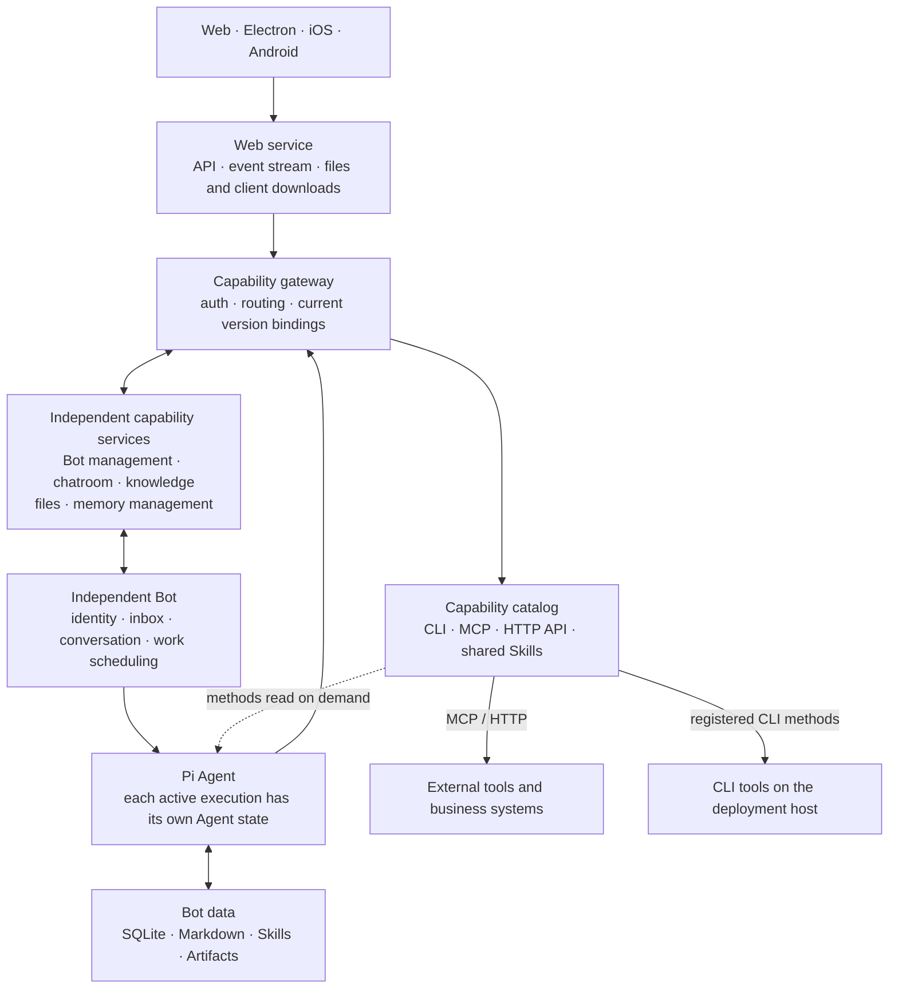

<div align="center">


# Summon Bot

**Hand your goals to an AI team that remembers, collaborates, and keeps working.**

<sub>[English](README.md) · [简体中文](README.zh-CN.md)</sub>

Create your own Bots, work with them in direct chats, and organize projects in group chats. Bring command-line tools, APIs, and files into the work.<br/>
Work starts with one conversation and continues with its goal, progress, and accumulated knowledge.

[](package.json)
[](bot/)
[](docs/CAPABILITY_CATALOG.md)
[](#multi-platform-experience)

[Overview](#what-is-summon-bot) · [Core capabilities](#core-capabilities) · [Design choices](#design-choices) · [Architecture](#architecture) · [Multi-platform experience](#multi-platform-experience) · [Let an AI deploy it](docs/DEPLOYMENT.md)

</div>

---

## What is Summon Bot

Summon Bot is an AI workspace built around long-term collaboration. Every Bot has a stable identity, role, contacts, work records, and its own knowledge. You can talk to a Bot on its own, or put several Bots into one project group to divide work around a shared goal.

A single request becomes work that can keep moving: it records requirements, waits on dependencies, receives new information, and brings results back to the original conversation. Knowledge accumulated in actual work is kept in Markdown, and refined reusable methods can be captured as Skills for later tasks to load on demand.

For example, you can start like this:

> **Development collaboration** — "Give this requirement to the engineering partner, use Codex in the project directory, and come back here for anything that needs my decision."
>
> **Project staffing**: "Organize suitable members for this project, make the responsibilities clear, and follow up on dependencies and handovers."
>
> **Ongoing attention**: "Keep an eye on this work and tell me when something substantive changes; also write down how you handled it this time."

These are usage examples; actual execution depends on the configured model, connections, tool permissions, and user authorization.

## Core capabilities

### Bots with identity, teams with clear roles

Create and configure Bots by responsibility, maintaining their role, prompts, contacts, and available capabilities. Direct chats are for working side by side; group chats carry project goals, requirements, deadlines, and member responsibilities.

In an ordinary project group, the lead drives progress and integration while EggBot finds or creates suitable members, arranges temporary and standing responsibilities, and handles handovers. Working members can also raise questions from real sources about dependencies, duplicated work, or capability gaps. Messages are delivered according to explicit mentions, replies, and work ownership, with semantic routing only when needed. See [EggBot and group teams](docs/EGGBOT.md).

### Work that can wait, resume, and stop

Inside a Bot, conversation and work are distinct; each piece of work separately stores its goal, requirements, progress, sources, and external execution bindings. One Bot can handle multiple pieces of work, the same logical conversation always runs serially, and foreground conversation takes priority.

When waiting on a peer, a time condition, or an external result, the work stores its waiting state and releases the execution slot; once the event arrives it continues along the original work. Restarts preserve work records and waiting relations, and pauses, cancellations, and unknown results each have an explicit state. The web UI shows execution progress, tool activity, and external task status, and can cancel the current operation.

### Sourced memory, accumulated methods

Raw conversation and tool results, refined knowledge, and current work state are stored separately. Knowledge is isolated per work or per standalone conversation, with Markdown as the body; new work reads the relevant material on demand according to its current goal and the material directory.

Refinement, compaction, and context assembly each create a short-lived maintenance conversation on demand. Real tool results and user corrections can become the basis for updating a Skill; a Bot can maintain its own methods and can also propose sourced revisions to the maintainers of shared Skills. See [Context and persistent work design](docs/BOT_3_PLUS_3_DESIGN.md).

### One catalog for CLI tools, MCP, HTTP APIs, and Skills

Find registered command-line tools, MCP services, HTTP APIs, and shared Skills in the capability catalog. After the chat model is connected and the guide starts, Pi discovers CLI entry points on the deployment host. MCP supports stdio and Streamable HTTP, and existing HTTP endpoints can be registered directly as tools. Skills store reusable procedures and their supporting resources.

Each registered capability has a dedicated maintenance Bot. For CLI tools, that Bot reads the installed version and help output and publishes methods with their sources and applicable versions. Other Bots use those methods within their authorization or consult the maintainer about a new use or a failure. [Capability catalog and shared Skills](docs/CAPABILITY_CATALOG.md)

### Native tools in the original work

Pi drives the work and can run an enrolled CLI such as Codex in the authorized project directory. The original work keeps the operation ID, execution state, output references, and the native session ID when available. A tool method that provides structured events can send progress and questions back to the work and its conversation. A maintainer can also publish quota or status observations through the shared display interface. [Display sources](docs/CAPABILITY_CATALOG.md#展示来源)

File capabilities provide reading, writing, and editing files plus running commands, usable in Bot workspaces and configured project directories. Commands run with host user privileges, so the available scope should be configured according to actual use. See [Operations](docs/OPERATIONS.md).

### Standing responsibilities and visible usage

Configure scheduled responsibilities for a Bot, or observe work, task, and room state. With explicit observation sources, it stays quiet when nothing has changed; in-flight triggers of the same responsibility are merged, and foreground conversation takes priority.

Token statistics show request details, cached usage, and reference cost by Bot, direct chat, group chat, and time range; background refinement and context maintenance are recorded as well. Cost is estimated from API receipts and configured prices, while the vendor's record remains authoritative for vendor billing.

## Start with a conversation

Open the web workspace, or open the installed desktop app and choose the local production instance or a remote address. Create or select a workspace and continue in the same app window. The main Bot guides you through importing an available Codex or Grok login from the deployment host, authorizing a subscription, or entering an API key in a hidden input. The guide uses scripted messages until the chat model is configured, and the credentials stay in the host's private configuration.

Continue to start a real conversation with the main Bot. It introduces the next steps around what you want to do, one question at a time. You can reopen this conversation from **Settings → New user guide (新手引导)**. The web, Electron, Android, and iOS interfaces use the same model connections and main Bot conversation.

## Design choices

Summon Bot's choices focus on the relationships among identity, work, knowledge, and capabilities:

| Concern | The choice here | What it means for you |
| --- | --- | --- |
| Bots and tasks | A Bot is a stable identity; an ordinary request creates separate work | One partner can take on many things, each with its own progress and context |
| Team organization | The project lead drives, EggBot staffs and hands over, members keep their own work | Teams adapt around the project, and existing members can join other projects too |
| Long tasks | Waiting relations and external bindings persist and are resumed by events | You can follow what the work is doing, what it waits for, and when you need to step in |
| Context | Raw records, Markdown knowledge, and work state are layered, with material assembled on demand | New requirements enter execution promptly, and relevant experience can be reused later |
| Shared capabilities | Connection configuration and Skill bodies are separate, each capability has a dedicated maintainer | Tool integration, usage permissions, and method revisions all have clear ownership |
| System boundaries | Bot kernel, domain capabilities, and user interfaces are implemented separately | Interfaces, tool services, and Agent lifecycles can each evolve independently |

## Architecture

Summon Bot builds its backend with Node.js 24+ and ESM JavaScript, uses Pi Agent as the execution kernel, stores runtime facts in SQLite, and keeps knowledge and methods in Markdown.



### Three clear runtime boundaries

- **Bot kernel**: each Bot has its own configuration, inbox, SQLite, and working directory; the scheduler manages serial execution per conversation and bounded concurrency, with each active execution holding its own Pi Agent state. There are 4 business execution slots by default, with background maintenance limited separately.
- **Capability services** own domain data for chatrooms, knowledge, files, Bot management, and memory management. The gateway provides authentication, routing, capability bindings, and aggregated endpoints. It also manages registered native tool executions and display sources. Independent capability updates switch over after active executions reach a safe boundary.
- **User interfaces**: the web provides pages, API forwarding, real-time events, and download distribution. Electron loads the same web pages, and native mobile clients connect through the API; Bots and external work run in the backend, so responsibilities and state persist after the page is closed.

### Three layers of durable data

| Layer | What it stores | Where it lives |
| --- | --- | --- |
| S1 · Raw records | Messages, tool calls and results, events, and their sources | Bot SQLite and the artifacts directory |
| S2 · Knowledge and summaries | Knowledge bodies refined per work or standalone conversation | The Bot's knowledge Markdown; SQLite keeps the directory and processing position |
| S3 · Work state | Goal, requirements, progress, waiting, external bindings, pauses, and notifications | Bot SQLite |

Refinement writes valuable increments back into the corresponding Markdown, assembly selects relevant material for the current execution, and compaction happens when the context budget requires it. All three start on demand and finish when done; raw records remain for later source lookup.

Further reading: [Architecture](docs/ARCHITECTURE.md) · [Context and work implementation notes](docs/BOT_3_PLUS_3_IMPLEMENTATION.md) · [Capability services and updates](docs/CAPABILITY_SERVICES.md). For Pi adaptation and upstream notes, see [Pi component notes](bot/third_party/pi/README.md).

## Multi-platform experience

| Platform | Implementation | How to use and update |
| --- | --- | --- |
| Web | Ordinary browser pages | Refresh after deployment to get the pages |
| Windows / macOS | Electron | Loads the same production web pages; the shell provides downloads and restart-to-update |
| iPhone / iPad | Swift / SwiftUI | Native interface, built and distributed from a Mac |
| Android | Kotlin / Compose | Native interface, checks the version, downloads the APK, and installs after system confirmation |

The project is in active development. The table describes the source implementation and update path of each platform; downloadable versions are those actually published under "Client downloads and updates" on the web. macOS and iOS are packaged from the same commit on a Mac. Native mobile interfaces are implemented separately as features are finalized.

## Code map

```text
bot/                        Independent Bot kernel, scheduling, context, and persistence
capabilities/               Domain capability services, gateway, capability catalog, and version bindings
roles/                      Role configuration and prompts
skills/                     Skills shipped with the project
web/                        Web pages, HTTP entry points, and release package distribution
desktop/                    Windows / macOS Electron shell
ios/                        SwiftUI native client
android/                    Kotlin / Compose native client
scripts/                    Build, install, operations, and per-platform releases
docs/                       Architecture, design, and operations documentation
```

## Documentation

| What you want to know | Start here |
| --- | --- |
| Let an AI install, start, or update it | [Deploy with an AI](docs/DEPLOYMENT.md) |
| Understand the system composition and data boundaries | [Architecture](docs/ARCHITECTURE.md) |
| Understand a Bot's work, context, and persistence | [Design](docs/BOT_3_PLUS_3_DESIGN.md) · [Implementation](docs/BOT_3_PLUS_3_IMPLEMENTATION.md) |
| Organize project teams and member handovers | [EggBot and group teams](docs/EGGBOT.md) |
| Connect CLI tools, MCP, HTTP APIs, and shared methods | [Capability catalog](docs/CAPABILITY_CATALOG.md) · [Capability services](docs/CAPABILITY_SERVICES.md) |
| Contribute to development and operations | [Development conventions](AGENTS.md) · [Development workflow](docs/DEVELOPMENT.md) · [Operations](docs/OPERATIONS.md) |
| Build and release clients | [Client releases and updates](docs/CLIENT_RELEASES.md) · [iOS](ios/README.md) · [Android](android/README.md) · [Desktop](desktop/README.md) |
