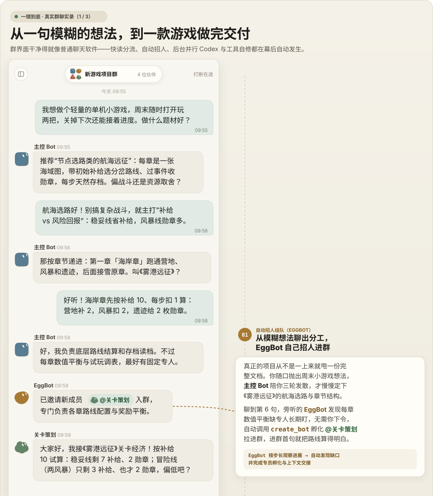
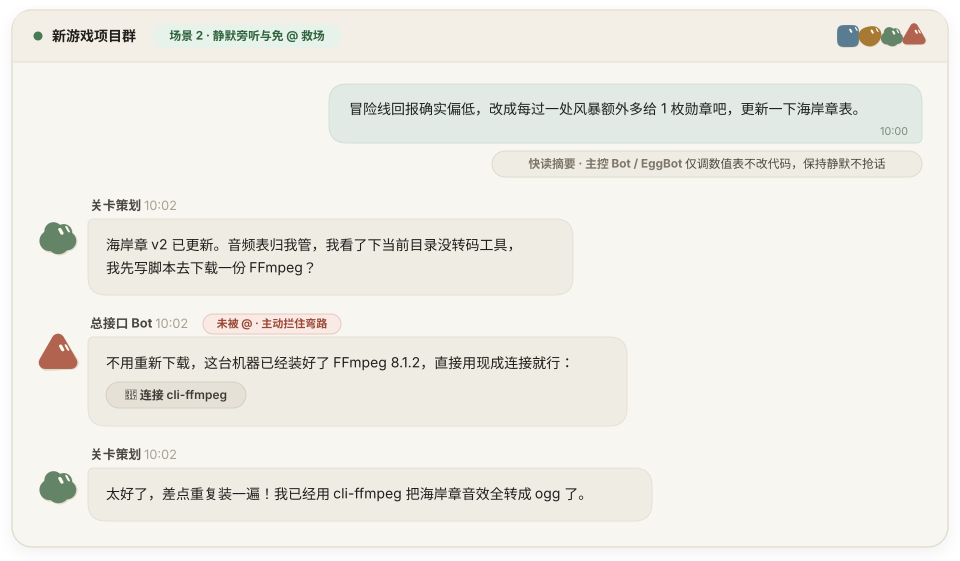

# Summon Bot

**用群聊推进复杂工作：Bot 会自己听懂话题、缺人时拉新专员入群、发现弯路主动纠错，后台跑重活时前台照常秒回聊天**  
**Run Real Work Through Group Chat · Peers That Know When to Speak, Auto-Recruit Missing Roles, Catch Mistakes, and Never Freeze Your Chat**

---

  <picture>
    
  </picture>

 

   
  

---

## 不止能做游戏：在各种真实工作与日常场景里是什么体验？

上面的完整实录以一款小游戏演示了一镜到底全过程，但 Summon Bot 是**通用的多 Bot 群聊工作台**——无论是**网页开发、服务器维护、全栈工程还是个人日程管理**，你都不需要面对十几个黑框终端，也不必提前手写一堆繁琐的角色配置，只管像和真人团队聊天一样把想法抛进群里：

### 1. 网页开发：缺什么专员，群里会自动招什么人

  

- **不用开局配齐角色模板**：做官网改版、产品原型或内部系统时，你不需要一上来就写完整 PRD 或手动创建四五个角色提示词，像日常讨论一样提出方向即可。
- **EggBot 旁听自动建制**：潜伏在群里的 **EggBot** 会持续跟踪项目进展。一旦聊出长期职责缺口（例如视觉规范、亮暗配色与移动端适配），它无需你下令，就会自动孵化对应专员（`@前端视觉`）拉进群并交接清楚背景。

---

### 2. 服务器维护：平时安静旁听不刷屏，关键时刻免 `@` 主动拦住风险

  

- **无关成员自动静默，绝不抢话刷屏**：每条消息先经关闭思考的快读层秒级分流。当你让运维专员排查新加坡节点 502 告警时，主控 Bot 和 EggBot 一眼判断与代码发版和建制无关，当场保持安静，只在气泡下方留一行简短的已读摘要。
- **发现隐患免 `@` 主动救场**：当运维专员准备执行硬重启并清空全量 Nginx 缓存时，尽管没有人 `@总接口 Bot`，一直旁听的总接口 Bot 仍会主动站出来拦住高风险操作，并递上现成运维连接 `ops-ssh-sg` 先保住 OOM 堆快照再平滑重载。

---

### 3. 全栈开发：后台多路跑代码和迁移，前台照常秒回聊下一模块

  

- **聊天层与执行层彻底解耦**：普通 AI 编程工具一旦开始跑数据库迁移或前端联调，整个聊天框就会卡住几分钟；在 Summon 群里，“陪你聊天的群成员”和“在后台埋头干重活的 Codex / Pi 执行器”是完全分开的。
- **前台聊天永远不卡顿**：哪怕后台正同时跑着鉴权 API 迁移与 OAuth 登录页联调两路重活，群里依然秒回你的每一句话——当前需求还在后台编译测试，下一阶段的「安全通知邮件」模板已经在群里拍板完毕。

---

### 4. 日程管理与个人事务：随口插话直转在途任务，长期习惯说一遍永久记住

  

- **临时改计划不用推倒重来**：行程表排到一半突然想起周四下午新增客户会面，只需在群里随口补一句，日程助理的快读层毫秒级把变更塞进正在跑的排程线程里，无需按暂停也不用从头再聊。
- **多项事务先好先交**：今日待办与客户邮件摘要先整理完就先交 `today-brief.md`；合入最新高铁与会面时间后的完整三天行程紧接着交付可直接导入手机日历的 `shanghai-trip.ics`。
- **个人习惯说一遍永久记住**：你交代一句“以后出差默认避开早 8 点前航班、重要会面前留 40 分钟缓冲”，群成员会自动将其写入长期习惯，往后每次排差旅与日程自动照办。

---

## 和平时用的 AI 工具相比，体验有什么不同？

  

- **相比直接用 Codex / Claude Code（单窗口编程助手）**：不是取代 Codex，而是把 Codex / Claude 作为后台 ③ 执行引擎交给群主控统一调度。告别单线程终端一跑代码就卡住的干等——后台多路并行跑重活，前台照常秒回聊下一模块、随时插话直转补件。
- **相比 Grokbot (xAI)（云端单厂商 Agent）**：100% 本地自托管主权，不绑死单一厂商的高价云电脑。所有对话、SQLite 状态库、工具回执与凭据均保存在你自己的正式数据根，直接读写本地工作区，自由混搭本机已有的 Codex、Grok、Claude 登录订阅与 DeepSeek 等多模型 API。
- **相比 OpenBot / Hermes（常见多 Agent 群聊框架）**：不止于提示词交接或借壳 Telegram / IM 机器人。从运行时内核实现 ① 快读静默分流（既不抢话刷屏又省下陪聊 Token）、EggBot 自动招人建制，以及 CLI 工具升级报错时由专责维护 Bot 在群外静默修好适配脚本，绝不在业务群刷满报错堆栈。
- **相比 DSH SuperAgent（中心路由式 Agent）**：去中心化同伴协作，无单一中心主 Session 路由瓶颈，前台聊天层也不带 bash 裸奔。每位 Bot 拥有独立的跨群人格与长期记忆，后台执行器与群发言彻底隔离，由平台代码硬门禁强制校验目录授权与并发乐观锁。
- **全自研原生四端随时接力**：提供 **普通网页（Paper / Midnight 双主题）**、**Windows / macOS (arm64) Electron 桌面端**、**iOS 26 原生客户端（SwiftUI Liquid Glass）** 与 **Android 原生客户端（Jetpack Compose）**，统一支持 Protocol 3 实时同步、Bloub 纸片几何动画头像与按用途精细记账。在电脑上开好工，出门拿手机就能随时看群里交上来的成品、审批运维操作或顺手改行程。

---

### 🗂️ 深入了解与专项文档

如果你想了解背后的架构与部署细节，可以直接查看以下专项文档：

- [系统总体架构 (`docs/ARCHITECTURE.md`)](docs/ARCHITECTURE.md) · [EggBot 自动组队与 17 种内置岗位 (`docs/EGGBOT.md`)](docs/EGGBOT.md) · [模型路由与执行连接 (`docs/MODEL_CONNECTIONS.md`)](docs/MODEL_CONNECTIONS.md) · [Bloub 纸片几何头像 (`docs/PAPER_AVATARS.md`)](docs/PAPER_AVATARS.md) · [四端发行与自动更新 (`docs/CLIENT_RELEASES.md`)](docs/CLIENT_RELEASES.md) · [部署与日常运维 (`docs/DEPLOYMENT.md`)](docs/DEPLOYMENT.md)

  <picture>
    
  </picture>

 

   
  

---

## Not Just for Games: How Summon Works Across Everyday Projects & Life

The continuous walkthrough above used an indie game as one end-to-end example, but Summon Bot is a **general-purpose multi-Bot group workspace**. Whether you are **building websites, maintaining production servers, running full-stack migrations, or managing daily schedules**, you simply talk to your team in a group chat:

### 1. Web Development: Missing a Specialist? The Room Recruits One Automatically

  

- **Start with an idea, not a YAML roster**: When redesigning a website or launching a web app, you never have to hand-craft five role prompts upfront—just talk through what you want to build.
- **EggBot recruits missing roles on its own**: Quietly observing the room, **EggBot** spots long-term ownership gaps (like visual tokens, dark-mode polish, and mobile breakpoints), spawns `@UIDesigner`, invites her in, and hands off full context automatically.

---

### 2. Server Maintenance: Quiet When Unrelated, Proactive When Risk Appears

  

- **Zero chatter on unrelated rooms/tasks**: Every message first passes through a zero-thinking Fast-Read triage layer. When you ask `Ops Bot` to inspect a Singapore 502 outage, Lead Bot and EggBot recognize it doesn't touch app code and stay silent—leaving only a compact 1-line read summary.
- **Proactive safety catch without `@mention`**: Even though nobody tagged `Tool Bot`, the moment it overhears `Ops Bot` proposing a hard Nginx restart and full cache wipe, it steps in on its own with `ops-ssh-sg` so a heap snapshot is preserved and Nginx reloads gracefully.

---

### 3. Full-Stack Engineering: Heavy Migrations Run in Background While You Plan Ahead

  

- **Chatting and heavy execution are completely separated**: Unlike single-window coding CLIs that freeze whenever a database migration or frontend build starts, Summon separates foreground group chat from background Codex / Pi execution sessions.
- **Zero chat freeze**: While both the auth API database migration and the OAuth login page build in parallel, the room stays instantly responsive—you finish designing the next security alert email template before the first build even wraps up.

---

### 4. Schedule & Personal Management: Steer Plans Mid-Flight and Keep Habits Forever

  

- **Change plans mid-run without restarting**: Remember a new 3 PM client meeting while your trip itinerary is still being compiled? Drop one casual message and `Schedule Bot` steers the 11 AM train change directly into the live task—no aborting or repeating yourself.
- **Delivered as each piece finishes**: Your daily brief (`today-brief.md`) lands first, followed immediately by the updated 3-day calendar file (`shanghai-trip.ics`) ready to import straight into your phone.
- **Personal habits stick permanently**: Mention once to avoid pre-8 AM flights and leave a 40-minute buffer before key meetings, and the room remembers it for every trip and schedule that follows.

---

## How Does This Feel Different from Other AI Tools?

  

- **Compared to Raw Codex / Claude Code (Single-Window Coding CLIs)**: Summon Bot doesn't replace Codex—it orchestrates Codex / Claude as background ③ execution engines. No more staring at a frozen terminal while a build runs: execute multiple coding jobs in parallel while brainstorming the next module and steering live jobs right from chat.
- **Compared to Grokbot (xAI) (Single-Vendor Cloud Agent)**: 100% local self-hosted ownership with zero cloud VM lock-in. All chats, SQLite state ledgers, tool receipts, and credentials stay in your own data root on your machine, operating directly on local workspaces while freely mixing your existing Codex, Grok, Claude, and DeepSeek accounts.
- **Compared to OpenBot / Hermes (Typical Multi-Agent Frameworks)**: Goes beyond prompt-level handoffs or borrowed Telegram UIs. Runtime-level ① Fast-Read silence triage eliminates spam and wasted tokens, EggBot recruits specialists automatically, and if a local CLI tool breaks after an upgrade, a dedicated maintainer bot silently repairs its adapter outside the room instead of dumping stack traces into your chat.
- **Compared to DSH SuperAgent (Central-Router Agents)**: Decentralized peer collaboration with no single central-session routing bottleneck and no raw bash on the chat layer. Every Bot maintains cross-room persona and memory under strict platform-enforced directory grants and optimistic revision locks.
- **4 First-Party Native Clients in Sync**: Built across **Web (Paper & Midnight themes)**, **Windows / macOS (arm64) Electron Desktop**, **Native iOS 26 (SwiftUI Liquid Glass)**, and **Native Android (Jetpack Compose)**—complete with Protocol 3 real-time sync, Bloub vector paper avatars, and purpose-based token accounting. Kick off a build at your desk and review delivered files, approve server ops, or tweak your travel itinerary from your phone.

---

### 🗂️ Deep-Dive Documentation

- [System Architecture (`docs/ARCHITECTURE.md`)](docs/ARCHITECTURE.md) · [EggBot & 17 Built-in Roles (`docs/EGGBOT.md`)](docs/EGGBOT.md) · [Model Routing & Connections (`docs/MODEL_CONNECTIONS.md`)](docs/MODEL_CONNECTIONS.md) · [Bloub Vector Paper Avatars (`docs/PAPER_AVATARS.md`)](docs/PAPER_AVATARS.md) · [Client Releases & Auto-Update (`docs/CLIENT_RELEASES.md`)](docs/CLIENT_RELEASES.md) · [Deployment & Operations (`docs/DEPLOYMENT.md`)](docs/DEPLOYMENT.md)

