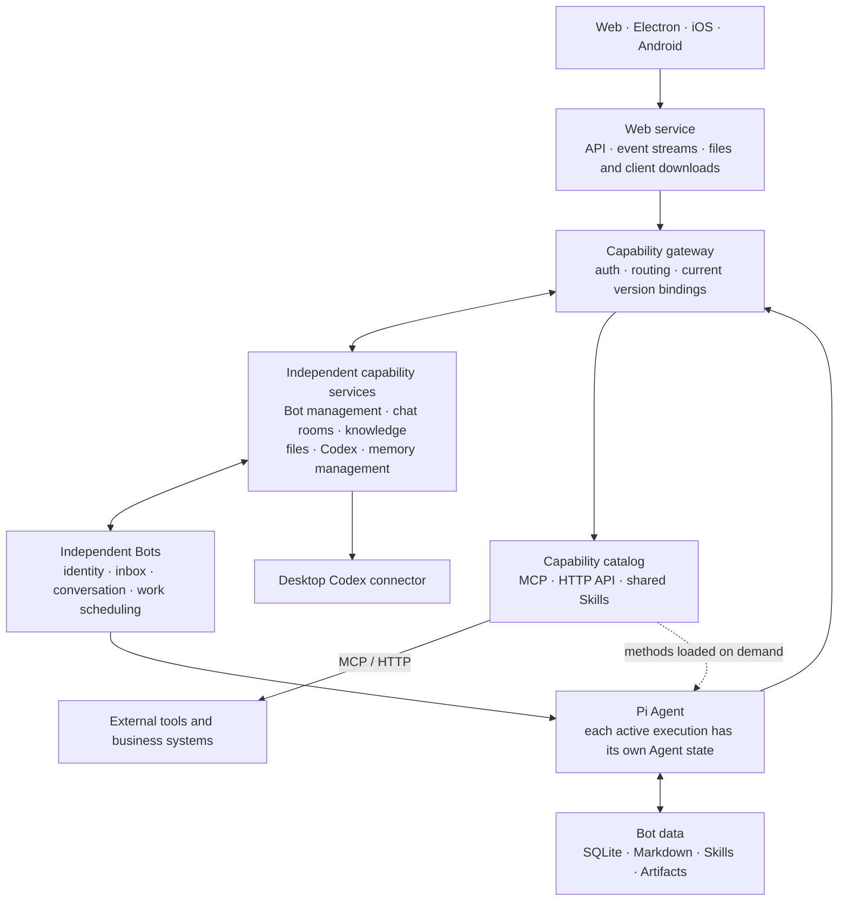

<div align="center">


# Summon Bot

**Hand your goals to an AI team that remembers, collaborates, and keeps working.**

Create your own Bots, work with them in private chat, organize projects in group chats, and connect tools, files, and desktop Codex.<br/>
Work starts with a conversation and keeps moving with its goals, progress, and accumulated context.

[](package.json)
[](bot/)
[](docs/CAPABILITY_CATALOG.md)
[](#platforms)

**English** · [简体中文](README.zh-CN.md)

[Overview](#what-is-summon-bot) · [Capabilities](#core-capabilities) · [Design](#design-differences) · [Architecture](#architecture) · [Platforms](#platforms) · [Deploy with AI](docs/DEPLOYMENT.md)

</div>

---

## What is Summon Bot

Summon Bot is an AI workspace built around long-term collaboration. Every Bot has a stable identity, role, contacts, work records, and its own knowledge. You can talk to a Bot one to one, or bring several Bots into the same project group and divide the work around a shared goal.

A request becomes work that can keep moving: it records requirements, waits on dependencies, receives new information, and brings results back to the original conversation. Knowledge accumulated in real work lives in Markdown, and reusable methods can be distilled into Skills for later tasks to load on demand.

For example, you can start like this:

> **Development collaboration**: "Give this requirement to the engineering partner, push it forward in desktop Codex, and come back here when something needs my decision."
>
> **Project teaming**: "Put together the right members for this project, define the responsibilities, and track dependencies and handoffs."
>
> **Ongoing attention**: "Watch the state of this work and tell me about substantive changes; write down how it was handled this time."

These are usage examples; actual execution depends on configured models, connections, tool permissions, and user authorization.

## Core capabilities

### Bots with identity, teams with responsibilities

Create and configure Bots by responsibility, maintaining their role, prompts, contacts, and available capabilities. Private chat is for direct collaboration; group chat carries project goals, requirements, deadlines, and member responsibilities.

In a regular project group, the lead drives and integrates the work, while EggBot finds or creates suitable members, arranges temporary and standing responsibilities, and handles handoffs. Working members can also raise issues about dependencies, duplicated effort, or capability gaps based on real sources. Messages are delivered by explicit mentions, replies, and work ownership, with semantic routing only when needed. See [EggBot and team chat](docs/EGGBOT.md).

### Work that can wait, resume, and stop

Bots distinguish conversation from work internally, and each piece of work stores its own goal, requirements, progress, sources, and external execution bindings. One Bot can handle several pieces of work, each logical conversation stays serial, and foreground conversation comes first.

When waiting on a peer, a time condition, or an external result, the work saves its waiting state and releases the execution slot; it resumes along the same work when the event arrives. Restarts preserve work records and waiting relationships, and pause, cancellation, and unknown outcomes each have an explicit state. The web UI shows execution progress, tool activity, and external task state, and can cancel the current operation.

### Sourced memory, accumulated methods

Raw conversations and tool results, organized knowledge, and current work state are stored separately. Knowledge is isolated per work or standalone conversation and written in Markdown; new work reads the relevant material from its goal and the knowledge directory on demand.

Organization, compaction, and context assembly each start a temporary maintenance conversation when needed. Real tool results and user corrections can become grounds for updating a Skill; a Bot can maintain its own methods and can also propose sourced revisions to the maintainer of a shared Skill. See [Context and continuous work design](docs/BOT_3_PLUS_3_DESIGN.md).

### One catalog for MCP, HTTP APIs, and Skills

Manage MCP servers, plain HTTP APIs, and shared Skills in the capability catalog. MCP supports stdio and Streamable HTTP, and existing HTTP endpoints can be registered directly as tools; Skills hold usage conditions, operating methods, and related resources.

Each registered capability automatically gets a dedicated maintenance Bot responsible for maintaining and advising on that connection or method. Other Bots use tools directly within their own authorization and delegate to the responsible Bot when business judgment is needed. See [Capability catalog and shared Skills](docs/CAPABILITY_CATALOG.md).

### Desktop Codex and local workspaces

Create, attach to, continue, read, and interrupt Codex sessions through the desktop connector, bringing desktop task progress and results back to the original work and conversation. External thread, turn, and operation identifiers are persisted, and unknown outcomes are resolved by querying the original operation.

File capabilities provide reading, writing, editing files, and running commands for Bot workspaces and configured project directories. Commands run with the host user's privileges, so available scope should be configured according to actual use. See [Operations](docs/OPERATIONS.md).

### Standing duties and visible usage

Configure scheduled duties for a Bot, or have it observe work, task, and room states. With a clear observation source, it stays quiet when nothing changes; concurrent triggers of the same duty are merged, and foreground conversation comes first.

Token statistics can show request details, cache usage, and estimated cost by Bot, direct chat, group chat, and time; background organization and context maintenance are recorded too. Costs are estimated from API receipts and configured prices, and supplier invoices remain authoritative.

## Design differences

Summon Bot's choices focus on the relationship between identity, work, knowledge, and capabilities:

| Concern | The choice here | What it means for you |
| --- | --- | --- |
| Bots and tasks | A Bot is a stable identity; an ordinary request creates a separate piece of work | The same partner can take on several things with separate progress and context |
| Team organization | The project lead drives, EggBot handles teaming and handoffs, members keep their own work | Responsibilities change around the project, and existing members can join other projects |
| Long tasks | Waiting relationships and external bindings persist and resume from events | You can follow what the work is doing, waiting for, and when it needs you |
| Context | Raw records, Markdown knowledge, and work state are layered, and material is assembled on demand | New requirements enter execution promptly, and relevant experience is reused in later work |
| Shared capabilities | Connection configuration and Skill bodies are separate, and each capability has a dedicated maintainer | Tool onboarding, usage permissions, and method revisions all have clear ownership |
| System boundaries | Bot core, domain capabilities, and user interfaces are implemented separately | UI, tool services, and Agent lifecycles can evolve independently |

## Architecture

Summon Bot builds its backend with Node.js 24+ and ESM JavaScript, uses the Pi Agent as the execution core, stores runtime facts in SQLite, and keeps knowledge and methods in Markdown.



### Three clear runtime boundaries

- **Bot core**: each Bot has its own configuration, inbox, SQLite database, and working directory; the scheduler enforces serial conversations and limited concurrency, and each active execution holds its own Pi Agent state. Four business execution slots by default, with separate throttling for background maintenance.
- **Capability services**: chat rooms, knowledge, files, Codex, Bot management, and memory management each own their domain data. The gateway provides authentication, routing, capability bindings, and aggregate APIs; updates to an independent capability switch after active executions reach a safe boundary.
- **User interfaces**: the web app provides pages, API forwarding, live events, and download distribution. Electron loads the same page, and native mobile clients connect through the API; Bots and external work run on the backend, so responsibilities and state persist after the page is closed.

### Three layers of persistent data

| Layer | What it stores | Where it lives |
| --- | --- | --- |
| S1 · Raw records | Messages, tool calls and results, events, and their sources | Bot SQLite and artifact directory |
| S2 · Knowledge and summaries | Knowledge bodies organized per work or standalone conversation | Bot knowledge Markdown; SQLite holds the directory and processing positions |
| S3 · Work state | Goals, requirements, progress, waits, external bindings, pauses, and notifications | Bot SQLite |

Organization writes valuable increments back to the matching Markdown, assembly selects relevant material for the current execution, and compaction happens when the context budget requires it. All three start on demand and end when done; raw records are kept so sources can be located later.

Further reading: [Architecture](docs/ARCHITECTURE.md) · [Current implementation](docs/BOT_3_PLUS_3_IMPLEMENTATION.md) · [Capability services and updates](docs/CAPABILITY_SERVICES.md). For Pi adaptation details and upstream notes, see [Pi component notes](bot/third_party/pi/README.md).

## Platforms

| Client | Implementation | How to use and update |
| --- | --- | --- |
| Web | Regular browser page | Refresh after deployment to get the current page |
| Windows / macOS | Electron | Loads the same production web page; the shell handles downloads and restart updates |
| iPhone / iPad | Swift / SwiftUI | Native UI, built and distributed from a Mac |
| Android | Kotlin / Compose | Native UI, checks versions, downloads the APK, and installs it after system confirmation |

The project is in development. This table describes the source implementation and update path per platform; downloadable builds are those actually published under "Client downloads and updates" on the web page. macOS and iOS are packaged from the same commit on a Mac. Native mobile UIs are implemented separately as finalized features are synced.

## Code map

```text
bot/                        Independent Bot core, scheduling, context, and persistence
capabilities/               Domain capability services, gateway, capability catalog, and version bindings
connectors/codex-desktop-api/ Desktop Codex connector
roles/                       Role configurations and prompts
skills/                      Skills shipped with the project
web/                         Web page, HTTP entry points, and release distribution
desktop/                    Windows / macOS Electron shell
ios/                        SwiftUI native client
android/                    Kotlin / Compose native client
scripts/                     Build, install, operational maintenance, and release tooling
docs/                        Architecture, design, and operations documentation
```

## Documentation

| What you want to know | Start here |
| --- | --- |
| Have an AI install, start, or update it | [Deploy with AI](docs/DEPLOYMENT.md) |
| Understand system components and data boundaries | [Architecture](docs/ARCHITECTURE.md) |
| Understand Bot work, context, and persistence | [Design](docs/BOT_3_PLUS_3_DESIGN.md) · [Implementation](docs/BOT_3_PLUS_3_IMPLEMENTATION.md) |
| Organize project teams and member handoffs | [EggBot and team chat](docs/EGGBOT.md) |
| Onboard MCP, HTTP APIs, and shared methods | [Capability catalog](docs/CAPABILITY_CATALOG.md) · [Capability services](docs/CAPABILITY_SERVICES.md) |
| Contribute to development and operations | [Development conventions](AGENTS.md) · [Development workflow](docs/DEVELOPMENT.md) · [Operations](docs/OPERATIONS.md) |
| Build and release clients | [Client releases and updates](docs/CLIENT_RELEASES.md) · [iOS](ios/README.md) · [Android](android/README.md) · [Desktop](desktop/README.md) |
