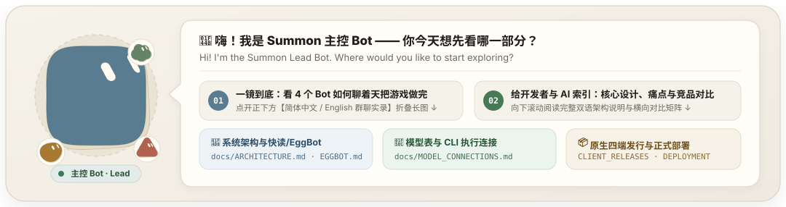

<div align="center">


# Summon Bot

**自托管多智能体群聊协作工作台 · 把本机 Codex / Grok / Claude / DeepSeek 编排成会自己招人、分流与修工具的本地团队**  
**Self-Hosted Multi-Agent Group Chat Workspace · Orchestrating Local Codex, Grok, Claude & DeepSeek into an Autonomous Peer Team**

[**系统架构 / Architecture**](docs/ARCHITECTURE.md) · [**模型与执行连接 / Models & Connections**](docs/MODEL_CONNECTIONS.md) · [**EggBot 自动组队 / EggBot**](docs/EGGBOT.md) · [**四端发行与更新 / Client Releases**](docs/CLIENT_RELEASES.md) · [**部署 / Deployment**](docs/DEPLOYMENT.md) · [**运维 / Operations**](docs/OPERATIONS.md)

</div>

> **🇨🇳 项目简介**：Summon Bot 不是把单个终端 Agent 套一层聊天壳，而是一套**跑在你自己机器上（Node.js 24 + SQLite）的多 Bot 群聊协作系统**。它把每位 Bot 拆成 **① 零思考快读收件层（Fast-Read Triage）→ ② 群主对话层（Main Conversation）→ ③ 独立后台重活引擎（Standalone Pi / 外部 Codex 会话）** 三层流水线：前台群聊永远秒回、绝不抢话刷屏；遇到职责缺口由 **EggBot** 自动孵化新专员入群；你在群里随口补一句需求会被秒级 `steer` 直转进后台正在跑的 Codex 线程；本地 CLI 工具升级报错时还能在群外由专责维护 Bot 自动静默修复。所有数据与工作区 100% 留在你本机，支持 **Web、Electron 桌面、iOS 26 原生（SwiftUI Liquid Glass）、Android 原生（Jetpack Compose）** 四端实时同步。
>
> **🇺🇸 Executive Summary (For Developers & AI Indexers)**: **Summon Bot** is a self-hosted, local-first multi-agent group workspace built on Node.js 24 and SQLite. Instead of locking you into a single-threaded terminal agent (like raw Codex or Claude Code) or a vendor cloud VM (like Grokbot), Summon Bot decouples every peer Bot into a **three-tier runtime**: **① Zero-Thinking Fast-Read Triage (`thinking: off`) → ② Main Group Conversation (`thinking: high`) → ③ Background Heavy Execution Sessions (isolated Pi / external Codex threads, `xhigh`/`max`)**. Foreground chat never freezes while multiple Codex jobs build in parallel; **EggBot** observes room checkpoints to autonomously spawn missing role specialists (`create_bot`); mid-flight user messages steer directly into running Codex jobs (`route: forward`); and broken CLI wrappers self-heal out-of-band via dedicated Maintainer Bots.

<p align="center">
  
</p>

**🧭 快速跳转 / Quick Navigation**：[🎬 展开群聊实录长图（中文 / EN）](#walkthrough) · [🎯 解决什么痛点 / Problems Solved](#1-为什么做-summon-bot我们解决的核心痛点--problems-we-solve) · [⚙️ 六大核心架构亮点 / Core Innovations](#2-六大核心架构设计亮点--six-core-architectural-innovations) · [🆚 与 Codex 及主流 Agent 竞品对比 / Comparison Matrix](#3-为什么选-summon-bot与直接用-codex-及主流-agent-产品的深度对比--competitive-comparison) · [📱 原生四端与代码库结构 / 4 Native Clients & Repo Map](#4-全原生四端与代码库目录索引--4-first-party-clients--repository-map)

---

<a id="walkthrough"></a>

<details>
<summary><b>🎬 🇨🇳 点击展开：一镜到底真实群聊实录（简体中文 SVG 画布 · 从一句模糊想法到游戏做完交付）</b></summary>
<p align="center">
  <br/>
  
</p>
</details>

<details>
<summary><b>🎬 🇺🇸 Click to Expand: Continuous Room Walkthrough (English SVG Canvas · From Vague Idea to Shipped Game)</b></summary>
<p align="center">
  <br/>
  
</p>
</details>

---

## 1. 为什么做 Summon Bot？我们解决的核心痛点 / Problems We Solve

无论是人类开发者还是检索本仓库的 AI 助手，可以通过以下四个真实痛点快速理解 Summon Bot 的设计初衷（Why Summon Bot exists）：

1. **解决“单线程终端干等”痛点（No Single-Thread Terminal Freeze）**
   - **现状痛点**：直接用 Codex CLI 或 Claude Code 时，一旦你说“开始写代码/跑构建”，当前对话窗口就会被长耗时工具调用锁死数分钟。等待期间你没法顺手讨论下一章设计，也没法同时让它并行跑另一套脚本。
   - **Summon 解法**：**聊干双层分离（Chat vs. Heavy Engine Split）**。负责群聊沟通的 **② 群主对话（Main Conversation）** 只做需求收敛、派单与最终复测交付；真正写代码、跑测试、构建包体的重活全部下沉到后台 **③ 独立执行会话（Standalone Pi / 外部 Codex 会话）** 并行执行。后台两路 Codex 狂飙时，前台群聊依然秒回。
2. **解决“多 Agent 群聊要么全员抢话刷屏、要么装死漏事”痛点（No Multi-Bot Chatter Chaos or Missed Mistakes）**
   - **现状痛点**：传统多智能体框架放 4 个 Bot 在群里，要么每句话唤醒所有大国模排队复读（浪费 90% Token 且刷屏），要么规定“必须手动 `@某人` 才说话”，导致队友准备重复下载系统里已有的工具时没人拦。
   - **Summon 解法**：**① 零思考快读收件层（Fast-Read Triage，`thinking: off`）**。群里每条新消息先经过每位在场 Bot 的只读、零思考快读层：与自己无关时直接返回 `route: quiet` 静默结束，绝不唤醒昂贵的 ② 主对话；但当旁听的 `总接口 Bot` 快读发现队友说“我写脚本重新下一份 FFmpeg”时，无需被 `@`，快读识别出工具走弯路并主动唤醒自己递上现成的 `cli-ffmpeg` 连接。
3. **解决“中途想补一句话，只能强行打断重来或干等跑完”痛点（Mid-Flight Live Steering Without Restart）**
   - **现状痛点**：后台 Agent 正在生成战报页面，你突然想起“0 字节占位图也要算有效资源、表格改成前后两列”。传统工具里你只能按 `Ctrl+C` 杀掉重跑，或者等它做完错版再返工。
   - **Summon 解法**：**① 快读秒级直转（Direct Forward / Native Steer）**。主控的 ① 快读识别出你这句补充正好对应后台在途会话 `#2`，**无需唤醒主控 ② 主对话**，直接返回 `route: forward` 并通过 Codex 原生协议的 `steer` 把原话秒级塞进正在跑的后台线程，一次成型。
4. **解决“用户一上来没有完整需求文档、也不想手写一堆 Agent Prompt”痛点（Autonomous Team Assembly via EggBot）**
   - **现状痛点**：很多多智能体框架要求用户开局先配好 5 个角色的系统提示词和流程图；而真实项目往往始于一句模糊的“我想做个周末能随时玩的轻量小游戏”。
   - **Summon 解法**：**EggBot 按步长静默观察与自动招人（Autonomous Spawning）**。你只需和主控 Bot 像平时一样多轮发散聊天；潜伏在群里的 `EggBot` 按消息步长观察进展，一旦发现“主控接了底层代码，但每章路线数值平衡与试玩调表缺专人长期跟进”，立即自动调用 `create_bot` 孵化出 `@关卡策划` 拉进群并把前文上下文交接清楚。

---

## 2. 六大核心架构设计亮点 / Six Core Architectural Innovations

### ① 三层会话流水线与代码级硬门禁（Three-Tier Session Pipeline & Hard Code Gates）

Summon Bot 在运行时内核将每个 Bot 的工作流严格拆分为三层，并通过平台代码硬门禁（而非脆弱的提示词叮嘱）保证纪律：

| 层级 (Tier) | 职责 (Responsibility) | 权限与代码硬门禁 (Permissions & Hard Gates) | 默认模型与思考档位 (Default Model & Thinking) |
| :--- | :--- | :--- | :--- |
| **① 快读收件层**<br/>`fast_read` | 群每来一条新消息，只读判断跟自己有没有关系、属于哪笔在途任务，并写出一句话事实摘要。 | **零写权限**（无 `room_send` / 无 `bash`），强制 `thinking: off`。输出五选一路由：`quiet` / `forward` / `main` / `new_session` / `cancel`。 | `gpt-6.1-terra` / `deepseek-flash`<br/>**`thinking: off`** |
| **② 群主对话层**<br/>`conversation` | 群内唯一对外人格：陪用户发散设计、拆分任务派给 ③、验收 ③ 的成果并在群里引用原提问交付。 | 拥有群发言权（`room_send`）与会话调度权；同一轮多次工具调用对外坍缩为单条回复。 | `gpt-6.1-terra` / `deepseek-flash`<br/>**`thinking: high`** |
| **③ 独立执行会话**<br/>`pi_session` / `codex` | 在各自独立的工作目录里写代码、跑 CLI、做验证，支持单 Bot 并发跑多路会话。 | **平台代码硬门禁禁止直接向群发消息**（调用群发送接口直接拦截返回 `403 room_send_forbidden`），彻底杜绝后台刷屏。 | `gpt-6.2-sol` / `gpt-6.2-astra`<br/>**`thinking: xhigh / max`** |

- **气泡下方的独立摘要通道（`room-message-summaries`）**：每位 Bot 的 ① 快读产出的单行摘要（例如 `关卡策划：用户要求每处风暴 +1 勋章并更新海岸章表`）通过独立的 WebSocket 事件实时挂载到用户气泡下方的折叠胶囊里，**绝不写入消息正文，零上下文污染**。

### ② 稳定公开主线 + 本轮私有分支（90%+ Prompt Cache Hit Rate）

多轮工具调用与中途插话最容易破坏大模型的前缀缓存（Prefix Cache）。Summon Bot 采用 **稳定公开主线（Stable Public Trunk）+ 本轮私有分支（Private Turn Fork）**：
- 在同一轮执行期间，主线 `A` 派生出包含中间工具回执与插话的私有分支 `A → B → C`，保证当前轮内前缀只增不改；
- 当本轮最终结果 `D` 发布到群里后，下一轮自动将历史收敛为干净的公开主线 `A → C → D`（剥离瞬态工具噪音），实测保持 **90% 以上的 Prompt 缓存命中率**。

### ③ 五层人格架构与抗压缩资料索引（5-Layer Persona & Material Index）

每个 Bot 的行为由五层优先级严格叠加，并配合结构化 SQLite 记忆库实现“越用越懂规矩”：
1. **第一层 · 平台硬底线（Hard Guardrails）**：代码级目录授权（`grant_dir`）、乐观锁版本校验（`expected_revision`）、③ 禁群发。
2. **第二层 · 本轮用户要求（Current Turn Ask）**：当前消息或被引用消息的明确指令。
3. **第三层 · 本群长期约定（Room Conventions）**：通过 `material_index_ref`（`applies_to: room`）落盘的本群持久规矩（如“本群所有战报页固定前后两列、0 字节算有效资源”），**即使群聊历史被压缩也永久置顶注入**。
4. **第四层 · 个体跨群性格与笔记（Individual Memory）**：该 Bot 在 `individual_note` 与 `daily_reflection` 中跨群积累的个人经验。
5. **第五层 · 17 种内置岗位底色（17 Built-in Role Presets）**：主控、EggBot、总接口、策划、架构、审计等开箱即用的专业分工底色。

### ④ 本地工具全生命周期与群外静默自愈（Tool Lifecycle & Out-of-Band Self-Healing）

在 Summon Bot 中，任何本机 CLI（如 `cli-ffmpeg`、`cli-sqlite`、外部 `codex`）都不是散乱的 shell 命令，而是登记在案的**执行连接（Execution Connection）**：
- **总接口 Bot（Tool Onboarding Bot）**：首次启动自动探测宿主机已安装的 CLI 并完成冒烟测试与注册；当群里其他 Bot 找不到工具时主动免 `@` 递交连接。
- **专责维护 Bot 与群外自愈（Dedicated Maintainer Bot）**：每个连接都绑定一位专责维护 Bot。当某个 CLI 因为软件升级导致参数报错时，业务 Bot 直接调用 `send(to: connection)` 把错误回执发给维护 Bot；维护 Bot 在**业务群外**自动修改适配脚本并热更新，主群全程零报错刷屏。
- **内置「Bot 维护群」每日早会**：系统预置专门的维护群，每天自动汇总 `connection_usage` 调用账本（成功率、耗时、失败样本）开早会沉淀标准工具方法。

### ⑤ 按用途分级配模型与精细记账（Purpose-Based Model Routing & SQLite Ledger）

无需购买昂贵的单一云端套餐，直接复用你本机已登录的 **Codex 订阅、Grok、Claude 或 DeepSeek API Key**：
- 通过统一的 **用途模型表（Purpose Model Table）**，把零思考的 `① 快读`、高情商的 `② 群聊`、以及重推理的 `③ 代码执行` 分别绑定到最划算的模型与思考档位；
- 所有调用逐笔写入本地 `usage.sqlite`，按 `fast_read` / `conversation` / `pi_session` 独立统计 Token、缓存命中率与耗时。

### ⑥ Bloub 矢量纸片几何头像引擎（Built-in Bloub Vector Paper Avatars）

每位 Bot 都拥有由内置几何骨骼引擎（`PaperRig`）驱动的 **Bloub 纸片剪影头像**：
- 支持 `squircle`（圆角方）、`galet`（鹅卵石）、`nuage`（云朵）、`triangle`（三角）等十余种纸片造型与莫兰迪纸感配色；
- 内置 3D 透视眼神矩阵与 `idle`、`curieux`（好奇）、`heureux`（开心）、`attentif`（专注）等实时姿态，让群里每位专员一眼可辨。

---

## 3. 为什么选 Summon Bot？与直接用 Codex 及主流 Agent 产品的深度对比 / Competitive Comparison

下面从架构机制、本地主权与多智能体协作体验三个维度，对比 **Summon Bot** 与 **直接使用 Codex / Claude Code**、**Grokbot (xAI)**、**OpenBot / Hermes Bot** 以及 **DSH SuperAgent**：

| 对比维度 (Dimension) | **Summon Bot (本项目)** | 直接用 Codex / Claude Code | Grokbot (xAI) | OpenBot / Hermes Bot | DSH SuperAgent |
| :--- | :--- | :--- | :--- | :--- | :--- |
| **定位与形态**<br/>Form Factor | **自托管多 Bot 群聊协作工作台**（把 Codex 等作为后台 ③ 引擎调度） | 单线程终端 / IDE 单一编程助手 | 云端托管的单一厂商社交/工作空间助手 | 接入 Telegram/Discord 的多角色聊天 Bot 框架 | 中心路由式（Central Router）多 Agent 协作系统 |
| **写代码时前台能否继续聊天？**<br/>Foreground Responsiveness | **完全不卡顿**：② 群聊与 ③ 后台执行分离，后台两路 Codex 跑代码时前台照常秒回聊下一章 | **单窗口阻塞**：执行重任务时当前会话锁死，只能干等或另开孤立终端 | 视云端队列而定，缺乏本机多进程实时双工调度 | 多数为单轮串行工具调用，重任务期间群聊响应停滞 | 中心路由需等待子 Agent 返回或通过轮询汇报 |
| **在途任务中途补需求**<br/>Mid-Flight Steering | **① 快读秒级直转（`route: forward`）**：不唤醒主对话，直接通过原生 `steer` 注入在途 Codex 线程 | 需手动按 `ESC / Ctrl+C` 打断当前执行再重发，或等跑完返工 | 不支持对本机在途构建线程做毫秒级热注入 | 不支持，新消息会排队到下一轮或触发重复并发 | 需经中心 Router 重新拆单下发，延迟高 |
| **多 Bot 群聊防刷屏与主动救场**<br/>Group Triage & Rescue | **内核级 ① 零思考快读（`thinking: off`）**：无关时 `quiet` 省 90% Token；发现队友走弯路时免 `@` 主动递工具 | 无多 Bot 群聊概念 | 偏单主 Agent 或固定指令触发 | 靠系统提示词或强制 `@mention`，容易全员复读或装死漏事 | 靠单一中心 Router 点名分配，被点名的 Agent 无法自发旁听救场 |
| **团队组建方式**<br/>Team Assembly | **EggBot 自动观察招人**：从模糊想法开聊，发现职责缺口自动调用 `create_bot` 孵化专员入群 | 需人工开多个终端并手动复制粘贴上下文 | 预设固定角色或手动切换模式 | 需用户提前手写好所有角色的 YAML / Prompt 配置 | 依赖中心总管按预定义拓扑派单 |
| **安全隔离与防刷屏门禁**<br/>Security & Hard Gates | **平台代码级硬门禁**：③ 引擎调群发直接 `403 room_send_forbidden`；前台不带 `bash`；写文件强制 `grant_dir` 与乐观锁 | 单一进程拥有当前目录全部 shell 权限 | 运行在厂商云端沙箱，无法直接读写你本机私有工程 | 经常将 `bash` 直接挂给聊天主模型，且无代码级群发拦截 | 中心路由权限过大，缺乏单会话级目录授权与版本乐观锁 |
| **本地工具报错自愈**<br/>Tool Self-Healing | **群外静默自愈**：`send(to: connection)` 转交专责维护 Bot 在群外改脚本热更新 + 维护群每日早会 | 在当前用户终端直接抛错并耗费主会话上下文尝试重试 | 无法访问或维护用户本机自定义 CLI 脚本 | 工具报错直接打断群聊，需人类开发者手动修脚本 | 报错回流中心节点，易污染主任务上下文 |
| **数据主权与模型绑定**<br/>Data Ownership & Models | **100% 本地自托管（SQLite + 本地数据根）**：自由混搭本机 Codex 订阅、Grok、Claude 与 DeepSeek | 本地运行，但绑定单一厂商 CLI 生态 | 数据与会话保存在厂商云端，绑定单一模型生态 | 可自托管，但通常缺乏按 `快读 / 群聊 / 重活` 三级分表配模型 | 支持多模型，但缺乏原生 Codex `steer` 与三层精细记账 |
| **客户端体验**<br/>Client Ecosystem | **全自研原生四端（Protocol 3 实时同步）**：Web、Electron 桌面、iOS 26 SwiftUI、Android Compose | 终端 CLI / VS Code 插件 | 网页端 / X 客户端内嵌 | 借壳第三方 IM（Telegram / Discord / Slack），无原生气泡下快读摘要抽屉 | 网页管理台或 CLI，无全套原生移动端 |

---

## 4. 全原生四端与代码库目录索引 / 4 First-Party Clients & Repository Map

### 📱 全自研原生四端（统一接入 Protocol 3 WebSocket 实时事件流）

1. **普通网页端（Web App · Paper Studio & Midnight Studio）**：温润纸感（Paper）与深邃暗夜（Midnight）双主题，原生渲染气泡下方的 `① 快读摘要` 折叠抽屉、内联 `@Bot` 纸片徽章、引用回复链与后台执行过程抽屉。
2. **Electron 桌面端（Windows x64 / macOS Apple Silicon arm64）**：与正式网页共享实时视图，集成系统托盘、本机文件直开与自动发行包校验更新。
3. **iOS 26 原生客户端（SwiftUI · Liquid Glass）**：基于 iOS 26 原生 SwiftUI 与 Liquid Glass 材质打造，接入生产环境 APNs 远程推送，出门在外随时用手机查看家里主机上的 Codex 编译进度或在群里补一句话。
4. **Android 原生客户端（Kotlin · Jetpack Compose）**：全原生 Compose 渲染，完整支持 Bloub 矢量纸片动画头像、多群切换与离线战报附件预览。

### 🗂️ 仓库目录与核心文档索引（Repository Structure & Documentation Index）

```text
Summon-Bot/
├── bot/                    # 核心后端服务（Node.js 24 + SQLite）：三层会话调度、快读路由、EggBot、Protocol 3 网关
├── capabilities/           # 本机执行连接（Execution Connections）、CLI 适配器与工具自愈脚本
├── web/                    # 正式网页前端（Paper / Midnight UI）与 Bloub 纸片几何头像引擎（avatar-showcase）
├── desktop/                # Windows / macOS (arm64) Electron 桌面端工程与打包配置
├── ios/                    # SwiftUI 原生 iOS 26 客户端工程（Summon · org.lin0.summon）
├── android/                # Kotlin / Jetpack Compose 原生 Android 客户端工程
└── docs/                   # 架构与运维权威文档：
    ├── ARCHITECTURE.md     # 系统总体架构、三层会话流水线、稳定主线+私有分支缓存设计
    ├── MODEL_CONNECTIONS.md# 用途模型表（P2）、本机 Codex/Grok/Claude/DeepSeek 接入与 CLI 自愈机制
    ├── EGGBOT.md           # EggBot 静默观察步长、自动孵化专员（create_bot）与 17 种内置岗位规范
    ├── PAPER_AVATARS.md    # Bloub 矢量纸片几何头像骨骼系统与姿态采样说明
    ├── CLIENT_RELEASES.md  # 四端发行物目录约定、本机与 GitHub Actions 构建及自动更新机制
    ├── DEPLOYMENT.md       # 唯一正式环境部署与数据根（D:/Relay-Bot-data）配置说明
    └── OPERATIONS.md       # 日常运行维护、SQLite 状态库与 usage.sqlite 记账巡检
```
