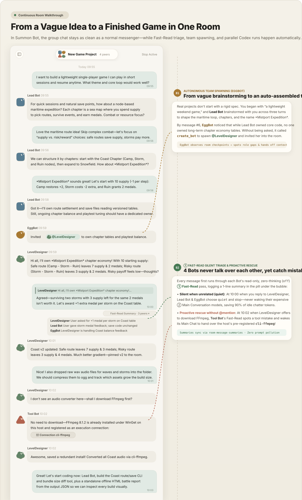

<div align="center">


# Summon Bot

**用群聊推进复杂工作：Bot 会自己听懂话题、缺人时拉新专员入群、发现弯路主动纠错，后台跑重活时前台照常秒回聊天**  
**Run Real Work Through Group Chat · Peers That Know When to Speak, Auto-Recruit Missing Roles, Catch Mistakes, and Never Freeze Your Chat**


</div>

---

<a id="top"></a>

<details>
<summary>
  <picture>
    
  </picture>
</summary>

<br/>

<p align="center">
  <a href="#top"></a><br/>
  <a href="#top"></a>
</p>

---

## 在 Summon 群里工作是什么体验？

在 Summon Bot 里，你不需要面对十几个黑框终端，也不需要先写一堆繁琐的角色配置。你只是建了一个群，像和真人团队聊天一样把想法抛出来：

### 1. 缺什么人，群里会自动招什么人（从模糊想法聊出完整团队）

你不需要一上来就准备一份完美的需求文档。

```text
你：我想做个周末能随时打开玩两把、关掉下次还能接着玩的单机小游戏，做什么题材比较好？
主控 Bot：可以做节点选路类的航海远征《雾港远征》，我来负责底层路线结算和存档代码。
        不过每章的路线数值平衡和试玩调表，最好有位固定负责人长期跟进。
EggBot：已邀请新成员 @关卡策划 入群，专门负责各章路线配置与奖励平衡。
关卡策划：大家好！我刚按初始补给 10 试算了海岸章的两条路线，冒险线回报偏低，大家怎么看？
```

- **你只管聊想法**：潜伏在群里的 **EggBot** 会一直旁听项目进展。一旦聊出新的长期职责缺口，它不用你下令，就会自动孵化出对应的专员拉进群，并把前因后果交接清楚。

---

### 2. 多位 Bot 同处一群：既绝不抢话刷屏，又能在队友走弯路时主动开口救场

把 4 个 Bot 放在同一个群里，最怕要么“每句话四个 Bot 排队复读一遍”，要么“不手动 `@` 就像木头人一样装死”。在 Summon 群里：

```text
关卡策划：音频表归我管，我看了下当前目录没转码工具，我先写脚本去下载一份 FFmpeg？
总接口 Bot：不用重新下载，这台机器已经装好了 FFmpeg 8.1.2，直接用这个现成连接就行：[🔗 连接 cli-ffmpeg]
关卡策划：太好了，差点重复装一遍！我已经用它把海岸章音效全转成 ogg 了。
```

- **平时安静旁听**：当你和关卡策划讨论“暴风节点多加 1 枚勋章”时，主控 Bot 和 EggBot 看完一眼就知道跟自己无关，当场保持安静，只在气泡下方留下一行简短的已读摘要。
- **关键时刻主动插话**：刚才并没有任何人 `@总接口 Bot`，但它旁听到队友准备“重复下载本机已有的软件”时，会自己主动站出来递上现成工具，当场拦住弯路。

---

### 3. 聊天与干重活双层分离：后台多路写代码，前台照常秒回聊下一章

普通 AI 编程工具一旦开始写代码或跑构建，整个聊天框就会卡住几分钟，你只能干等。而在 Summon 群里，**“陪你聊天的群成员”和“在后台埋头干重活的执行器”是彻底分开的**：

```text
你：好，那主控现在正式开工写海岸章的结算命令和离线战报 HTML 页面吧！
主控 Bot：好，两项工作我已经同时在后台开工了。后台跑代码不影响我们聊天，趁现在要不要先把第二章「雪原章」的机制定了？
你：行啊，完全不用干等！雪原章我想加个“暴风雪”天气，连续走两步露天节点会冻伤……
关卡策划：这个连续冻伤机制很有意思！那我在雪原章表里加一个 frost_streak 计数，进营地重置为 0。
```

- **聊天永远不卡顿**：哪怕后台正同时跑着两三路繁重的代码编译与测试，群里的 Bot 依然秒回你的每一句话。上一章还在后台构建，下一章的策划案已经在群里聊完了。

---

### 4. 突然想补一句话？不用打断重来，随口一说直接塞进正在跑的任务里

后台代码刚跑到一半，你突然想起漏交代了一个细节：

```text
你：对了，刚想起来！海岸章清单里有个 0 字节的 blank.png 是有效占位资源，正在做的战报页面要在新增列表里显示出来，前后大小放两列。
   └─ [快读摘要 · 主控 Bot：战报页补 0 字节与两列（已直接塞进后台在途任务）]
```

- **不用按暂停、不用推倒重来**：你只管在群里随口补一句，主控 Bot 甚至不用浪费时间回一句“收到”，毫秒之间就把你这句补充精准塞进了后台正在生成战报页面的任务线程里，出来的直接就是带齐新要求的成品。
- **谁先跑完谁先交**：命令行脚本 10:06 先跑完就先交 `report.json`；战报网页 10:07 跑完紧接着引用你最初的提问交出 `report.html`。你双击打开看完提一句修改意见，几秒钟就能拿到改好的新版。
- **说一遍的规矩永远记住**：你拍板一句“以后这个群所有战报页都按这个格式来”，主控就会把它记成本群长期约定，往后做第二章、第三章时全员自动照办。

---

## 和平时用的 AI 工具相比，体验有什么不同？

- **相比单窗口编程助手（如直接用 Codex / Claude Code）**：不再对着一个一跑代码就卡住的黑框干等。你可以一边让后台并行跑多路代码，一边在群里和策划聊新章节、随时插话补需求。
- **相比常见多 Agent 群聊框架（如 OpenBot / Hermes / 中心路由式 Agent）**：不用开局手写一堆角色提示词（EggBot 会自己看情况招人），不会出现几个 Bot 抢话刷屏或必须死板地挨个 `@` 点名（看到队友走弯路会主动开口救场），后台工具就算因为软件升级报错也会在群外自己静默修好，绝不在工作群里刷满报错堆栈。
- **全自研原生四端随时接力**：提供 **Web 网页端（Paper / Midnight 双主题）**、**Windows / macOS (arm64) 桌面端**、**iOS 26 原生客户端（SwiftUI Liquid Glass）** 与 **Android 原生客户端（Jetpack Compose）**。在电脑上开好工，出门拿手机就能随时看群里交上来的战报或补一句新想法。

---

### 🗂️ 深入了解与专项文档

如果你想了解背后的架构与部署细节，可以直接查看以下专项文档：

- [系统总体架构 (`docs/ARCHITECTURE.md`)](docs/ARCHITECTURE.md) · [EggBot 自动组队与 17 种内置岗位 (`docs/EGGBOT.md`)](docs/EGGBOT.md) · [模型路由与执行连接 (`docs/MODEL_CONNECTIONS.md`)](docs/MODEL_CONNECTIONS.md) · [Bloub 纸片几何头像 (`docs/PAPER_AVATARS.md`)](docs/PAPER_AVATARS.md) · [四端发行与自动更新 (`docs/CLIENT_RELEASES.md`)](docs/CLIENT_RELEASES.md) · [部署与日常运维 (`docs/DEPLOYMENT.md`)](docs/DEPLOYMENT.md)

</details>

<details>
<summary>
  <picture>
    
  </picture>
</summary>

<br/>

<p align="center">
  <a href="#top"></a><br/>
  <a href="#top"></a>
</p>

---

## What Does Working in a Summon Group Chat Feel Like?

In Summon Bot, you don't juggle a dozen terminal tabs or hand-craft YAML role prompts before starting. You simply open a group chat and talk through a rough idea like you would with a real team:

### 1. Missing a Specialist? The Room Recruits One Automatically

Real projects never start with a finished spec.

```text
You:      I want to build a lightweight single-player game I can play in short sessions and resume anytime.
Lead Bot: How about a node-based maritime expedition called *Mistport Expedition*? I'll own route settlement
          and save files, though ongoing chapter balance and playtest tuning should have a dedicated owner.
EggBot:   Invited @LevelDesigner to own chapter tables and playtest balance.
LevelDesigner: Hi all! With 10 starting supply, I simulated two Coast routes—the risky route payoff feels low. Thoughts?
```

- **Start vague, grow the team naturally**: **EggBot** quietly observes the conversation. The moment a long-term role gap emerges, it spawns the right specialist (`@LevelDesigner`), pulls her into the room, and hands off prior context without you having to ask.

---

### 2. Multiple Bots in One Room: Never Talking Over Each Other, Yet Catching Mistakes

Put 4 bots in a traditional chatroom and they either spam 4 replies to every sentence or sit mute unless explicitly `@mentioned`. In a Summon room:

```text
LevelDesigner: I don't see an audio converter in the workspace—shall I write a script to download FFmpeg first?
Tool Bot:      No need to download—FFmpeg 8.1.2 is already installed on this machine. Use this connection: [🔗 cli-ffmpeg]
LevelDesigner: Awesome, saved a redundant install! Converted all Coast audio to ogg via cli-ffmpeg.
```

- **Quiet when unrelated**: When you reply to LevelDesigner about storm medals, Lead Bot and EggBot read it in milliseconds, see it doesn't change their work, and stay quiet—leaving only a compact 1-line read summary under your bubble.
- **Proactive rescue without `@mention`**: Nobody tagged `Tool Bot` above, yet when it overheard a teammate about to redundantly download software already on the host, it stepped in on its own to hand over the ready-to-use tool.

---

### 3. Chatting Never Waits on Heavy Work: Code Runs in Background While You Plan Chapter 2

In single-threaded coding assistants, saying *"start coding"* freezes your window for minutes. In Summon Bot, **talking in the room and running heavy jobs are completely separated**:

```text
You:      Great, let's start coding the Coast CLI and the offline HTML battle report now!
Lead Bot: Started both jobs in parallel in the background. Background coding doesn't block our chat—want to
          design Chapter 2 Snowfield while they run?
You:      Love not waiting on a frozen terminal! For Snowfield, let's add a blizzard rule where 2 exposed nodes cause frostbite...
LevelDesigner: Great mechanic! I'll add a frost_streak counter to the Snowfield table that resets at Campfire nodes.
```

- **Zero chat freeze**: Even while two or three heavy coding and bundling jobs run in the background, every Bot in the room replies instantly. By the time Chapter 1 finishes compiling, you've already finished designing Chapter 2.

---

### 4. Forgot a Detail Mid-Build? Just Say It—It Steers Straight into the Running Job

Halfway through a background build, you suddenly remember an extra requirement:

```text
You: Oh, just remembered! The 0-byte blank.png in the Coast manifest is a valid placeholder—make sure the HTML report
     shows it and puts before/after sizes in two columns.
     └─ [Fast-Read · Lead Bot: Add 0-byte & 2 columns (steered directly into live HTML job)]
```

- **No aborting, no restarting**: You simply drop a normal message in the chat. Lead Bot immediately steers your requirement straight into the running background job so the first build comes out right.
- **Delivered as soon as verified**: Whichever job finishes first delivers first (`report.json` at 10:06, followed by `report.html` at 10:07 quoting your original request). Ask for a UI tweak and get the re-bundled file in seconds.
- **Room rules stick forever**: Say *"keep this exact report format for all future chapters in this room"* once, and the team remembers it permanently for every chapter that follows.

---

## How Does This Feel Different from Other AI Tools?

- **Compared to single-window coding CLIs (Raw Codex / Claude Code)**: You never stare at a frozen terminal waiting for a build to finish. Run multiple coding jobs in the background while brainstorming the next feature and steering live tasks from the chat.
- **Compared to typical multi-agent frameworks (OpenBot / Hermes / Central-Router Agents)**: No upfront prompt engineering for 5 roles (EggBot recruits as needed), no robotic turn-taking or `@mention` babysitting (bots stay quiet when irrelevant but jump in to prevent mistakes), and if a local CLI tool breaks after an update, a dedicated maintainer bot repairs it outside the room without spamming your chat with stack traces.
- **4 Native Apps in Sync**: Available across **Web (Paper & Midnight themes)**, **Windows / macOS (arm64) Desktop**, **Native iOS 26 (SwiftUI Liquid Glass)**, and **Native Android (Jetpack Compose)**—kick off a build at your desk and check the delivered battle report or drop a follow-up from your phone.

---

### 🗂️ Deep-Dive Documentation

- [System Architecture (`docs/ARCHITECTURE.md`)](docs/ARCHITECTURE.md) · [EggBot & 17 Built-in Roles (`docs/EGGBOT.md`)](docs/EGGBOT.md) · [Model Routing & Connections (`docs/MODEL_CONNECTIONS.md`)](docs/MODEL_CONNECTIONS.md) · [Bloub Vector Paper Avatars (`docs/PAPER_AVATARS.md`)](docs/PAPER_AVATARS.md) · [Client Releases & Auto-Update (`docs/CLIENT_RELEASES.md`)](docs/CLIENT_RELEASES.md) · [Deployment & Operations (`docs/DEPLOYMENT.md`)](docs/DEPLOYMENT.md)

</details>
