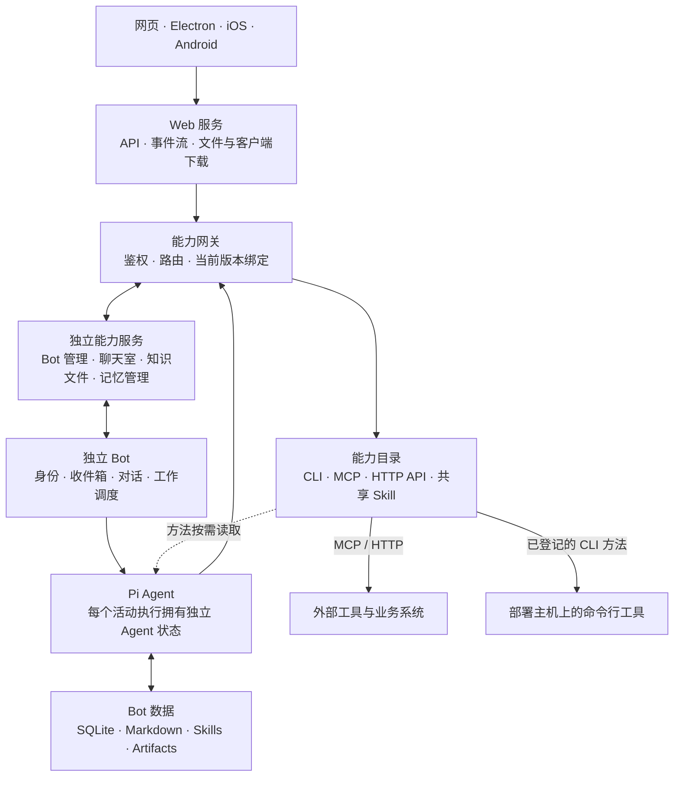

<div align="center">


# Summon Bot

**把目标交给一支有记忆、会协作、能持续工作的 AI 团队。**

<sub>[English](README.md) · [简体中文](README.zh-CN.md)</sub>

创建自己的 Bot，在私聊中合作，在群聊中组织项目，在工作中使用命令行工具、API 和文件。<br/>
让工作从一次交流开始，带着目标、进度和积累继续推进。

[](package.json)
[](bot/)
[](docs/CAPABILITY_CATALOG.md)
[](#多端体验)

[English](README.md) · **简体中文**

[产品介绍](#summon-bot-是什么) · [核心能力](#核心能力) · [设计差异](#设计差异) · [基础架构](#基础架构) · [多端体验](#多端体验) · [交给 AI 部署](docs/DEPLOYMENT.md)

</div>

---

## Summon Bot 是什么

Summon Bot 是一个围绕长期协作构建的 AI 工作空间。每个 Bot 拥有稳定的身份、角色、联系人、工作记录和自己的知识；你可以与它单独交流，也可以把多个 Bot 放进同一个项目群，围绕共同目标分工。

一次委托会成为可以持续推进的工作：记录要求、等待依赖、接收新信息，并把结果带回原来的对话。实际工作中积累的知识保存在 Markdown，经过整理的可复用方法可以沉淀为 Skill，供后续任务按需使用。

例如，你可以这样开始：

> **开发协作**「把这个需求交给工程伙伴，在项目目录用 Codex 推进，遇到需要我决定的事情回到这里说。」
>
> **项目组队**：「为这个项目组织合适的成员，明确分工，跟进依赖和交接。」
>
> **持续关注**：「关注这项工作的状态，有实质变化时告诉我；把这次处理方法整理下来。」

这些是使用场景示例；具体执行取决于已配置的模型、连接、工具权限和用户授权。

## 核心能力

### 有身份的 Bot，有分工的团队

按职责创建和配置 Bot，维护它的角色、提示词、联系人和可用能力。私聊用于直接合作，群聊承载项目目标、要求、期限与成员分工。

普通项目群由主控负责推进与整合，EggBot 负责寻找或创建合适的成员、安排临时与常驻职责、处理交接。工作成员也能根据实际来源提出依赖、重复劳动或能力缺口等问题。消息按明确的点名、回复和工作归属投递，需要时再做语义路由。详见 [EggBot 与群聊团队](docs/EGGBOT.md)。

### 能等待、续接和停止的工作

Bot 内部区分交流与工作，每项工作单独保存目标、要求、进度、来源和外部执行绑定。同一个 Bot 可以处理多项工作，同一逻辑对话始终串行，前台交流优先。

等待同伴、时间条件或外部结果时，工作保存等待状态并释放执行位置；事件到达后沿原工作继续。重启保留工作记录和等待关系，暂停、取消与结果未知也各自有明确状态。网页可以查看执行进度、工具活动和外部任务状态，并取消当前操作。

### 有来源的记忆，能积累的方法

原始交流与工具结果、整理后的知识、当前工作状态分别保存。知识按工作或独立对话隔离，正文使用 Markdown；新的工作根据当前目标和资料目录按需读取相关内容。

整理、压缩和上下文组装分别按需创建短暂维护对话。真实工具结果与用户纠正可以成为更新 Skill 的依据；Bot 可以维护自己的方法，也可以向共享 Skill 的维护者提出有来源的修订建议。详见 [上下文与持续工作设计](docs/BOT_3_PLUS_3_DESIGN.md)。

### CLI、MCP、HTTP API 与 Skill 的统一目录

在能力目录中查找已登记的命令行工具、MCP 服务、HTTP API 和共享 Skill。连接聊天模型并开始引导后，Pi 在部署主机发现 CLI 入口。MCP 支持 stdio 与 Streamable HTTP，现有 HTTP 接口可以直接登记为工具。Skill 保存可复用的方法和相关资源。

每项登记的能力有一个专属维护 Bot。CLI 的维护者读取本机版本和帮助，登记附有来源和适用版本的方法。其他 Bot 按授权使用已登记的方法，需要新用法或遇到故障时咨询维护者。[能力目录与共享 Skill](docs/CAPABILITY_CATALOG.md)

### 原工作中的本机工具

Pi 推进工作，在授权的项目目录运行已接入的 CLI，例如 Codex。原工作保存操作标识、执行状态、输出引用，以及实际取得的原生会话标识。提供结构化事件的方法可将进度和问题带回原工作与原对话，维护者也可通过统一展示接口发布额度和状态等观察。[展示来源](docs/CAPABILITY_CATALOG.md#展示来源)

文件能力提供读取、写入、编辑文件与执行命令，可用于 Bot 工作区和已配置的项目目录。命令以宿主用户权限运行，部署时应按实际用途配置可用范围。详见 [运行维护](docs/OPERATIONS.md)。

### 持续职责与可见的用量

为 Bot 配置定时职责，或观察工作、任务与房间状态。有明确观察源时，状态没有变化就保持安静；同一职责的在途触发合并，前台交流优先。

Token 统计可以按 Bot、单聊、群聊和时间查看请求明细、缓存用量与参考费用，后台整理和上下文维护也纳入记录。费用按接口回执与已配置价格估算，供应商账单仍以供应商记录为准。

## 从一段对话开始

打开网页工作区，或在安装后的桌面应用开箱页选择本机正式实例或远程地址。新建或选择工作区后，在同一窗口继续。主 Bot 会引导你导入部署主机上已有的 Codex 或 Grok 登录、授权订阅，或在隐藏输入中填写 API Key。接通聊天模型前使用脚本引导消息，凭据保存在主机的私有配置中。

点击继续后，真实主 Bot 会围绕你想做的事，一次一个问题地介绍和完成后续配置。网页、Electron、Android 和 iOS 共用模型连接和主 Bot 的对话，也可以随时从“设置 → 新手引导”重新进入。

## 设计差异

Summon Bot 的选择集中在身份、工作、知识和能力之间的关系上：

| 关注点 | 这里的选择 | 对使用者的意义 |
| --- | --- | --- |
| Bot 与任务 | Bot 是稳定身份；普通委托创建独立工作 | 同一个伙伴可以承接多件事，分别保存进度和上下文 |
| 团队组织 | 项目主控推进，EggBot 负责组队和交接，成员保留自己的工作 | 分工围绕项目调整，已有成员也可参与其他项目 |
| 长任务 | 等待关系与外部绑定持久保存，由事件续接 | 可以追踪工作在做什么、等什么，以及何时需要你介入 |
| 上下文 | 原始记录、Markdown 知识与工作状态分层，资料按需组装 | 新要求及时进入执行，相关经验可在后续工作中复用 |
| 共享能力 | 连接配置与 Skill 正文分开，每项能力有专属维护者 | 工具接入、使用权限和方法修订都有明确归属 |
| 系统边界 | Bot 内核、领域能力与用户界面分别实现 | 界面、工具服务和 Agent 生命周期可以各自演进 |

## 基础架构

Summon Bot 以 Node.js 24+ 和 ESM JavaScript 构建后端，使用 Pi Agent 作为执行内核，SQLite 保存运行事实，Markdown 保存知识与方法。



### 三个清晰的运行边界

- **Bot 内核**：每个 Bot 拥有独立配置、收件箱、SQLite 和工作目录；调度器管理同会话串行与有限并发，每个活动执行持有独立的 Pi Agent 状态。默认 4 个业务执行位置，后台维护独立限流。
- **能力服务**各自管理聊天室、知识、文件、Bot 和记忆等领域数据。网关提供鉴权、路由、能力绑定和聚合接口，也管理登记的原生工具执行与展示来源。独立能力更新在活动执行到达安全边界后切换。
- **用户界面**：Web 提供页面、API 转发、实时事件和下载分发。Electron 加载同一网页，原生手机端通过 API 接入；Bot 与外部工作在后端运行，关闭页面后仍保留责任与状态。

### 三层持久数据

| 层 | 保存什么 | 存在哪里 |
| --- | --- | --- |
| S1 · 原始记录 | 消息、工具调用与结果、事件及其来源 | Bot SQLite 与产物目录 |
| S2 · 知识与总结 | 按工作或独立对话整理的知识正文 | Bot 的 knowledge Markdown；SQLite 保存目录与处理位置 |
| S3 · 工作状态 | 目标、要求、进度、等待、外部绑定、暂停与通知 | Bot SQLite |

整理把有价值的增量写回对应 Markdown，组装为当前执行选择相关资料，压缩在上下文预算需要时发生。三者各自按需启动、完成后结束；原始记录继续保留，供后续定位来源。

进一步阅读：[架构说明](docs/ARCHITECTURE.md) · [工作与上下文实现记录](docs/BOT_3_PLUS_3_IMPLEMENTATION.md) · [能力服务与更新](docs/CAPABILITY_SERVICES.md)。Pi 的适配与上游说明见 [Pi 组件说明](bot/third_party/pi/README.md)。

## 多端体验

| 终端 | 实现 | 使用与更新方式 |
| --- | --- | --- |
| 网页 | 普通浏览器网页 | 部署后刷新获取页面 |
| Windows / macOS | Electron | 加载同一正式网页，外壳提供下载与重启更新 |
| iPhone / iPad | Swift / SwiftUI | 原生界面，由 Mac 构建和分发 |
| Android | Kotlin / Compose | 原生界面，检查版本、下载 APK，经系统确认安装 |

项目处于开发阶段。上表说明各端的源码实现与更新方式，可下载版本以网页“客户端下载与更新”中实际发布的条目为准；macOS 与 iOS 由 Mac 从同一提交打包。原生手机界面随定稿功能单独同步实现。

## 代码地图

```text
bot/                        独立 Bot 内核、调度、上下文与持久化
capabilities/               领域能力服务、网关、能力目录与版本绑定
roles/                      角色配置与提示词
skills/                     随项目提供的 Skill
web/                        普通网页、HTTP 入口与发行包分发
desktop/                    Windows / macOS Electron 外壳
ios/                        SwiftUI 原生客户端
android/                    Kotlin / Compose 原生客户端
scripts/                    构建、安装、运行维护与各端发行
docs/                       架构、设计与操作文档
```

## 文档

| 你想了解 | 从这里开始 |
| --- | --- |
| 让 AI 安装、启动或更新 | [交给 AI 部署](docs/DEPLOYMENT.md) |
| 理解系统组成与数据边界 | [架构说明](docs/ARCHITECTURE.md) |
| 理解 Bot 的工作、上下文和持久化 | [设计](docs/BOT_3_PLUS_3_DESIGN.md) · [实现](docs/BOT_3_PLUS_3_IMPLEMENTATION.md) |
| 组织项目团队与成员交接 | [EggBot 与群聊团队](docs/EGGBOT.md) |
| 接入 CLI、MCP、HTTP API 和共享方法 | [能力目录](docs/CAPABILITY_CATALOG.md) · [能力服务](docs/CAPABILITY_SERVICES.md) |
| 参与开发和运行维护 | [开发约定](AGENTS.md) · [开发流程](docs/DEVELOPMENT.md) · [运行维护](docs/OPERATIONS.md) |
| 构建与发布客户端 | [客户端发行与更新](docs/CLIENT_RELEASES.md) · [iOS](ios/README.md) · [Android](android/README.md) · [桌面端](desktop/README.md) |
