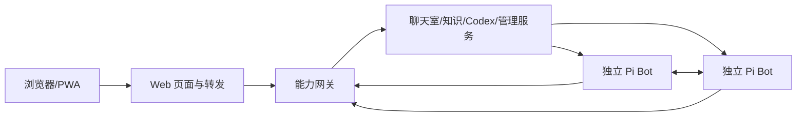

# 架构

系统由通用 Bot、外部能力和 Web 三部分组成。所有被称为 Bot 的实例都通过同一个 `@relay/bot` 启动 Pi Agent；入口和聊天室角色也使用这条路径。



## Bot 本体

`bot/` 是独立 npm package，公共入口为 `@relay/bot`，并提供 CLI。Bot 拥有自己的配置、身份、生命周期、HTTP 接口、消息收件箱、任务执行循环、Pi Agent、上下文和 SQLite 状态。外部 HTTP/MCP/模块工具及 Skill 通过配置接入。Bot 不依赖聊天室、Web、Codex 或管理服务才能启动。

SQLite 是任务、工具结果、会话和记忆的事实来源。每次启动更换 bootId；botId 与数据目录不变。相同来源消息 ID 去重；重启后未确认的执行标为中断或未知，不自动重放。状态文件用于观测，不能替代数据库或实例身份检查。

## 外部能力

`capabilities/` 按聊天室、知识、文件、Codex、Bot 管理、记忆管理拆分。能力网关提供受认证的 HTTP/MCP 接口。角色配置决定可调用哪些工具，网关验证调用者身份与权限。

聊天室拥有公开消息、成员、投递回执与公共附件；Bot 拥有自己的私有模型历史、任务、记忆和产物。Codex 能力拥有执行器工作、事件和工作目录锁。事实咨询交给指定 Bot；用户授权或方向选择保持待用户状态。咨询期间只读工具限制由网关执行，防止等待工作区锁的死锁。

Web 不持有模型执行循环，不打开业务数据库，也不控制 Bot 生死。关闭 Web 后，网关和 Bot 继续运行。网关自身也不是 Bot；入口、聊天室、管理和记忆角色均为单独 Pi Bot 实例。

## 分身和记忆

管理能力从母体 SQLite 的一致读事务获得已持久化会话、记忆和资源，创建新身份与独立目录。它不复制在途任务、outbox、活动锁或母体凭据。Bot 本体没有 fork/join 或自我复制协议。

分身先持久交付成果，记忆管理能力根据派生基线提出增量并检查版本冲突。母体离线时交付可保留；合并需要明确处理冲突，重复请求保持幂等。回收前检查未完成任务和交付状态；已被引用的产物保留。

## 代码、部署与数据

源码根与发行物分开；发行物与可写数据分开。数据根：

```text
Relay-Bot-data/
  config/                   deployment.json、runtime.env
  bots/<botId>/             config.json、state.sqlite
    memory/ resources/ artifacts/ workspace/ logs/ cache/ run/ tmp/
  capabilities/<能力>/      state.sqlite、能力自己的文件与日志
  web/                      run/、logs/
  archives/                 分身交付与回收元数据
  migration/                迁移映射和校验报告
  verification/             验证证据
```

安装根：`Relay-Bot-app/releases/<buildId>/`、`current.json` 与启动脚本。发行物包含 bot/web/capabilities/roles/skills/scripts、生产依赖和 Node；没有数据库、用户数据、密钥或开发目录链接。

## 启动链

StartupHub → 安装根 Start.ps1 → installation CLI → 能力网关进程 → Web 进程。管理能力按配置恢复或按需启动独立 Bot 进程。首次分配的网关端口持久化，以便网关重启后 Bot 工具仍可连接。停止全系统时先要求各 Bot 完成关闭，再停 Web 和网关；单独关闭 Web 不产生该效果。
