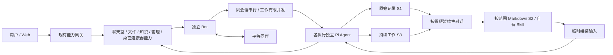

# 架构

Summon Bot 由独立 Pi Bot、现有能力服务、网关和 Web 组成。入口、聊天室、管理与记忆岗位都是普通平等 Bot，不构成全知主控。第二版继续使用 `@summon/bot` 与 Pi Agent，不迁移 Host。

普通群以共享项目记录承载目标、要求、期限、分工和协作问题，默认有项目主控与可跨群复用的 EggBot。主控负责项目推进和整合，EggBot 负责发现/孵化成员、临时与常驻生命周期及交接；每位工作 Bot 均可从自身职责主动提出有来源的协作问题。项目责任与 Bot 身份分开，工作仍留在各成员自己的 work。实现与接口见 [EggBot](EGGBOT.md)。



## Bot 本体

前台 chat 只聊天、查询资料与协调，实际制作交给隔离的 work 或 Codex。工具权限由引擎和网关按真实 task 共同执行；工作过程不进入聊天，worker 不直接参与用户聊天。上下文、能力目录与结果回流的边界见 [前台聊天与独立工作](CHAT_WORK_ISOLATION.md)。

Bot 拥有自己的身份、配置、消息收件箱、SQLite、工作与产物目录。`botId`、`conversationId`、`workId` 稳定，task/run 表示触发和执行段。前台聊天独立 1 位，后台工作默认 4 位，维护独立 1 位；同一会话串行，各执行的 Agent 状态互不共享。

S1 保存原始消息、工具记录及来源。S3 保存 work 目标、要求、进度、等待、外部绑定与通知。S2 正文位于按工作或独立对话隔离的 MD，SQLite 只持有目录和处理游标，不存另一份总结正文。

整理、压缩、组装每次各用一个新的短暂模型对话，按需发生。组装仅为本次输入；原始尾部和最新指令直接进入业务对话。维护失败保留旧文档和增量。旧 Pi 原文/投影/恢复能力继续使用，常规摘要真相改为 MD。

普通临时委托创建 work。工作等待后释放位置，事件到达沿原 work 续接；没有事件不模型空转。暂停/取消保留结果而不自行恢复。重启保留未知工具状态，不重放已发出的副作用。

## 外部能力与协作

`capabilities/` 继续按聊天室、知识、文件、Codex、Bot 管理、记忆管理划分。能力拥有各自领域数据与后台投递；网关负责当前版本路由、既有鉴权、绑定切换及 Web 聚合。能力切换等待所有活动执行安全边界，正式交付后只保留当前有效版本，不保留并行旧服务。

聊天室保存房间原文和投递。明确来源/工作归属直接投递，未明确的新群消息只做一次单成员语义路由。按 Bot、房间及 work 增量组装，原文可按页读取。同伴纠错有具体来源，纯通知和无进展重复链不继续唤醒。

Codex 能力是现有桌面连接器的持久适配，保存操作意图、原操作键、真实线程与回合绑定、SSE 游标及待投递结果。S3 仍是 Bot 的责任记录。新工作不进入旧 app-server；未知写请求先查原操作。接单、外部运行和用户目标完成分别表达。

持续职责沿用现有网关 timer 与 routines，支持在途合并、前台优先与 work/task/room 状态 watch。普通独立 Bot 的创建、运行与停止保留；任务分身、父子复制/交付/合并/回收不再是当前工作主链。有效旧材料仍作为来源保留。

## 数据与正式交付

```text
D:/Relay-Bot-data/
  config/                         正式部署配置与私密 runtime.env
  bots/<botId>/
    config.json / state.sqlite    身份、S1、S3、目录与游标
    knowledge/*.md                按范围的 S2 正文
    skills/<name>/SKILL.md         本 Bot 可维护的方法
    artifacts/ workspace/ logs/ run/ tmp/
  capabilities/<能力>/            领域数据库、文件与日志
  connectors/codex-desktop-api/    原连接器配置、幂等/事件数据与日志
  web/                            运行状态与日志
```

源码 `D:/Relay-Bot`，安装 `D:/Relay-Bot-app`；`current.json` 与数据根 `deployment.json` 指向当前发行。正式入口为 `https://bot.lin0.org` / `http://127.0.0.1:8787`。沿原安装和启动链更新运行引用，不创建开发、测试或预览实例。

构建物不携带用户数据库和凭据。安装清理被替代发行、能力版本与构建中间目录，保留有效历史、MD、Skill、用户文件和业务归档，不生成备份或回退副本。关闭 Web 不停止后端责任；显式停止意图仍有效。

本文件描述源码结构，不替代本次构建、安装、启动的实际结果说明。未运行测试或哈希不是阻塞，也不自动补齐历史验收记录。
