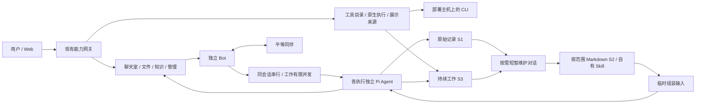

# 架构

Summon Bot 由独立 Pi Bot、现有能力服务、网关和 Web 组成。入口、聊天室、管理与记忆岗位都是普通平等 Bot，不构成全知主控。第二版继续使用 `@summon/bot` 与 Pi Agent，不迁移 Host。

普通群以共享项目记录承载目标、要求、期限、分工和协作问题，默认有项目主控与可跨群复用的 EggBot。主控负责项目推进和整合，EggBot 负责发现/孵化成员、临时与常驻生命周期及交接；每位工作 Bot 均可从自身职责主动提出有来源的协作问题。项目责任与 Bot 身份分开，工作仍留在各成员自己的 work。实现与接口见 [EggBot](EGGBOT.md)。



## Bot 本体

前台 chat 只聊天、查询资料与协调。隔离的 work 由 Pi 推进，按当前授权调用所需工具。引擎和网关按真实 task 执行工具权限。工作过程留在工作记录中，进度、问题与交付结果按来源回到会话。[前台聊天与独立工作](CHAT_WORK_ISOLATION.md)

Bot 拥有自己的身份、配置、消息收件箱、SQLite、工作与产物目录。`botId`、`conversationId`、`workId` 稳定，task/run 表示触发和执行段。前台聊天独立 1 位，后台工作默认 4 位，维护独立 1 位；同一会话串行，各执行的 Agent 状态互不共享。

S1 保存原始消息、工具记录及来源。S3 保存 work 目标、要求、进度、等待、外部绑定与通知。S2 正文位于按工作或独立对话隔离的 MD，SQLite 只持有目录和处理游标，不存另一份总结正文。

整理、压缩、组装每次各用一个新的短暂模型对话，按需发生。组装仅为本次输入；原始尾部和最新指令直接进入业务对话。维护失败保留旧文档和增量。旧 Pi 原文/投影/恢复能力继续使用，常规摘要真相改为 MD。

普通临时委托创建 work。工作等待后释放位置，事件到达沿原 work 续接；没有事件不模型空转。暂停/取消保留结果而不自行恢复。重启保留未知工具状态，不重放已发出的副作用。

## 外部能力与协作

`capabilities/` 按聊天室、知识、文件、Bot 管理与记忆管理等领域划分。各服务管理领域数据和后台投递。网关负责当前版本路由、鉴权、绑定切换和 Web 聚合。能力切换等活动执行到达安全边界后进行，正式安装保留当前有效版本。

聊天室保存房间原文和投递。明确来源/工作归属直接投递，未明确的新群消息只做一次单成员语义路由。按 Bot、房间及 work 增量组装，原文可按页读取。同伴纠错有具体来源，纯通知和无进展重复链不继续唤醒。

网关维护统一工具目录，保存 CLI 的主机、入口、版本、维护 Bot 与已观察的方法。HTTP API 和 MCP 也使用目录中的维护责任、方法与观察。Pi 在原工作中按授权启动命令，运行器在模型回合之间保留受管进程、输出和操作身份。工具提供原生会话标识时写入 WORK 绑定，续接根据该会话和实际操作状态进行。输出按游标读取，未知写入先核查原操作。接单、外部运行和用户目标完成各自有状态。

维护 Bot 可将实际观察发布成额度、金额、状态、进度、文本、表格或文件引用。来源与目录条目的资源身份及修订关联，网关把已登记的快照和动作交给客户端。工作详情按该工作实际使用的资源返回有关来源。[能力目录与共享 Skill](CAPABILITY_CATALOG.md)

持续职责沿用现有网关 timer 与 routines，支持在途合并、前台优先与 work/task/room 状态 watch。普通独立 Bot 的创建、运行与停止保留；任务分身、父子复制/交付/合并/回收不再是当前工作主链。有效旧材料仍作为来源保留。

## 决策记录与流程复核

Bot 的业务工具、实际答复（含 PASS）、任务收口与记忆整理在同一次决策中检查当前目标、证据和权限。Bot 私库与群服务各有 `business-decisions` 索引，按任务、来源、工具回执、工作或发布消息追溯。记录短结论、可查事实及结果，不保留自问的推理过程。没有模型结论或结果未确认时保留缺口；索引不参与派工、自动重放或授权。

流程复核 Bot（`bot-skeptic`）默认加入当前用户的项目群。实际交付、相关进展或对原判断的讨论触发有上限的同群复核；它可以保持静默，或用确切来源向原判断者发一个问题。私聊仅使用已经存在且双方有权限的会话，私聊内容不回流原群。原判断者按证据复核；只允许在当前拥有的原 WORK 上纠正下一步记录，涉及派工、接管、验收或权限变动仍由原流程处理。

明确要求“原工作已受理就沿用、未受理就按原授权提交一次”时，先找同一用户、群和已核原制作动作，查实际受理、待定或确未受理。仅对已知中断且没有派工痕迹的单一动作，用原消息的稳定续办身份继续；已应用验收和未知结果均保留。

## 数据与正式交付

```text
D:/Relay-Bot-data/
  config/                         正式部署配置与私密 runtime.env
  bots/<botId>/
    config.json / state.sqlite    身份、S1、S3、目录与游标
    knowledge/*.md                按范围的 S2 正文
    skills/<name>/SKILL.md         本 Bot 可维护的方法
    artifacts/ workspace/ logs/ run/ tmp/
  capabilities/<能力>/            领域数据库、文件与日志
  capabilities/native-executions/  原生执行状态、输出和事件文件
  web/                            运行状态与日志
```

源码 `D:/Relay-Bot`，安装 `D:/Relay-Bot-app`；`current.json` 与数据根 `deployment.json` 指向当前发行。正式入口为 `https://bot.lin0.org` / `http://127.0.0.1:8787`。沿原安装和启动链更新运行引用，不创建开发、测试或预览实例。

构建物不携带用户数据库和凭据。安装清理被替代发行、能力版本与构建中间目录，保留有效历史、MD、Skill、用户文件和业务归档，不生成备份或回退副本。关闭 Web 不停止后端责任；显式停止意图仍有效。

本文件描述源码结构，不替代本次构建、安装、启动的实际结果说明。未运行测试或哈希不是阻塞，也不自动补齐历史验收记录。
