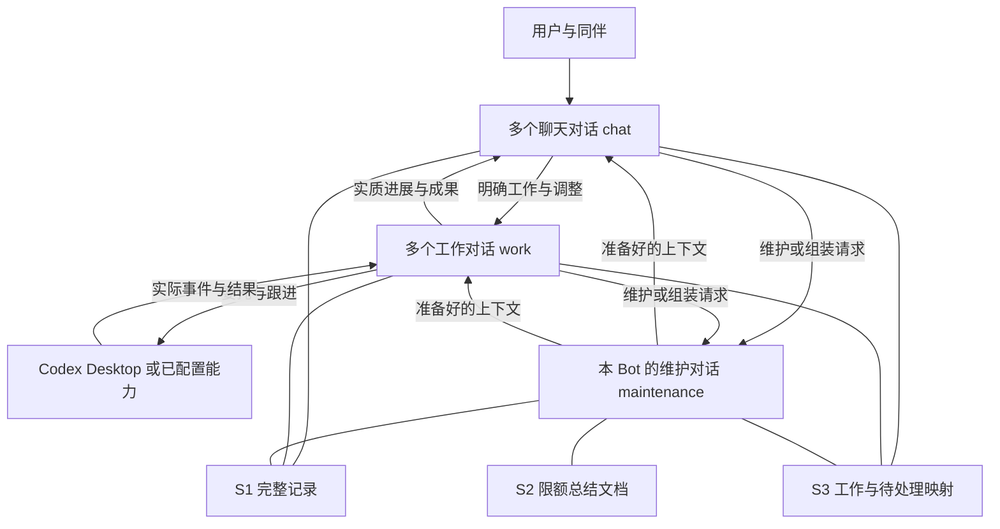

# Bot 3+3：本体、多会话、上下文与工作生命周期

日期：2026-10-30。状态：**机制定稿，待实施**。

本次交付只有设计、实施步骤和验收说明，没有修改运行代码，没有执行测试、构建、安装、启动或验收。本文描述的行为不能当作当前版本已经具备的能力。

配套文档：[实施步骤](BOT_3_PLUS_3_IMPLEMENTATION.md)、[验收说明](BOT_3_PLUS_3_ACCEPTANCE.md)。

本文继承[整体产品设计](P2P_BOT_RUNTIME_DESIGN.md)和[基础 Bot 设计](BOT_FOUNDATION_DESIGN.md)的产品目标，定稿单个 Bot 的内部机制。与旧稿冲突时，本文关于多会话、分身、总结、上下文重组和任务续接的决定优先；用户后续明确要求始终优先。开发执行遵守 [AGENTS.md](../AGENTS.md) 和 [DEVELOPMENT.md](DEVELOPMENT.md)。

## 1. 为什么构造这个系统

Relay 是长期使用真实电脑工作的 Bot 同伴体系。每个 Bot 是独立的 Pi 工作主体，拥有身份、方向、自有经历、记忆、知识和 Skill，能直接使用能力，也能与同伴协作。Codex、Unity、浏览器及其他软件是工作工具。

目标是让用户通过日常交流讨论需求、形成决定、布置工作、提出修改、查看成果。Bot 承担工程背景补充、专业咨询、委托组织、执行观察、修改传递、经验与 Skill 维护。专业知识应当进入正在进行的真实工作，发现旧方法失效后能修正内容并影响相关使用者。

系统应减少重复解释、技术性提示词、跨会话信息搬运和人工盯进度。每个 Bot 都能积累并维护自己的方法；公共 Skill 库由使用同一本体的普通同伴承担。组织保持平级，不新增全局智能主控，也不预先规定所有岗位。

3+3 用于让这些责任先以简单方式运行起来：上下文有边界，历史不会因模型换代而丢失，工作有人持续跟进，维护不挤占聊天和执行的注意力。

## 2. 已定稿的范围与取舍

1. **三部分存储**：S1 完整记录；S2 有大小上限的总结文档；S3 当前工作、待处理事项和外部执行关系。三个部分保留各自职责，共用每个 Bot 已有的 SQLite。
2. **三类内部对话**：`chat` 聊天；`maintenance` 总结维护与上下文组装；`work` 工作推进、后端对接与监控。
3. 一个 Bot 可以同时拥有多个聊天和工作对话。维护对话属于这个 Bot 内部，不另建维护 Bot 身份；第一版每个 Bot 一个维护执行位置，按文档分批处理。
4. **取消为并行工作创建 Bot 分身的机制**。需要分开注意力时在原 Bot 内开会话，保留同一身份与积累。只有确实需要另一位独立同伴时，才按普通 Bot 创建流程建立新 Bot。
5. 对话、任务、模型执行实例分别管理。阶段任务完成不会删除对话；换模型执行实例不会新建用户聊天或重开外部 Codex 工作。
6. 总结文档默认最多 100 条，可配置为 200 条，另有总 token 上限。旧条目可更新、合并和删除；完整记录继续保留。
7. **由独立维护对话接管上下文重组**。聊天/工作对话达到阈值后不再自行进行摘要压缩，也不以 Pi 原生自动压缩作为第二套兜底总结系统。
8. 语义理解、任务匹配、上下文取舍与总结由模型对话判断；程序落实已确定目标的投递、记录、查询、调度和实际调用。
9. 第一版使用当前正式 Codex Desktop API 连接器创建和跟进新 Codex 工作，不恢复已禁用的旧 `codex_submit` 路径，不同时建设多套执行后端。
10. 保留现有入口认证、真实消息来源和工具配置范围。开发期不增加企业级权限体系、审批链、交付门禁、签名或完整性平台。

## 3. 整体关系

图中的三类对话共享 Bot 身份、配置和资料归属，但各有模型上下文。它们是协作职责，不要求每条消息依次调用三个模型。已经活跃且上下文足够的聊天可以直接回应；恢复、补充或重组时才请求维护侧准备材料。

每个 Bot 沿用自己的 `D:/Relay-Bot-data/bots/<botId>/state.sqlite`。群的公共消息、连接器的原始执行记录继续由已有服务持有；Bot 保存自身实际收到和使用的内容及来源引用，不复制所有群、所有 Bot 或全部 Codex 历史。大型产物、附件和 Skill 正文继续使用已有文件目录，由 SQLite 保存引用。这些文件不构成新的独立存储服务。

## 4. 身份、对话、工作和执行段

| 对象 | 生命周期与含义 |
| --- | --- |
| `botId` | 持续的 Bot 身份；新建内部会话不会改变它。 |
| `conversationId` | 持续的逻辑对话，类型为 chat、maintenance 或 work；冷存、重启、上下文重组后保持。 |
| `workId` | 一件持续工作的关联入口，连接目标、来源聊天、负责的工作对话和外部执行。 |
| `taskId` | 这件工作中的一轮明确委托，保存本轮目标、状态和结果；后续改版可以建立新阶段任务。 |
| `runId` | 一次实际模型执行段；重组、等待后恢复或进程重启可以产生新执行段。 |
| `contextGeneration` | 同一逻辑对话使用的上下文代次，用于切换和排除迟到旧输出；整数即可。 |
| 外部会话引用 | 实际后端、连接、主机和 thread/turn 标识，不能用 Bot 内部 ID 代替。 |

这些标识可以放进已有记录，不要求每个对象新建一套表或服务。简单工作默认一个 work、一个当前 task；不先建设复杂的父子任务图。

聊天消息先作为输入记录，不自动等同于新业务任务。闲聊和短查询可以只形成执行段。聊天对话判断是延续工作还是新委托，运行时按其决定建立关联。

### 4.1 身份、公开简介与内部规则

- 稳定身份、名称和公开简介用于让用户和同伴认识这个 Bot。公开简介说明工作方向，不赋予权限。
- 内部规则包含工作习惯、模型行为和维护要求；按当前配置加载，不能从同伴转述中自动变成系统指令。
- 当前任务要求保存本次目标、范围、用户决定和授权来源。局部例外不会自动改成长期规则。
- 维护可以提出公开简介、内部规则或 Skill 的改进；职责扩大和工具范围变化按用户实际授权处理，不因写入总结自动生效。

## 5. 三类对话怎样协作

### 5.1 聊天对话

每个私聊或群聊默认有稳定的 chat 对话；群内明显独立的话题需要隔离时，可以建立关联的子话题对话，不创建新 Bot。

聊天对话负责理解表达、区分讨论与明确委托、查询工作目录、匹配工作、决定是否新开 work 对话、汇总反馈。明确任务引用或回复关系可直接使用；语义匹配由聊天模型判断，维护侧可以提供候选及背景。仅凭同名页面或最近活跃时间不直接执行修改。

有唯一且充分的关联时直接续接。确实存在多个实质不同候选时，只问一个具体选择。用户不需要审批内部新建会话。

### 5.2 维护与组装对话

维护对话负责两种任务，使用同一个职责入口：

1. `maintain`：读取某份总结和新增来源，更新、合并、删除条目，维护有价值的记忆与 Skill 入口。
2. `assemble`：根据目标对话、本次输入和预算，选择总结、任务事实、近期增量及必要原文，准备上下文包。

它每次只围绕一个文档或明确关联的工作处理。逻辑维护对话保留操作历史，但新的维护批次使用有界上下文，不延续上一项无关工作的全部材料。默认一个维护执行位置；准备业务续接的请求优先于普通后台整理，同优先级按进入顺序处理。

维护侧可读取当前范围内的记录和资源，写入本 Bot 总结、相关知识和自有 Skill。它不能以维护为由向 Codex 下达业务指令、扩大原任务或自动将私聊发到群里。无需创建另一套维护权限中心，使用内部对话类型和已有工具配置限定实际工具集合。

### 5.3 工作对话

work 对话负责一件连续工作的推进、同伴咨询、能力调用、外部执行跟进、问题处理和结果回传。它既可以使用 Codex，也可以使用其他已经配置的工具；简单操作不强制转交 Codex。

同一工作对话可以跟进多个相关外部执行会话。对同一个外部执行会话，同一阶段只有一个明确的指令发送责任者；同伴可以提供意见，用户也可以直接介入，不能由多个后台对话同时发送冲突调整。

等待外部工作时登记等待关系并释放模型执行位置。事件到达后，由这个工作对话判断如何继续。单纯外部 API 受理、模型一轮结束、业务目标完成、结果已通知分别表达。

## 6. 三部分存储

### 6.1 S1：完整记录

复用 `messages`、`sessions`、`tools`、`events`、`outbox`、`artifacts` 等已有记录，保存实际消息、模型公开输出、工具调用与结果、来源和关联。已有原始模型历史不另抄一份。

每条可引用记录有稳定 ID；大型原文使用已有分页读取或文件引用。查询先限定 Bot、会话/工作及关键词，再读取必要范围。第一版用 SQLite 查询和已有文本搜索即可，不引入向量数据库、全仓知识图谱或新的搜索服务。

历史记录不会因总结替换、任务完成或对话冷存而删除。某条历史结论后来失效，保留当时发生的内容，并关联后来的修正。用户明确要求删除或清空时才按相应操作处理。

### 6.2 S2：限额总结文档

每个有需要的 chat/work 对话维护自己的总结；同一工作从多个聊天入口访问时引用同一份工作总结。Bot 的自身说明、长期知识与 Skill 目录可作为另外的明确文档范围，不复制进每个聊天。

一份总结记录最少包含：

| 字段 | 内容 |
| --- | --- |
| `id / ownerRef` | 文档身份及所属 Bot、聊天或工作。 |
| `body` | 以稳定条目 ID 编排的 Markdown 正文。 |
| `revision` | 简单递增整数，防止旧批次覆盖新内容。 |
| `throughSeq` | 本次已处理到的来源事件位置。 |
| `maxItems / maxTokens` | 默认 100 条、8192 token；条数可调到 200，实际正文还受模型预算限制。 |
| `pendingRef` | 指向 S3 的待维护事项；不在总结内再维护一份任务状态。 |

正文按可独立更新的事项组织，例如 `[s012] 背包布局要求：电脑三列，手机两列。来源：消息引用。` 不规定大量必填分类；需要时标明“要求”“已观察事实”“待确认”即可。

更新手机列数时替换对应条目，必要时留一句“手机由三列改为两列，原因……，来源……”。用户未说明原因就写未说明，不补造原因。旧要求退出当前总结和默认检索；原始消息仍可回查。

达到限额时先移除失效项、合并重复项和归并无当前价值的过程。仍有效的用户限制不能仅因时间久被删掉；任务约束在 S3 保持结构化来源，长资料移为可按需读取的引用。限额用于控制当前文档，不限制 Bot 一生能保存多少历史和知识。

当前要求与实际实现分开。用户说“手机两列”只更新要求；收到实际执行结果后才能更新实现情况。维护模型不能凭总结文本把工作改成 completed。

完整 Skill 正文、示例、脚本继续保存在已有资源目录，由本 Bot 维护并登记适用范围及来源；100/200 条总结只保存必要结论或入口，不把完整 Skill 永久压成一句话。

### 6.3 S3：工作与待处理映射

一条工作记录保存：`workId`、名称/目标、当前 `taskId`、负责的 `conversationId`、来源聊天及消息、当前要求/范围/来源、状态、等待项、外部会话引用、结果与通知目标。

已有关联允许一份工作连接多个群/私聊，也允许一个工作对话连接多个外部执行。关系记录按需要增加，不先建设通用图数据库。

外部引用至少包含 `backendKind / connectionId / hostId / threadId`，存在时再记录 `turnId / operationKey / lastEventCursor / observedAt`。创建结果未知时，threadId 可以为空；operationKey 继续保存，不能换键重新创建。

待维护、待发送、待通知及等待同伴都可以放在现有任务/记录结构中。所有这些记录仍属于 S3，不另造调度数据库或消息中间件。已完成工作从活动列表退出，但映射不删除，后来可以继续关联。

### 6.4 最简单的落地方式

先复用已有 SQLite 表以及 `records(kind,id,data)`；需要筛选的少数字段再加直接索引。总结正文以 SQLite 为唯一可写来源，界面可以展示和编辑 Markdown，不同步维护另一份可写总结文件。不要同时保留“文件版”和“数据库版”两份当前正文。

当前总结只保留最新版；历史修改原因进入现有事件/来源记录，不为每次更新另存完整文档快照。上下文包也是派生视图，放在会话记录即可，不作为第四套长期知识库。

## 7. 总结维护与上下文组装

### 7.1 触发与分批

用户明确修改、专业纠正、工具或执行结果、工作阶段结束等事件先持久记录。运行时按已知关联标记相关文档有新增内容；哪些内容有长期价值、如何归并，由维护模型判断。

维护批次只读取：自身规则、此次请求、当前限额总结、S3 必要事实、一个有上限的新增记录块。若一批容纳不下就继续下一批，记录处理位置。不能把全部历史塞进维护对话后再让它自己压缩。

更新正文、revision 和 throughSeq 使用同一个短 SQLite 事务。revision 已改变时重读当前条目后处理，不用最后写入覆盖。只有确认本批相关来源已处理或明确判定无需入总结，才推进 throughSeq；失败不推进。

维护自己的日志和 summary.updated 事件不再次触发同类维护。无实质变化可只推进处理位置，不制造新的知识条目。后来新关联一条较早历史时，形成带原始引用的新维护项，不因为其旧时间在游标之前而漏掉。

### 7.2 不遗漏尚未进入总结的新要求

上下文包标明文档 revision、throughSeq 和本次纳入的最新输入范围。准备期间又收到的用户修改保留为待处理增量，在下一步有副作用的操作前纳入，不等待下一轮完整总结。

维护模型负责选择与整理；程序负责保证“这条新消息确实尚未处理”的事实不会被丢掉。暂停、取消等明确控制请求直接改变任务控制状态，不依赖总结先写出一句“已取消”。

若未整理增量很少，可以把有关原文直接放进准备好的包；太多时先由维护侧分批处理。不能在大增量时悄悄把全部历史灌入执行对话，也不能为了速度忽略增量。

### 7.3 上下文包的最少内容

1. 当前 Bot 身份、实际工具声明、适用内部规则。
2. 本次触发消息/事件，以及真实来源。
3. 这项工作的当前目标、用户约束、状态、等待和实际外部绑定。
4. 维护侧选出的相关总结、必要近期消息和原始结果片段。
5. 尚未确认的事实、需要继续处理的变化、可回查的来源入口。

模型选择信息和表达方式；程序按约定消息类型装入，并计算能否容纳。历史引用、同伴意见和工具文本保持其来源，不提升成系统指令。实际工具能力由当前配置提供，不能由总结虚构。

无关群和无关工作的完整历史默认不进入包。受限私聊内容不能因为同 Bot 共享数据库就被带到公开群；沿用现有成员/来源范围做查询过滤，模型判断内容关联和表达范围。

首次维护批次从固定职责、本次请求、目录/关联入口开始自行检索，不需要另一个组装 Bot。维护不会为了自己的上下文再次递归调用维护。

## 8. 上下文重组与容量

### 8.1 预算

同时约束条目数量与 token 数量。8192 是每份总结的默认上限，不意味着每次加载所有文档，也不意味着小窗口模型必须接受这么大的总结。

每次发出模型请求前，根据实际模型窗口 `C`、已准备输入 `T`、本次允许输出及余量 `R`、下一步可预期新增内容 `B` 判断 `T + R + B` 是否能够容纳。复用当前 token 估算和 reserveTokens 配置；现有 16384 预留可作为起点，具体输出、总结和材料块必须适应实际窗口。不使用统一低百分比或字节数作为重组阈值。

工具大结果先保留原文，向模型提供有界片段和继续读取入口。预估不足而发生实际超限时，回到同一维护重组机制，缩小非必要材料；若最小必要输入仍无法容纳，明确说明是哪部分无法容纳并挂起这项工作，不循环调用直到报错。

### 8.2 切换过程

1. 在工具结果已记录或在途操作已明确登记的位置，停止旧执行段继续发起新动作。
2. 保存实际进度、已发请求、结果未知项和新增输入；维护侧补齐必要增量并准备新上下文。
3. 包准备成功后，在同一逻辑会话上推进 contextGeneration，创建新的 Pi 执行实例。
4. 新实例继续原 task/work，沿用外部 thread/turn 及请求关联，不重发已经执行的动作。
5. 旧执行段结束；迟到结果仍写入原操作记录，由当前会话处理，不能作为旧代次的新指令继续执行。

不在同一会话同时运行新旧两个有权发业务指令的实例。同步工具仍在运行时优先等待其返回；可异步跟进的操作登记映射后让位。换上下文本身不表示撤销外部操作。

### 8.3 失败行为

维护暂时失败时，旧可用视图和待整理记录继续保留。旧视图尚有空间、相关最新要求能够纳入时可以继续；否则标记等待上下文准备并释放业务执行位置。其他会话继续工作，独立维护位置不被这些等待占住。

下一次显式续接或实际恢复事件可以重试当前失败事项；不建立无限自我重试和恒定模型轮询。超过实际 API 的有界重试后保留错误供处理，不新增总任务时长或工具调用次数门槛。

正常主链停用 Pi 的业务自摘要压缩。旧 checkpoints/contextEdits 只作为已有历史/恢复信息处理；实际需要的工具协议修复继续保留。不会因迁移而删除原始消息，也不为了新机制重算旧摘要。

## 9. 工作、等待、暂停和冷存

### 9.1 阶段任务状态

| 状态 | 含义 |
| --- | --- |
| `ready` | 已接收且可以执行，等待本 Bot 的执行位置。 |
| `running` | 当前有模型或本地同步操作在推进。 |
| `waiting` | 等待外部工作、同伴、用户信息或上下文准备；不占模型执行位置。 |
| `paused` | 用户明确暂停；普通完成事件不能解除暂停。 |
| `completed` | 本阶段明确要求已经处理，实际结果已保存。 |
| `failed` | 本阶段已知无法继续，错误和剩余事项已保存。 |
| `cancelled` | 已停止继续本阶段工作；不表示此前副作用被撤销。 |

cancelRequested 可先置位，再落实停止。执行段中断记录在 run 上；外部操作结果未知记录在映射/工具结果上，不把它们压成一个含义不明的 completed 或 failed。

阶段结束与结果通知分别记录：外部执行完成后还可能等待 Bot 整理结果；通知失败保留待投递，不重新执行业务。后续相关改版可在原工作对话建立新 task，保留前次结果。

### 9.2 可恢复等待

等待项至少包含：所属 work/task、等待对象或请求 ID、匹配事件、已处理位置、发生超时后的下一步。需要时间条件时复用现有调度能力，不另建调度服务。

收到事件先持久记录、按 ID 去重，再匹配等待。回复先于等待登记到达时，登记过程检查已有对应结果；事件重复或晚到不会产生第二份业务动作。暂停或取消后，结果可以入库，业务执行不会自动恢复。

暂停一项工作也暂停为该工作启动的维护和组装模型调用，可以继续保存外部结果；其他工作不受影响。暂停整个 Bot 时三类对话都遵守停止意图。模型不能借“后台整理”绕过用户暂停。

### 9.3 冷存与恢复

聊天或工作暂时无输入时，可卸载其模型执行实例。冷存只改变当前装载状态，不是永久结束，不设历史自动删除日期。

恢复使用同一 conversationId/workId，维护侧按本次请求准备上下文。阶段任务已完成后仍能追加新阶段。界面默认突出当前活动和待处理事项，历史可以搜索和重新打开。

进程重启后恢复 ready、waiting、待通知和维护游标。中断的执行段先结合实际工具/外部状态判断；未知请求查询原 operationKey 或原会话，不把重启当作重发授权。用户停止意图继续有效。

## 10. 并行与资源

默认每个 Bot 最多 4 个业务执行位置，chat/work 共用；另有 1 个维护执行位置。这个默认值是资源上限，可以按机器和模型额度调整，不影响可保留的历史会话数量。

同一逻辑对话同一时刻一个执行段。等待和冷存不占模型位置；等待外部结果和等待维护包时都让位。每个正在执行的对话有自己的 Pi Agent 可变状态，不能复用一个全局 agent.state.messages 在并行任务间来回覆盖。

所有执行仍可在原 Bot 进程中完成，不新增进程池、分布式队列或独立运行服务。SQLite 使用已有事务和整数 revision 处理并行写入。

共享 Unity 工程、鼠标或外部执行器仍按实际能力可用性协调；内部模型并行不表示共享资源也可同时写入。保留现有必要锁或明确工作负责人，不为此建设全项目资源调度平台。

## 11. 任务路由与跨聊天续接

群里的讨论先进入对应 chat。明确执行意图形成或更新 work；模糊讨论保留为讨论。聊天模型决定任务语义归属，维护模型提供历史候选和所需背景。

匹配顺序为：明确 work/消息回复关联 → 当前聊天已确定的工作指向 → 项目、对象、请求人、来源群和状态等候选。没有足够把握时明确询问候选，不按最高文本相似度直接写代码。

私聊修改已有关联工作时，保存原消息来源与适用范围，更新当前委托，再交给同一个 work 对话。新决定取代旧决定只作用于对应范围；旧消息晚到不覆盖新要求。多个有权表达的来源发生实质冲突时，保留冲突并由负责对话处理。

用户在 Codex 内直接做出的修改，在当前后端确实可读取时纳入；无法读取时说明可见性限制，不假装已经知道。每次发送执行调整前处理已获得的最新有效要求。

在哪里提出修改，先在哪里回应。原群按工作已有汇报关系接收可公开的进展；私聊原因和无关内容不随修改广播。无需新增一套企业级信息流权限系统，只沿用实际来源、群成员及已有范围约束。

## 12. Codex 对接、监控与通知

### 12.1 第一版执行入口

使用本仓 `connectors/codex-desktop-api` 及现有 Codex 中继 Skill。新工作固定选择当前明确配置的 Desktop 连接；本轮方案不建设账号池、自动换后端、跨机搬运或旧 app-server 兼容运行链。

创建、继续和中断前保存一次逻辑操作的 requestId/operationKey。受理、结果未知与实际业务完成分别记录。重试复用已记录操作身份，并优先查询结果。

保留实际 project/host/thread/turn，不按名称或工作目录猜测同一会话。连接器未提供的原生 steer、审批代答等能力不模拟；继续方式依据当前接口支持，在适用轮次发送。用户的外部审批或目标选择由实际界面与授权流程处理，不另加 Relay 审批门禁。

### 12.2 跟进方式

优先使用现有连接器可用的状态事件/SSE，对已登记工作进行订阅与恢复；缺少事件或事件断开时用普通代码按已知工作做有界间隔状态查询。第一版查询间隔可沿用 60 秒，读取相同状态不唤醒模型。

只跟进本 Bot 明确绑定的工作，不枚举全部桌面聊天进行接管。创建 pending 时继续查询同一个操作；已有旧执行记录保留来源与能力限制，不自动搬到 Desktop 重做。

结果要持久进入负责 work 对话的收件箱。向群 append 一条状态、调用 webhook 或显示 SSE 均不能单独算 Bot 已处理完成。work 对话判断实际结果后，向相关 chat/同伴交付。

原来每 60 秒启动模型的跟进职责，在对应工作转换到新持久事件跟进后关闭，避免同一工作有两条跟进循环。一般进度更新只保存记录；完成、失败、待决定和实质变化才形成需要处理的模型事件。

### 12.3 通知

持久保存通知目标、来源事件、内容和投递状态，复用现有消息 ID/去重能力。通知失败只重试投递；不重新委托工作。用户实际读过与消息成功投递不混为一谈。

默认通知实际成果、影响目标的变化、无法自行解决的阻碍和需要决定的问题。正常心跳、相同状态和无变化的内部讨论不反复通知。重复事件按来源及目标关联合并。

## 13. 积累、Skill 与普通同伴协作

独立维护对话属于每个 Bot 自身积累能力。它既维护上下文总结，也能在当前责任范围内修正知识和自有 Skill；何时形成可复用方法由模型判断，不要求每次任务机械新增经验。

公共库同伴负责共享方法的整理，个人积累继续由各 Bot 持有。贡献只发送有来源的相关增量；共享更新不无声覆盖个人扩展。公共库离线时先保留待贡献事项，当前工作不依赖公共库永远在线。

代码、接口和实际使用反馈导致方法变化时，维护侧标明适用范围并找到使用它的在途工作，work 对话把实际需要的修正送给执行者。仅修改 Skill 文件不能被描述为所有执行者已经采用。

第一版只把这条通用读写、待维护和联系同伴的链路接通，不建设全盘依赖扫描、自动岗位生成、模型训练或覆盖全部领域的知识平台。

## 14. 最少必要保障与明确不做的事

必须保留的机制直接服务于正常功能：真实消息来源、现有入口认证、已有工具可用范围、SQLite 事务、整数 revision、消息/操作 ID 去重、用户暂停和取消、结果未知状态。这些用于避免串任务、重复操作和覆盖数据，不新增用户确认步骤。

第一版不做：

- 文件、目录、总结、上下文包、产物的哈希计算或比对，不增加签名、完整性扫描、来源证明链。
- 新的审批中心、RBAC、权限策略服务、多级发布门禁、签字和验收证据包。
- 为三类对话分别部署服务，或者建设新的消息队列、向量数据库和分布式调度。
- 同时维护旧自动压缩和新重组两套主路径，或者保留分身兼容入口。
- 开发、测试或预览服务，第二个数据根，备份发行、回退副本及旧版本并行运行。
- 无请求的回归、单元、集成、浏览器、真实模型测试或压力测试；不恢复删除的测试入口。
- 为证明改造成功追加全仓扫描、重复验收和流程报告。

新记录使用稳定 messageId/runId/recordId/contextGeneration 和整数 revision 关联，不增加 contentHash 或 assistantDigest 依赖。改到原有摘要/工具关联时以稳定引用替换；旧记录中的历史 hash 字段可原样保留，不重算、不比对，也不扩大成一次全仓去 hash 工程。

## 15. 当前源码与最小改动范围

以下是 2026-10-30 当前工作区静态阅读，不代表部署验收；相关文件已有其他未提交修改，实施时保留。

| 当前入口 | 当前事实 | 3+3 所需变化 |
| --- | --- | --- |
| `bot/src/runtime/config.mjs` | concurrency 被限定为 1，limits 只接受原压缩配置。 | 接受多会话执行与维护预算；一次性转换配置，不保留双开关。 |
| `bot/src/agent/engine.mjs`、`runtime/bot.mjs` | 单 Agent，全局执行状态，runtime/engine 串行。 | 按 conversationId 隔离实例和运行状态，同会话串行，等待让位。 |
| `storage/store.mjs` | 消息创建时 taskId=runId，重启把未终态任务标中断。 | 分清工作、阶段和执行段；复用原始记录与事件，恢复等待/维护/通知。 |
| `context/context.mjs`、`pi/core/compaction/lifecycle.mjs` | Pi 原生压缩、检查点和工具恢复；历史工具主要读取当前会话。 | 用维护准备的上下文代次切换主路径，扩展按引用/范围读取，保留必要协议恢复。 |
| `capabilities/core-tools.mjs`、`context/resources.mjs` | 已有记忆、状态、联系人、发送和资源读取。 | 增加最少总结/映射/维护请求入口，自有 Skill 可更新并在后续读取生效。 |
| `connectors/codex-desktop-api`、`skills/codex-desktop-api` | 已有 Desktop 连接器与请求身份，Skill 以任务文件和定时职责跟进。 | 持久绑定进入工作映射，事件唤醒负责对话，移除同工作旧模型轮询。 |
| `capabilities/services/builtin.mjs` | 旧执行器结果回调主要向群 append。 | 不能把 append 作为已唤醒证据；新主链沿 Desktop，接通持久入箱与结果回流。 |
| `roles/common.md`、`roles/protocol.md`、岗位 profile | 已有公共行为与岗位文本。 | 加入三类对话合同，普通岗位保持方向，不硬编码全部业务。 |
| Web 当前会话/工作视图 | 已有聊天、工作事件展示。 | 显示工作关联、等待/维护/冷存状态，保持原聊天入口与历史可打开。 |

具体实施按[步骤文档](BOT_3_PLUS_3_IMPLEMENTATION.md)进行；不因为表中列出了文件就要求重写整套服务。

## 16. 数据转换与正式交付

本轮仅编写文档。后续实施使用唯一正式数据根 `D:/Relay-Bot-data`、正式入口 `https://bot.lin0.org` / `http://127.0.0.1:8787`，安装根为 `D:/Relay-Bot-app`。

一次性转换已有会话、原始消息引用、任务和外部关联，保存原 ID、来源及结果。无法判断的旧状态明确标未知/待恢复，不生成新的业务事实。已有 Bot 的身份、个人配置与有效积累继续保留。

旧分身停止新增。明确属于分身的有效历史和积累按原归属/派生关系转换成相应 Bot 的关联工作会话，保留来源标识；在途外部绑定不复制执行，独立用户创建的普通 Bot 不自动合并。无法确认归属的记录先保留待处理，不能按名称删除。

转换需有最小持久完成位置，可在中断后继续；这属于同一次转换的恢复，不是长期兼容分支。完成后移除转换代码、分身专用新建/合并/回收入口及旧运行引用，保留历史来源与用户文件。已有压缩检查点作为历史保留，新会话主路径只用 3+3。

当前安装清理代码涉及 `archives` 等目录，实施必须把有效分身交付、历史引用和用户产物先纳入保留范围，不能把业务归档当旧发行物整目录删除。只清理被替代的代码、发行目录、旧配置和构建中间物；清理目标按明确绝对路径处理，不新增哈希或全盘扫描。

最终通过现有[正式安装流程](OPERATIONS.md)更新所有运行引用并启动最新版本，不新建开发入口，不保留旧服务回退副本。实际运行报错只处理该错误。验收说明用于后续用户授权的实际行为观察，不是交付前新增门禁。

## 17. 定稿后的实施边界

先让一个普通 Bot 在原正式入口中完成：多聊天交流、建立工作、跟进现有 Desktop、独立维护总结、重组后续接、交付通知，以及冷存后恢复。再让相同机制应用到已有其他 Bot；公共库和专业能力继续用同一本体接入。

完成应说明实际修改、实际启动和剩余限制。设计文档、提示词或界面出现一个状态，不足以宣称相应机制已经运行。阶段任务完成、历史可恢复和知识待维护可以同时成立。

本文之后的实现不再重新讨论是否采用 3+3。可以根据实际代码调整字段名和文件拆分，保持上述行为、单正式环境和最简单实现原则。
