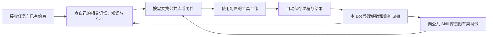

# 基础 Bot：自有历史、记忆、知识与 Skill 的持续维护

日期：2026-10-22。状态：设计，尚未实施。

本文按最新讨论收敛第一阶段范围：所有 Bot，包括临时 Bot，都具有相同的记录、学习和 Skill 维护能力；公共 Skill 库由专门的普通 Bot 维护；Codex 监督以后作为岗位 Bot 的工作开发。本轮只调整文档，不改代码、不启动服务、不运行测试。

> **2026-10-30 机制更新：** 本文关于自有历史、记忆、知识、Skill 和公共库的目标继续有效。内部运行和当前实施顺序以 [Bot 3+3 设计](BOT_3_PLUS_3_DESIGN.md)、[实施步骤](BOT_3_PLUS_3_IMPLEMENTATION.md)及[验收说明](BOT_3_PLUS_3_ACCEPTANCE.md)为准，尚未实施。任务分身收回单 Bot 多会话；维护对话负责限额总结及上下文组装；原分身交接步骤不再作为新建路径。

## 1. 基础 Bot 的定义

**基础 Bot 是一个有独立身份、能接收工作、保存自己的经历、提取知识、维护自己的方法并与同伴交换经验的运行单元。**

每个 Bot 都有一个初始偏向，例如组件、Unity 操作、资料整理、聊天室维护或公共 Skill 整理。初始方向帮助它选择工作与资料；它的实际专业性来自之后积累的知识、Skill、操作经验和纠错。

因此，“专业 Bot”不作为另一种特殊运行时。长期 Bot 与临时 Bot 使用同一本体，差别在生命周期、起始资料和承担的工作。临时 Bot 也能学习、维护自己的 Skill，并在结束时交出值得保留的增量。

这里的“基础”指每个 Bot 都带有的通用能力，并不意味着这些内容必须写成不可修改的程序。程序提供可靠记录、查询、编辑和触发；Bot 判断记什么、如何改、何时分享。身份、提示、知识和 Skill 仍可通过相应入口更新。

## 2. 每个 Bot 都要具备的七项基础

| 基础 | 必须能做什么 | 最小实现边界 |
| --- | --- | --- |
| 身份与工作方向 | 知道自己是谁、偏向什么、当前负责什么、能联系谁 | 独立 botId、简短档案、当前任务、联系人；不建立职业分类平台。 |
| 任务与执行 | 接收任务、调用已配置工具、保存状态、返回真实结果 | 继续使用通用 Pi Agent 和独立任务/会话，不内置 Codex 或 Unity 业务。 |
| 自有历史 | 保存自己收到的消息、判断输出、工具调用、结果和修正 | 自动记录原文；Bot 能跨自己的会话检索、摘要和引用。 |
| 自有记忆与知识 | 把经历整理成可复用的事实、约定、待办和有条件的结论 | 保存来源、适用范围、修订和状态；先共用一套存储。 |
| 自有 Skill | 查找、使用、新建、编辑、纠错、退役自己的工作方法 | Skill 正文、关联资源、使用版本与待更新事项都属于自身积累。 |
| 持续维护习惯 | 做事前取用相关积累；出错、被纠正、工作结束后继续整理 | 每个 Bot 默认带有维护机制；不靠用户每次提醒，也不靠某个岗位的提示词碰巧执行。 |
| 同伴与公共库协作 | 找同伴、查询公共 Skill、反馈问题、贡献改进、接收更新 | 复用 Bot 通信；公共库离线时，本地积累仍可使用和维护。 |

七项能力可以归结为一条基本工作循环：



这条循环是通用的。将来 Codex 监督 Bot、电脑操作 Bot、聊天室 Bot 只是在它之上配置不同工作方向和工具。

## 3. 历史、记忆、知识、Skill 分别是什么

| 内容 | 回答的问题 | 例子 |
| --- | --- | --- |
| 历史 | 我实际经历了什么？ | 某任务里读取了哪个文件，调用了哪个工具，返回了什么，用户如何纠正。 |
| 记忆 | 哪些与我或当前关系有关的内容要持续记住？ | 用户在本项目的约定、自己的未完成工作、同伴联系信息。 |
| 知识 | 在什么条件下，我目前知道什么？ | 某组件当前接口是什么；某种错误在特定版本下出现；哪个结论尚未确认。 |
| Skill | 遇到这一类工作，应怎样做？ | 操作步骤、前置条件、例外、失败处理、示例和可复用脚本。 |

这四种内容的区别首先是用途，不要求立刻创建四套数据库、四个服务或四种 Bot。

历史由程序忠实保存；Bot 维护历史的索引、摘要和纠错说明，不需要把每条日志再抄一遍。后来发现旧结论有误，应关联修正而保留当时实际发生的事。

记忆和知识第一版可以沿用 `memories`，补上类别、适用范围、来源与状态。Skill 作为有正文和资源的工作方法单独管理。会话压缩只是在控制上下文长度，不能代替这些长期积累。

## 4. 自有知识怎样进入下一次工作

“有保存工具”还不够。一个基础 Bot 要有默认的读取和整理时机，否则依然会发生存下了却没再用。

### 4.1 开始工作时

为当前任务提供少量常驻内容：自身方向、当前目标与用户明确约束，以及如何查找自己的积累。再根据任务检索相关记忆、知识和 Skill 的目录，按需读取正文。

旧历史、全部 Skill、所有专业资料不一次性放进对话。查询结果应带来源和适用条件；正在执行的任务记录实际读取过的 Skill 修订，避免后面把新版本误认为当时就已经采用。

第一版用关键词、标签、项目范围和明确引用即可，不先引入向量数据库或一个额外的记忆模型。检索无法保证找全所有相关内容，Bot 仍可继续查原文或询问同伴。

### 4.2 工作过程中

明确纠正、新发现、已知做法失效时，本 Bot 可以立即记下经验或修改自有 Skill，不必等到整个任务结束。

读取 Skill 时能知道它的来源、当前修订和待更新原因。发现不适用时，区分“本任务的例外”“该版本的问题”和“通用方法应改变”，不要把局部经历直接推广到所有项目。

### 4.3 一次工作结束时

完成、失败或中断都会留下实际记录；在这些事件上形成一项可恢复的整理事项。整理仍由这个 Bot 自己承担，使用同一个模型执行器和工具，不额外生成一个永久反思 Bot。

它只需要判断：

1. 本次有什么值得下次复用的事实或修正？
2. 使用过的 Skill 有没有错误、缺漏或变化？
3. 应更新已有内容、形成一份新方法，还是无需修改？
4. 哪些内容适合贡献公共库或交回母体？

**每次流程都有记录和整理机会，不等于每次都必须新增记忆、重写 Skill 或再调用一次模型。** 当前工作已完成相关整理时，关联其结果即可；没有实质新信息可以结束。纯消息确认不产生无意义的知识版本。

需要额外判断时，把它作为本 Bot 的短维护任务，使用独立的整理会话，读取源任务的必要片段。维护任务不能因为自己结束而无限触发新的维护任务。

任务结果与知识维护状态分开：用户可以先得到已完成工作的结果；未整理项持久保留，在下一次相关使用或允许的维护时机处理。明确的用户纠正和已知失效项优先处理，不能长期淹没在普通任务之后。用户主动暂停时不擅自继续模型调用。

### 4.4 程序与 Bot 各自负责什么

| 程序提供 | Bot 判断 |
| --- | --- |
| 自动写入真实消息、工具和任务记录 | 哪些经历具有长期价值 |
| 记录结束/纠正/失效事件与处理位置 | 应成为记忆、知识还是 Skill |
| 检索、按修订读写、持久化待处理事项 | 内容如何归纳，适用范围如何界定 |
| 在任务边界提供待维护提示 | 是否修改、如何合并、何时分享 |
| 发送消息并保留结果状态 | 遇到异常找谁、如何修复工作流程 |

程序保证“事情有记录、需要处理的项不会因一次退出而消失”，不能保证模型的每个结论都正确。必要的通用维护约定应由基础 Bot 默认提供；只在 components 或 memory 角色提示里写一句不够。

## 5. 每个 Bot 的自有 Skill

### 5.1 必要信息与操作

一份 Skill 最少记录：稳定 ID、目的、正文/资源位置、修订、适用范围、来源、相关依赖、当前状态，以及最近为何修改。

来源可以是自身经验、继承自母体，或者引用公共库的某个修订。引用公共 Skill 时还记录 `upstreamBotId/skillId/revision`；本地扩展不能冒充公共原版。

每个 Bot 都能完成：查目录、读内容、登记使用、创建或编辑、标记过时、保留修订、提出共享。这些操作通过自己的通用接口完成，不需要跨越普通工作目录限制去直接改安装包或别人的数据库。

### 5.2 可编辑文件与存储

建议继续使用每个 Bot 已有目录：

```text
D:/Relay-Bot-data/bots/<botId>/
  config.json
  state.sqlite                 历史、任务、记忆、索引、修订与待处理项
  resources/skills/<skillId>/
    SKILL.md                   可编辑正文
    references/                按需引用的资料
    scripts/                   实际需要时沉淀的脚本
  artifacts/                   工作产物
  workspace/                   自身工作区
```

这里没有新增环境或数据根。已安装的通用 Skill 可以作为起始资料；本 Bot 的持续积累保存在自己的数据目录。

Markdown 保持可读可改，SQLite 保存当前登记的修订、引用和必要正文快照。通过接口更新时使用整数修订与冲突处理；人工直接编辑也应能被重新载入并标记待整理。文件和索引更新中断时保留待协调状态，不假装两者已经同步。

同一个包中的引用说明、示例、脚本也是 Skill 的组成部分，其变化需要关联到相应修订。记录方法不会自动赋予执行某个外部工具的能力，实际操作仍使用 Bot 已配置的工具。

### 5.3 更新怎样生效

新任务按当前适用版本检索，正文按需读取。在途任务保留已经使用的版本记录；收到相关变化时形成待处理提示，不追溯改写它过去读到的内容。

第一版以任务边界刷新目录和相关资源为主，已知失效项在下一次使用前提示 Bot 处理。需要在长操作途中停止或改变执行的行为，后续由对应操作 Bot 实现；这里不预设 Codex 专属控制。

基础本体提供“报告变化、标记待更新、重读、接受修订”的接口。外部文件、Unity、网页等变化由接入的工具、同伴通知或实际使用发现；以后可以增加针对已登记依赖的观察能力，不先让每个 Bot 扫描整台电脑。

## 6. 公共 Skill 库由专门的 Bot 维护

公共库 Bot 使用同一个基础本体，偏向“整理共享方法”。它也有自己的历史、记忆、知识、自有 Skill 和待办；其中被声明为共享的 Skill 供同伴查询。第一阶段明确安排这一职责，不再只把它写成可有可无的目录。

它的工作包括：接收贡献、查找已有方法、合并重复内容、保留适用分支、处理过时说明、联系相关作者澄清问题，以及把实质更新通知已知使用者。

它不需要掌握全部领域知识。涉及 Unity 或组件具体事实时，与实际使用和维护这些内容的 Bot 协作。公共库的整理职责与每个 Bot 的个人维护并行存在。

### 6.1 最小协作流程

1. Bot 从公共库查询一个适用 Skill，记录来源和修订；需要离线使用时保留该版副本。
2. 在自己的工作中发现问题，先保存本地修正及实际来源。
3. 向公共库 Bot 提交一份具体贡献：基于哪版、发生什么、建议改哪里、适用什么条件。只发送相关内容，不自动共享全部私人历史。
4. 公共库 Bot 整理成适用的新修订，或保留问题并向作者询问；用户不需要逐条审批普通知识整理。
5. 使用方收到更新提示，或下次取用时发现上游已有更新；结合自己的适用范围更新本地引用。

共享记录属于公共库 Bot 管理，个人工作版本属于使用方。公共版本更新不直接覆盖各 Bot 的本地扩展；贡献被接收也不等于其内容已经采纳。

### 6.2 保持普通 P2P 协作

已知 Skill 的目录和正文读取可以走公共库 Bot 提供的普通数据接口，不必每次让公共库模型重新回答一遍。含义判断、合并和维护则通过消息形成它的普通任务。

基础 Bot 提供统一的本地 Skill 接口；配置为共享的记录可按现有联系人身份对外读取。私人记录不会因为开启共享库就全部开放。贡献和答复复用现有消息 ID、任务结果与持久发送机制，不必先建新的中央 Skill 服务。

公共库 Bot 不可用时，其他 Bot 继续维护自己的积累，贡献保留待发送。临时 Bot 不必等公共库完成整理才能结束，但其贡献和本地改进必须有继续保留的位置。

## 7. 临时 Bot 与分身同样完整

| 阶段 | 基础要求 |
| --- | --- |
| 创建 | 新身份、新历史空间；按任务继承必要的方向、记忆和 Skill 基线，不默认把母体所有对话灌入新上下文。 |
| 工作 | 自己记录经历，自己维护记忆、知识和 Skill；与母体/公共库保持明确来源关系。 |
| 结束 | 保存结果和整理状态；形成有来源的新增经验、Skill 修改或待处理项，交给指定接收方。 |
| 并行分身汇合 | 按各自基于的修订合并，不用最后结束的分身覆盖其他人的全部知识。 |
| 回收 | 可以停止进程；仍被引用或待处理的积累继续保留。无需等待所有公共贡献完成整理。 |

临时仅表示工作时长，不表示它可以缺少学习能力。第一版也不要求任何任务都创建分身，已有单 Bot 可以先完成自己的循环。

## 8. 当前代码已经有什么

本节依据本次读取的 `D:/Relay-Bot` 工作区源码，不代表正式安装中的运行结果。

| 能力 | 源码现状 | 最小缺口 |
| --- | --- | --- |
| 独立本体与身份 | Bot 有自己的配置、数据目录、Pi 执行器、HTTP 与任务队列。[运行时](D:/Relay-Bot/bot/src/runtime/bot.mjs:55) | 起始方向目前主要是 prompt/外部角色资料；需作为每个 Bot 可读的简短自身档案，不预制所有职业行为。 |
| 历史记录 | 消息、任务、会话、工具与事件已经持久化；模型消息结束时保存原文。[存储](D:/Relay-Bot/bot/src/storage/store.mjs:65)、[消息保存](D:/Relay-Bot/bot/src/agent/engine.mjs:177) | 不重建日志系统。补 Bot 可用的自身跨会话检索/读取；当前 `read_session_history` 固定在当前会话。[查询](D:/Relay-Bot/bot/src/context/context.mjs:90) |
| 自有记忆 | 通用核心工具已有 `memory_list/write`、`state_get/set` 和修订检查。[工具](D:/Relay-Bot/bot/src/capabilities/core-tools.mjs:28) | 补按范围检索、知识类别/状态及来源引用；下一次工作需有默认取用入口。 |
| Skill 使用 | 已有目录加载和按需 `read_resource`；正文每次读文件。[资源](D:/Relay-Bot/bot/src/context/resources.mjs:11) | 目录在初始化时加载；缺自有 Skill 的登记/编辑/修订、使用关联和任务边界刷新。[初始化](D:/Relay-Bot/bot/src/agent/engine.mjs:35) |
| 工作结束 | runtime 标记 completed/failed/interrupted，store 发出相应事件。[调度](D:/Relay-Bot/bot/src/runtime/bot.mjs:107)、[状态事件](D:/Relay-Bot/bot/src/storage/store.mjs:92) | 缺默认经验整理任务、处理位置及持续接续。当前完成记录本身不等于已经学习。 |
| 通信 | 核心已有 contacts/messages/tasks 工具，支持直接联系同伴和读实际任务结果。[工具](D:/Relay-Bot/bot/src/capabilities/core-tools.mjs:19) | 公共库可复用这些通道；补通用共享 Skill 的读取与贡献内容约定。 |
| 分身 | 已复制所选会话/记忆和自有资源，已有结果与记忆增量交付。[分身](D:/Relay-Bot/capabilities/bot-management/service.mjs:170) | 需把新增的 Skill 索引、基线和修改纳入初始化/交付；现有资源复制、记忆合并不会自动完成 Skill 合并。 |

因此当前已有的底层支撑应继续使用。真正要补的是通用的自身资料检索、自有 Skill 写入与修订，以及由任务事件驱动的持续维护；这些不能只落在组件 Bot 或 Codex 能力内。

## 9. 最小实现顺序

以下只是后续实施安排，本轮不修改实现。

### 第一步：让一个普通 Bot 管好自己的积累

复用 `state.sqlite`，扩展通用核心工具：

- 自身历史：跨会话检索和按引用读取，复用现有原文。
- 自身记忆/知识：在现有工具上补 query、scope、category、source、status，避免只能整份列出。
- 自有 Skill：最少有查找、读取、保存与状态更新入口；保存时记录修订及来源。
- 当前任务的 Skill 使用关系：在读取入口自动登记，不要求模型另外填一遍使用日志。

主要落点：`bot/src/storage/store.mjs`、`bot/src/capabilities/core-tools.mjs`、`bot/src/context/resources.mjs`。必要的自身档案用已有 config/state 保存，不增加独立岗位服务。

### 第二步：把维护变成每个 Bot 的默认习惯

在任务开始处提供少量相关积累入口；在实际工作结束、纠正或失效事件后形成待整理项；由同一个 Bot 分批处理，保存处理位置、内容修订或无需修改的结果。

主要落点：`bot/src/runtime/bot.mjs`、`bot/src/agent/engine.mjs`，以及一个小型自身积累模块。通用维护方法默认随 Bot 提供，岗位 prompt 只补方向和专门规则。任何临时/长期实例都走这条机制。

维护中断后恢复的是已有整理事项，不自动重放原任务的外部操作。当前用户任务和维护任务使用不同会话，避免复盘内容挤占执行上下文。

### 第三步：用同一本体建立公共 Skill 库 Bot

增加公共库岗位配置、贡献消息格式、共享目录读取与版本通知，复用已有 Bot 管理和直接通信。公共库的内容整理仍由 Bot 完成，其本地 Skill 存储复用第一步。

主要落点：公共库 `roles/` 配置、通用 Bot 的共享 Skill 读取入口、既有管理服务的岗位初始化。按现有正式流程更新既有实例的配置，不重建它们的身份和历史。

### 第四步：让临时 Bot 交出完整积累

沿用已有 clone/deliver/merge/archive，增加 Skill 来源基线和改进提交；按修订处理并行贡献，保留未整理项。使用普通 Bot 的相同接口，避免给分身实现另一套学习机制。

主要落点：`capabilities/bot-management/service.mjs`、`capabilities/memory-management/service.mjs`。先完成普通 Bot 的自身循环，再补分身交接，避免先改所有外围系统。

## 10. 当前第一阶段明确不包含的岗位开发

Codex 监督、Unity 操作、桌面导航、任务工单、聊天室管理和运行故障处理，都可以逐步成为带有不同工具与经验的 Bot 工作。它们共享本文的基础，不需要反过来成为每个 Bot 的内置业务。

这一阶段也不建设多种新模型、全仓知识图谱、全量向量检索或常驻自我讨论循环。继续使用现有正式数据根与进程管理，工作区已有其他修改不属于本轮。

第一阶段的目标是：**任何一个 Bot 做完有价值的工作，都能留下可追溯的经历，维护自己的知识和 Skill，下次使用这些积累；值得共享的改进能够送到公共 Skill 库 Bot。**

专业性在这条循环中逐渐形成。它依靠可取用、可修订的积累，不代表模型参数已经训练，也不能仅凭积累数量宣称已经成为某个领域的专家。
