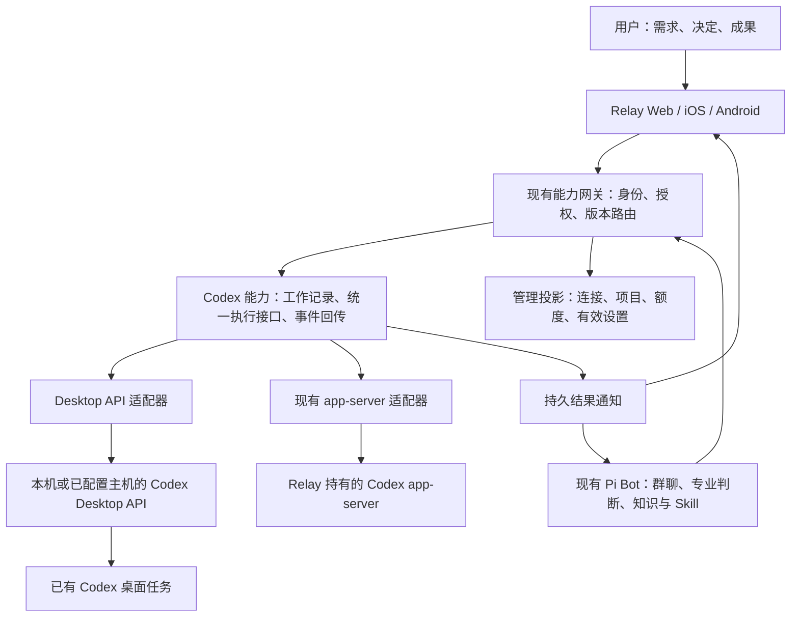

# Cindy 周边管理能力迁入 Relay Bot：设计与模块评估

日期：2026-10-27。状态：设计提案，未实施。

本轮只读三个仓库的当前源码并新增本文，不修改产品代码、配置、凭据或现有文档，不启动服务、不运行测试、不提交或部署。源码基点：Cindy `4fc89c26`、Relay Bot `ab914d7`、Codex Desktop API `d2265d6`。Relay 有大量既有未提交修改，本文读取的是当前工作区，不能将结论归为这些提交的全部内容；API 的既有临时文件未读取或改动。提交号仅用于定位，不是文件完整性校验。

本文是架构与抽取候选评估，不是所有文件逐行审计，也不是三个产品当前部署状态的验收。下文明确区分已读源码事实、设计建议与待验证能力。基础 Bot 的历史/记忆/Skill 维护设计仍沿用原优先级，本文不自动授权开始实现。

## 1. 产品裁决

Relay 面向策划等非代码用户：讨论需求、形成决定、委托执行、查看成果、提出修改。Bot 承担项目背景补充、专业咨询、提示词组织、执行跟进与经验维护。Codex 是 Bot 使用的工作工具之一。

本次迁移目标是减少账号、额度、执行连接、设备和设置的重复建设，不把 Relay 改成 Cindy/Codex 风格的开发工作台，也不把 Orca Lead/Worker 替换成 Relay 的组织模型。

推荐路线：**保留 Relay 现有 Pi Bot 和能力服务，在现有 Codex 能力中增加 Desktop API 后端；抽取 Cindy 低耦合逻辑，重做 Relay 所需的管理投影。** 不 fork 整个 Cindy Desktop，不把其 maker-core、Electron 主进程、数据库及官方账号链一起搬进来。

“干净的壳”在本方案中是可被 Bot、Web、iOS、Android 共用的管理接口与少量设置页面，不要求新增 Electron 应用或更换现有前端技术栈。

## 2. 三个系统的现状和所有权

| 系统 | 已核对的事实 | 迁移中的职责 |
| --- | --- | --- |
| Relay Bot | Bot 本体使用 Pi；聊天室、知识、Codex、Bot 管理等通过独立能力服务接入；Web 是界面与转发层 | 保留身份、群聊、专业积累、委托、人工交互与能力授权 |
| Relay Codex 能力 | `executor.mjs` 自行 spawn `codex app-server --stdio`；一个执行器实例持有一个 `active`；保存 works/threadId/turnId/serviceVersion，支持运行中 steer | 保留为 `codex-app-server` 后端，既有工作不转移所有权 |
| Codex Desktop API | HTTP 调用桌面端 create_thread/send_message_to_thread/read_thread 等；使用 Windows 私有桌面 IPC；支持幂等操作查询、状态/SSE、周额度 | 新增 `codex-desktop` 后端，复用用户现有桌面及任务，不另开执行器 |
| Cindy | 有可独立的纯逻辑包，也有 Electron、localDb、账号作用域、maker-core、远端与云服务深度交织的宿主层 | 提供实现候选和成熟行为参考，不成为 Relay 运行时依赖 |

重要：两个 Codex 后端创建的会话不是一套宿主管理关系。相同名称或相同工作目录不构成可互换证据。Relay Bot 的 Pi 是组织者运行时，不因为接入 Codex Desktop 就换成 Codex；Bot 模型与执行任务模型分别配置。

来源：[Relay 架构](ARCHITECTURE.md)、[Bot 引擎](../bot/src/agent/engine.mjs)、[当前 Codex 执行器](../capabilities/codex/executor.mjs)、[Desktop API 服务](../../Codex-Desktop-API/src/server.js)。

## 3. 迁移等级的定义

- **A：可直接抽取的候选**。文件级算法/解析器不依赖 Cindy 云服务或 Electron。仍需纳入 Relay 构建、类型和授权语境；不是目录复制后保证运行。
- **B：适配后复用**。价值明确，但需要替换存储、身份、事件、配置、日志或运行环境依赖。
- **C：服务端相关**。客户端源码不足以形成完整功能；需要 Relay 对应服务或显式第三方服务接入。改 base URL 不是完成迁移。
- **D：不整块迁入**。与 Relay 已有职责重叠或耦合过深，仅参考局部规则。

有些模块同时属于 B/C；“纯协议无运行依赖”不代表不需要服务端。以下复杂度是定性排序，不是工期承诺。

## 4. Cindy 模块清单与迁移结论

路径均相对 `D:/cindy`。这些是抽取边界，不授权同时建设所有功能。

| 模块与源码入口 | 等级 | 依赖/限制 | Relay 落点与决定 |
| --- | --- | --- | --- |
| `packages/maker-scheduler/src/engine/cron.ts` | A，低 | Intl 时区计算、纯解析；不含任务持久化或可靠投递 | 未来需要定时观察时抽取 cron 算法；沿用 Relay 消息触发，不先迁完整 scheduler-host |
| `apps/desktop/src/main/usage/modelUsageDelta.ts` | A，低 | 针对 Claude SDK 累计值；不能直接套所有事件格式 | 引擎事件能证明是累计值时复用差分思路/函数；Desktop API 没有相应完整指标时不造账 |
| `packages/file-browser-core` | A/B，中低 | Node 文件系统、`ignore`，搜索还需 ripgrep 与平台路径；不是访问控制层 | 确有成果目录浏览需求时抽取；包外叠加 Relay 项目权限，复用已有文件能力 |
| `packages/model-providers` | B，中 | 依赖 `model-compat`；目录含品牌、内置产品、接口与引擎语义；不是零依赖包 | 选取模型身份、能力合并、effort 校验等必要文件；不整包带入官方目录/品牌路由 |
| `packages/model-compat` | B，中 | 包内有固定版本上游模块和 Cindy 路由策略 | 仅新模型接入确有协议差异时评估闭包；第一阶段 Desktop API 不需要该代理层 |
| `model-providers/src/modelMetadataLayers.ts`、`effortResolution.ts` | B，中低 | 依赖类型、模型代际等同包文件；优先级与字段含业务语义 | 重用“来源+默认+实报+覆盖”的规则，抽必要闭包；目录声明不代表账号可用 |
| `apps/desktop/src/main/usage/*`、`usageBroadcaster.ts` | B/D，中高 | 配额刷新有可注入部分；广播器依赖 BrowserWindow、localDb、账号作用域、device-link | 额度 DTO 与刷新合并可借鉴；数据优先取 Desktop API，不复制 Cindy 账户采集和账本 |
| `provider-group/scheduler.ts`、`failurePolicy.ts` | B，中 | 算法与候选数据可分离；整组管理依赖账户、远程状态、用量来源 | 多执行端后再抽选择算法；先固定路由，禁止首版自动搬运活动会话 |
| `provider-group` 的 store/router/managementClient | B/C/D，高 | 远程组、分享、原拥有者授权、Cindy 本地 DB 与 device-link | 不整块迁；Relay 的工作执行端分配与模型账号池分别设计 |
| `packages/maker-remote-ssh` | B，中高 | ssh2/ssh-config/ws；RemoteHost 可独立，bootstrap 还牵涉安装包、凭据、远端 daemon | 后续按需抽连接/转发模块；不复制账号文件推送和自动安装整链 |
| `maker-cc-manager`、`maker-pi-manager`、`remote-file-service` | B，高 | 远端进程/版本/打包合同，宿主 glue 不在这些包里 | 第二类执行后端需求明确后再接；不为设置页上线提前迁三个 daemon |
| `packages/device-link-protocol` | A/B，中 | 协议包无 runtime 依赖，但 envelope/认证/分享语义与服务端配套 | 可借鉴消息 ID、能力协商；第一阶段无需搬 Cindy wire 协议 |
| `packages/device-link/src/client.ts`、allowlist 等 | B/C，高 | 依赖 device-link-protocol；含分享/任务协议和 Cindy IPC 白名单 | 不把 Cindy IPC 搬为 Relay 公网 API；需要自有 Relay 执行端协议与配对 |
| Desktop `main/device-link`、`remote-agent` | C/D，很高 | authManager、所有者作用域、Electron、localDb、MCP、文件与凭据通道 | 不迁整体；后续只复用明确分离的传输部件 |
| `packages/auth-client`、`main/authManager.ts` | C/D，高 | 前者只是 auth-server 客户端合同；后者依赖官方认证、回调、safeStorage、升级和账号边界 | 不用 Cindy 登录作为 Relay 用户身份；Relay 身份与设备授权单独补齐 |
| `main/model-access`、供应商 OAuth/BYOK 流程 | B/C，高 | 部分可直连厂商，部分经 oauth-broker/model-access；回调与 client 注册不能假定可移植 | Desktop 后端登录仍由 Codex 处理；Bot BYOK 先沿用 Relay，后续逐供应商建立能力表 |
| `main/secrets/providerSecretStore.ts` | B/D，高 | Electron safeStorage、appSessionState、所有者命名空间、BYOK 与插件 secret 类型 | 不直接引 Electron；定义 Relay credentialRef，秘密留现有私密数据边界，后续宿主注入加密存储 |
| 设置 UI：`renderer/components/settings/*` | D，中高 | React hooks、IPC、i18n、store、provider/runtime/主题组件；Relay Web 是现有 JS，移动端原生 | 迁信息结构与交互规则；用现有 Relay 组件重做，不复制整个 TSX 页面 |
| `packages/design-tokens` | B，中 | 生成链、主题字典及 Cindy 视觉语义 | 可参考主题组织；保留 Relay 人物与产品语言，不先做设计系统替换 |
| `main/maker-host`、`maker-ipc`、`packages/maker-core` | D，很高 | 生命周期、权限、数据库、提示词、供应商代理、IM、Orca 等广泛耦合 | 不迁“整个 Codex 管理器”；保持后端适配器，优先现有 Desktop API |
| `main/local-agent` | D，高 | 依赖 maker-core、Cindy 身份/提示词、授权与恢复状态；API 仅本机 | 不把它当独立通用执行服务或 Desktop API 替代品 |
| Orca、Bot/companion-cloud、bot-groups | D，云部分 C | 团队会话与角色/云 Actor 合同 | 保留 Relay Pi Bot、P2P、群与知识体系；仅借鉴回报/去重细节 |
| `main/worktree`、git-review、terminal、input-handoff | B/D，高 | 宿主文件/进程权限、UI、跨端事件与数据库 | 第一期沿用 Codex；Desktop API 未暴露的操作不做假按钮或调用其内部 DB |
| Skill 扫描/导入纯规则与 SkillHub | B/C，中高 | 本地扫描可分离；市场、组织安装、发布依赖 hub 服务与包状态 | 保留 Relay Skill 所有权/版本设计；不把公共 Skill 库 Bot 变成 Cindy 市场客户端 |
| `.cindy` 插件运行时与市场 | D/C，很高 | 沙箱、批准记录、能力 slot、资产协议、签名/分发和账户边界 | 不迁；Relay 外部能力服务继续作为扩展接口 |
| IM hook、云伙伴、推送、语音/媒体、billing、更新 CDN | C/D，高 | 各自云端、对象存储、认证、计费或发行链 | 非本次主线；按实际需求逐个接入独立供应商或 Relay 服务 |

### 4.1 “可直接迁”的准确范围

目前没有证据支持“把 Cindy 登录/远程/额度设置目录复制到 Relay 即可使用”。接近直接复用的是 cron、部分纯数据计算及文件扫描。模型目录、SSH、协议包虽无 Electron 依赖，仍要带最小依赖闭包并替换产品合同。

抽取顺序：选具体函数 → 查实际 import 闭包 → 明确输入输出与副作用 → 转成 Relay 独立模块 → 替换 Cindy 品牌/云端/存储引用。最终发行物不能 import `D:/cindy` 源目录，也不能依赖它的 node_modules 或私人配置。目前仅完成代表性入口与依赖检查，逐函数完整闭包留在实际实施时确认。

## 5. 哪些需要服务端：明确替代方案

Cindy 的 `config/endpoint.global.json` 实际配置了 auth、chat、device-link、oauth-broker、oss、heartbeat、model-access、SkillHub、plugin、voice、IM hook 和 CDN。客户端根 README 明确后端在独立仓库。客户端代码存在不代表这些服务可以随仓自部署。

| 依赖域 | Cindy 服务承担的事 | Relay 选择 |
| --- | --- | --- |
| 用户/组织身份 | 登录、token、账号/组织边界 | 首版复用 Relay 现有 controller/Bot 授权；明确它不是完整多人 RBAC。面向多人前新增真实用户与项目/设备授权，不把 controller token 发给所有策划 |
| 设备发现与中继 | 在线状态、连接建立、同账号/分享路由 | 首版注册明确的 Desktop API 连接，支持本机/已配置受控地址；自动发现、反向隧道、穿透另做阶段 |
| 云模型目录与用量/计费 | 下发目录、覆盖、产品套餐与账务 | 自维护小目录或后端实报；只展示有来源的数据，不接 Cindy model-access 作为默认依赖 |
| OAuth broker | 托管回调、厂商授权流程 | Desktop 登录交给 Codex；其他厂商逐项选择直连授权或 Relay 自有回调服务，不复用 Cindy client 身份 |
| 云伙伴/群历史 | 云端 actor、房间、消息与主力电脑 | 保留 Relay Bot/聊天室数据，不建第二份身份和群历史 |
| OSS/市场/更新 | 附件上传、插件和 Skill 分发、客户端更新 | 保留 Relay 正式数据根、能力发行和安装流程；不携带 Cindy 公共端点作为静默 fallback |

部署仍使用唯一正式环境 `D:/Relay-Bot-data`，入口 `https://bot.lin0.org`。功能分阶段不意味着另建开发/预览数据根或服务。具体远程网络配置不在本轮执行。

## 6. 目标架构：沿用能力服务，不加智能总管



这里的管理投影是职责边界，第一版不增加新的常驻服务。连接配置、工作和事件由 Codex 能力持有，网关只鉴权与路由。Bot 通过能力工具使用它，Web 不持有执行循环。以后接 CC/Pi 工作执行器时复用接口；不为它们再造一套 Bot 人格或组织。

### 6.1 执行接口（拟新增，非现有 API）

由服务内部适配器提供以下操作；现有 `codex_*` 工具先保留兼容，不要求 Bot Skill 一次性改名：

| 操作 | 语义与限制 |
| --- | --- |
| `capabilities(connectionId)` | 返回真实支持项、连接状态、版本、模型来源及已知限制 |
| `listProjects(connectionId)` | 返回执行端的稳定项目 ID；不能用本机路径代替远端 ID |
| `createWork(brief, route, requestId)` | 保存委托和幂等键，调用后端创建；结果区分 accepted/unknown/failed |
| `sendUpdate(workId, updateId, content)` | 固定发往原绑定；后端无法保证原生 steer 时不冒充 steer |
| `readWork(workId, cursor)` | 返回后端状态、历史与裁剪标记；读取失败不将工作标为完成 |
| `interrupt(workId, expectedTurnId)` | 仅停止指定轮；失败/未知仍保留实际状态，不伪造 cancelled |
| `archive(workId)` | 与停止分开；不能把归档解释为取消或删除 |
| `subscribe/reconcile` | 订阅已知工作，缺口按快照对齐；只读恢复不重放写请求 |
| `readAccountUsage(connectionId)` | 返回有来源、有范围、有时间的额度快照；未知为 null |

后端 capability 至少区分 `nativeSteer`、`sendWhileRunning`、`approvalReply`、`modelDiscovery`、`loginManagement`、`worktreeCreate`、`remoteExecution`、`historySummarized`、`usageWindows`。缺能力必须明确返回 unsupported，而非让模型猜测替代命令。

### 6.2 数据关系与所有者

扩展现有 works，建议字段：

```text
Work
  id, botId, roomId, sourceMessageId, goal, constraints, inputRefs
  serviceVersion                         # 保留现有能力版本所有权
  backendKind                            # codex-desktop | codex-app-server
  connectionId, endpointGeneration        # 指定后端服务，防止连接被换绑
  hostId, projectId, workingDir
  externalThreadId, currentTurnId
  requestedModel, requestedThinking       # 用户请求
  effectiveModel, modelObservationSource  # 后端可证明的实际值，未知为 null
  briefRevision, lastEventCursor, observedAt, stale
  executionState, deliveryState, reviewState
```

外部会话标识采用 `(backendKind, connectionId, hostId, externalThreadId)`；仅 threadId 不够。已有 threadId/turnId 保留兼容映射，不能直接批量改指向 Desktop。

`executionState` 表示执行事实，`deliveryState` 表示已接受/结果未知等投递事实，`reviewState` 表示 Bot/用户是否认可成果。Codex 一轮完成不等于业务目标完成，避免堆成一个含义混杂的 completed。

其他建议记录：

- `executorConnections`：地址、类型、显示名、credentialRef、能力快照、最后可见时间；不含前端可见密钥。
- `workUpdates`：来源消息、目标 work、明确正文、修订、supersedes、稳定 requestId、投递状态。
- `workNotifications`：事件来源、接收 Bot/群、持久去重键、发送状态；成功入 Bot 收件箱后确认。
- `usageSnapshots`：来源连接、账号标识（无法获得时 null）、额度窗口、观测时间、unknown/stale；不冒充账单。

Bot 的私有知识留在自身存储；群消息留聊天室；原始 Codex 历史由后端持有，Relay 只保存委托、必要事件/摘要与引用，不强制复制完整轨迹或制造另一份事实源。

## 7. Desktop API 接入的逐项映射与缺口

本节依据现有 `src/server.js`、`validate.js`、`app-tools.js` 与 `docs/webhook.md`，不是按桌面 UI 能力反推 HTTP API。

| Relay 需求 | 已有 API | 结论 |
| --- | --- | --- |
| 连接检查 | `GET /v1/capabilities` | 可用；保留桌面连接/协议能力，不只看 healthz |
| 项目选择 | `GET /v1/projects` | 可用；建立业务项目→执行端保存项目映射 |
| 创建正式任务 | `POST /v1/threads` | 可用；项目只支持 environment.local，或 projectless；未开放新 worktree/任意 cwd 创建 |
| 续发与运行中追加 | `POST /v1/threads/{id}/messages` | 可用；202 表示接受，具体排队/插话由桌面处理；不等价 app-server turn/steer |
| 历史与状态 | `GET .../{id}`、`.../messages`、`.../state` | 可用；历史为摘要、可能截断；state 不自动唤醒冷任务 |
| 停止 | `POST .../{id}/interrupt` | 需要 expectedTurnId；协议支持以实时能力为准 |
| 重命名、归档、恢复 | PATCH / archive / unarchive | 可用；不要借归档模拟取消 |
| 幂等核对 | `GET /v1/operations/{key}` | 可用；结果不明不能换键重试创建 |
| 事件 | `GET /v1/events` | 已有 journal、cursor 与缺口响应；应指定 work 的 thread/host 订阅 |
| 额度 | `GET /v1/account/usage` | 仅周窗口（10080 分钟）百分比、重置时间；仅当前端点本机桌面账号范围 |
| 模型列表 | 无专门模型目录 endpoint | 不使用 Cindy 目录猜测；首版用管理员显式配置/桌面默认，后续再增只读能力 |
| 登录/登出/换号 | 无 | 由用户在 Codex 完成，Relay 只给指引与重连；不读写 auth.json |
| 回答桌面审批 | 无 | 提示到 Codex 处理；Relay 对话确认不等于桌面批准已提交 |
| 五小时额度、完整按任务 token 账本 | 当前 usage endpoint 无 | 留空/不展示；需要未来 API 扩展或有来源的独立事件 |
| 跨机完整支持 | hostId 可转发既有连接，但仓库文档只记录本机验收 | 显式能力与实际部署后再开放，不能宣称远程功能已完成 |

首版选定业务项目必须已登记在目标 Codex 桌面项目列表中；没有映射时报告缺失，不悄悄创建 projectless 任务以免改错目录。

### 7.1 启动、未知结果和恢复

创建前保存 work 与固定 requestId，再用同一 Idempotency-Key 调用 API。正常回包保存真实 threadId；若返回排队创建标识，保持 pending，不把客户端标识当 threadId。网络超时先查 operations，再查已知目标状态；不能自动创建第二份工作。

同一连接恢复只影响绑定该连接的工作，不能重启所有 Bot 或所有后端。API 不可用时标 stale/unavailable，Codex 可能仍在执行；禁止自动转到 raw app-server 重做。

关闭 Relay Web 不停止执行；重启能力服务恢复绑定与订阅，不重新提交 prompt。更换连接地址/身份必须更新代次，旧回包不能写进新连接的账户或任务记录。

### 7.2 事件与 Bot 唤醒

首版建议以已知工作的 SSE + 只读状态核对为主，webhook 作为可选唤醒提示。原因：现有 webhook 队列在内存，重启会丢未完成通知；首次历史终态不补发，发现范围有限。它不是可靠业务队列。

Relay 接到事件先保存和去重，再向负责此工作的 Bot 投递稳定消息 ID；仅在有意义的完成、失败或待用户输入时唤醒。相同 turn 的重复状态不重复启动 Bot。SSE cursor 过期时按 API 409 重新取快照；缺口不能伪造成完整事件流。

原群 `chatroom.append` 和 Bot 收件箱投递是两个动作。当前 builtin 的 onResult 主要向群追加记录，迁移必须显式增加给对接 Bot 的持久通知；否则页面有“完成”但 Bot 没有接着工作。

运行中用户补充、专业意见和用户已确定的新要求保留来源与委托修订；按单一对接者串行提交。其他 Bot 提议不能自动升级成用户授权。对接者正常继续需服从具体工作规则，例如 QA Skill 的“禁止后续发消息”依然有效。

## 8. 登录、模型、额度与设置的具体设计

### 8.1 三种身份必须分开

1. Relay 使用者/管理员：能查看哪些工作、控制哪些 Bot、操作哪些连接。
2. Bot 推理供应商：现有 Pi Bot 使用的模型及凭据。
3. 工作执行端账号：例如 Codex 桌面当前登录账号及其订阅。

连接 Desktop API 的 Bearer 只证明可以调用该桥接服务，不是 Codex 订阅凭据，也不是所有 Relay 用户的身份。首版不搬 Cindy 的官方登录，也不接管桌面账号切换。

现有 Relay controller/Bot allowedTools 不能被描述为已经具备企业多租户授权。多人访问前要为工作、项目、连接增加用户作用域，后端校验，而不是仅隐藏前端按钮。首版保留受信任管理员范围，不因加页面而扩大控制权。

### 8.2 模型设置

Bot 模型设置与工作执行模型分屏/分组，避免“换助手模型”意外改变正在执行的 Codex 任务。每个连接声明其真实支持能力。模型 ID 绑定后端/连接；Cindy 的 GPT/Grok 条目不能直接作为 Codex Desktop 模型 ID 使用。

Desktop API 未暴露动态目录时，管理员可配置明确已知的 model/thinking，或不指定以沿用桌面配置；显示“由桌面决定/尚未读取实际模型”，不展示虚假的全部模型选择器。后续扩展 API 的只读模型发现，再接可抽取的目录合并逻辑。

配置采用默认值+显式 override；恢复默认删除 override，不能写死今日默认。进行中的 work 保持原路由；修改默认只影响新工作。跨后端/跨引擎切换作为新委托交接，不承诺无损恢复原上下文。

### 8.3 额度和用量

首版展示当前 Desktop API 能提供的周额度：已用/剩余百分比、重置时间、更新时间、连接与来源。展示在管理员资源页，普通用户仅在影响工作时看到“执行资源暂不可用”等具体状态。

必须区分：

- **订阅额度**：百分比窗口，不是 token 数或余额；空值不代表无限或未使用。
- **实际 token 用量**：只有真实事件才能计量；Bot 推理与 Codex 执行分列。
- **费用估算**：参考价计算不是厂商结算；当前 Desktop 周额度不能推导实际金额。
- **预算限制**：Relay 自定义约束，若以后实现应独立标注；不是厂商配额。

同一账号多个端点可能重复报告，账号身份未知时不得汇总为多份可用额度。遇到限额先显示并交给既定工作策略；首版不自动换号、不消耗 reset、不为了均衡额度迁移活动线程。

### 8.4 管理界面与普通工作界面

保留 Relay 现有 Web、iOS、Android，不引入 Cindy React/Electron/Expo 全栈。管理信息结构建议：

- 执行连接：连接名称、后端、可用性、项目映射、能力缺口；凭据只显示已配置状态。
- 账号与额度：按真实来源展示，不展示未接通的厂商卡片。
- 工作默认值：每个业务项目的执行连接、目录映射、模型偏好。
- Bot 设置：独立的模型/工具/Skill 入口，保留角色和长期积累。
- 高级项：事件断点、协议状态、错误详情与运维设置。

普通用户默认看到需求、负责助手、实质进展、产物和必要决定。高级日志与原 Codex 入口按需展开。后续 UI 实施使用 Relay 的视觉语言和现有双主题机制，分别确认 Light/Dark 实际结果；本文没有产出视觉稿或声称已双模式验证。

## 9. 远程能力分层，避免一次复制整个 device-link

| 阶段/模式 | 作用 | 不应混淆的边界 |
| --- | --- | --- |
| 已有手机/Web 访问 Relay | 远程与 Bot 讨论、看工作 | 不等于 Agent 在手机或另一台电脑执行 |
| 注册 Desktop API 端点 | 控制已部署桥接服务管理的桌面任务 | 连接可达、鉴权与目标项目需要真实确认；不自动解决 NAT 或穿透 |
| 使用桌面已有 hostId | 桌面转发到其已连接主机 | 由桌面管理远端；API 支持情况与验收单独确认 |
| 后续 SSH 执行后端 | 指定远端文件、进程和工作目录 | 可抽 Cindy SSH 模块；不是沿用本机路径，也不是迁移已有桌面线程 |
| 后续自有执行节点/中继 | 多设备配对、反向连接、撤销、状态同步 | 需要 Relay 服务端工作，不能靠复制 device-link client 获得 |

首版只做明确注册的连接。远程请求走现有认证边界与受控传输，不将 API token 下发给浏览器/Bot prompt。网关服务端调用目标端点。已有代理/公网地址是否可用需按实际部署确定；本设计不改监听地址或网络策略。

Cindy 的“Agent 在 A，文件与命令在 B”的供应商共享还包含远程工具执行通道，不是普通 API 转发。Relay 首版固定工作、文件与执行宿主关系，不迁这种拆分，不从 Codex Desktop API 推断支持它。

## 10. 并发、目录和现有工作兼容

现有 raw executor 的单 active 是实现事实；新增 Desktop 后端不应顺手解除它的队列。可以先串行运行 Relay 发起的工作，后续按需要增加并发。

Relay 的目录锁不能阻止用户在 Codex 桌面或外部编辑器直接修改同一目录。因此不能宣称 Desktop 接入继承了跨应用排他保证。后续并行默认以显式任务文件范围和项目调度为依据；共享目录有已知重叠时串行，不自动改分支/建 worktree。

迁移规则：

1. 旧 works 无 backendKind 时只在兼容读取层解释为 `codex-app-server`；保留 serviceVersion 和原会话。
2. 新配置显式选择 `codex-desktop`；每个新 work 固定 backendKind/connectionId。
3. 不导入、复制或重写 Codex 私有数据库，不改其安装目录、账号文件。
4. 既有用户桌面任务只有在明确选择后才绑定为 Relay 工作；列表可见不等于允许接管。
5. 取消绑定只停止 Relay 管理，不删除桌面历史；停止、归档分别执行。
6. 回退只改变新工作的默认后端；已发出的 Desktop 工作仍保留原记录，不自动在 raw 后端重跑。
7. 跨能力版本的在途工作继续由原版本收口；沿用现有 prepare/ready/committed 与排空机制，不用升级抢占任务。

## 11. 拟议代码落点与交付阶段

路径是实施建议，本轮未创建这些代码文件。避免一次引入新平台或独立管理 daemon。

| 阶段 | 最小改动范围 | 可观察结果 | 暂不包含 |
| --- | --- | --- | --- |
| P1 桌面执行闭环 | `capabilities/codex/backends/desktop-api.mjs`、适配器合同、现有 executor 包装、builtin 工具接线、连接记录和事件回传 | Bot 在指定已有项目创建正式桌面任务，结果回同一 Bot/群；重连不会重复创建 | Cindy 云登录、多引擎池、自动换机、完整新设置 UI |
| P2 管理壳最小版 | Codex 能力的连接/项目/额度查询，gateway 白名单投影，Web 管理页面；原生端随后同合同接入 | 管理员看连接、周额度、项目与有效默认；普通用户只见工作和产物 | 未暴露的登录、模型目录、审批、五小时配额 |
| P3 补齐必要 API 能力 | 在 Codex-Desktop-API 独立明确扩展模型发现/额度窗口等；版本能力协商 | 只有后端确实支持后才开放相应设置 | 通过读私库或伪造厂商数据绕过缺口 |
| P4 远程与多执行端 | 明确需求后抽 SSH/连接算法，新增节点身份和项目映射 | 工作在明确的目标机器执行，文件归属清楚，断线不误重跑 | Cindy 跨账号供应商分享、活动会话自动搬迁 |
| P5 可选资源池/其他引擎 | CC/Pi 执行适配器、真实 usage 数据后再引调度算法 | 专业 Bot 可按工作选择合适执行器；账号用量有来源 | 用资源池代替用户决策、默认扩大自动执行权限 |

P1 与基础 Bot 设计是两条可独立推进的能力线；先接工作闭环不代表专业知识持续维护已完成。第一项实现应是一个工程 Bot 经 Desktop API 发出一项真实授权委托，而不是先复制 Cindy 全部设置页。

### 11.1 未来实施的结果检查口径

本轮不执行或新增测试。未来按用户授权进行必要运行时，检查实际结果：创建回执有真实会话；断网未知不重复创建；同一完成事件只唤醒一次 Bot；已有任务未被接管；周额度缺失显示未知；不支持审批时能正确指回桌面；后端切换不迁移在途工作。它们是产品完成条件，不要求新增一套回归系统、临时环境、哈希报告或额外交付门禁。

## 12. 风险、停止范围与待决定事项

| 事项 | 已知边界/设计决定 |
| --- | --- |
| 桌面私有 IPC 漂移 | Desktop API 已隔离适配器，但不能保证未来版本兼容；能力失效时停止对应操作并保留 work，不全局停 Bot |
| 成果与模型错误 | 管理壳不能证明模型判断正确；reviewState 与执行终态分开 |
| 账号/权限 | 目前单机 controller 不等于企业权限；多人开放前必须落实用户/项目/连接作用域 |
| 云服务缺失 | 本轮未拿到 Cindy 服务端源码；服务契约只可作设计参考，不宣称可私有化整套服务 |
| 协议与凭据 | 跨端 contract、秘密存储、账号换绑是实施敏感点，动手前按所属仓规则说明具体风险；本轮无变更 |
| 前端复用成本 | Cindy 的 TSX 依赖不适合直接塞入现有 JS/Swift/Kotlin；优先复用信息结构与纯逻辑 |
| 许可与品牌 | 已读根 Apache-2.0 和若干包声明；实际复制时保留适用 LICENSE/NOTICE/版权与修改说明，检查所选文件及第三方子模块；品牌、图标、云端访问资格不随代码自动获得。此为工程迁移处理项，不是完整法律结论 |

本提案默认：保留 Web/原生端；新工作优先 Desktop API；旧 raw 工作保留；首版本机/显式连接；不接 Cindy 云账号；不建 Orca 式新组织层。未来实现若要改成 fork Cindy Desktop、全面接管登录或一次建设多人远程中继，应单独改方案和范围，而不是作为本次迁移的隐含步骤。

## 13. 来源索引

以下相对链接从本文件可导航到同一 D 盘工作区；部署后源码不在这些位置时仅用于设计追溯。所有“可迁”判断基于当前工作区静态阅读。

### Relay

- [项目规则](../AGENTS.md)、[开发约定](DEVELOPMENT.md)、[能力服务](CAPABILITY_SERVICES.md)。历史文档中与当前单正式环境、不自动测试/哈希规则冲突的内容不采纳。
- [专业组织目标](P2P_BOT_RUNTIME_DESIGN.md)、[基础 Bot](BOT_FOUNDATION_DESIGN.md)、[监督缺口对照](PROFESSIONAL_BOT_MINIMAL_PLAN.md)。这些文档标注的设计状态不冒充已上线。
- [Bot 引擎](../bot/src/agent/engine.mjs)、[Codex 执行器](../capabilities/codex/executor.mjs)、[能力装配/回报](../capabilities/services/builtin.mjs)、[网关授权](../capabilities/gateway/index.mjs)。

### Codex Desktop API

- [README 与边界](../../Codex-Desktop-API/README.md)、[路由](../../Codex-Desktop-API/src/server.js)、[参数限制](../../Codex-Desktop-API/src/validate.js)。
- [桌面工具与周额度归一化](../../Codex-Desktop-API/src/app-tools.js)、[状态订阅](../../Codex-Desktop-API/src/broker.js)、[Webhook 合同](../../Codex-Desktop-API/docs/webhook.md)。

### Cindy

- [仓库地图](../../cindy/docs/dev-rules/repo-map.md)、[模型维护规则](../../cindy/docs/dev-rules/model-catalog-maintenance.md)、[配置覆盖规则](../../cindy/docs/dev-rules/configuration-and-overrides.md)、[远程形态](../../cindy/docs/dev-rules/remote-and-mobile-adaptation.md)。
- [官方服务端点](../../cindy/config/endpoint.global.json)、[authManager](../../cindy/apps/desktop/src/main/authManager.ts)、[auth-client](../../cindy/packages/auth-client/package.json)、[secret store](../../cindy/apps/desktop/src/main/secrets/providerSecretStore.ts)。
- [模型包](../../cindy/packages/model-providers/package.json)、[元数据合并](../../cindy/packages/model-providers/src/modelMetadataLayers.ts)、[兼容包](../../cindy/packages/model-compat/package.json)。
- [额度广播器](../../cindy/apps/desktop/src/main/usageBroadcaster.ts)、[刷新协调](../../cindy/apps/desktop/src/main/usage/codexAccountUsageRefresh.ts)、[累计差分](../../cindy/apps/desktop/src/main/usage/modelUsageDelta.ts)。
- [设备客户端](../../cindy/packages/device-link/src/client.ts)、[设备宿主](../../cindy/apps/desktop/src/main/device-link/index.ts)、[协议包](../../cindy/packages/device-link-protocol/package.json)、[SSH 导出入口](../../cindy/packages/maker-remote-ssh/src/index.ts)。
- [供应商组调度](../../cindy/apps/desktop/src/main/provider-group/scheduler.ts)、[组管理依赖](../../cindy/apps/desktop/src/main/provider-group/managementClient.ts)、[供应商分享](../../cindy/docs/product-rules/provider-sharing.md)。
- [设置向导](../../cindy/apps/desktop/src/renderer/components/settings/AddProviderWizard.tsx)、[设计规范](../../cindy/docs/design-rules/DESIGN.md)、[本机 Agent API](../../cindy/docs/local-agent-api.md)、[Orca 架构](../../cindy/docs/dev-rules/orca-team-architecture.md)。
- [cron 解析](../../cindy/packages/maker-scheduler/src/engine/cron.ts)、[文件浏览包](../../cindy/packages/file-browser-core/package.json)、[许可证](../../cindy/LICENSE)。
