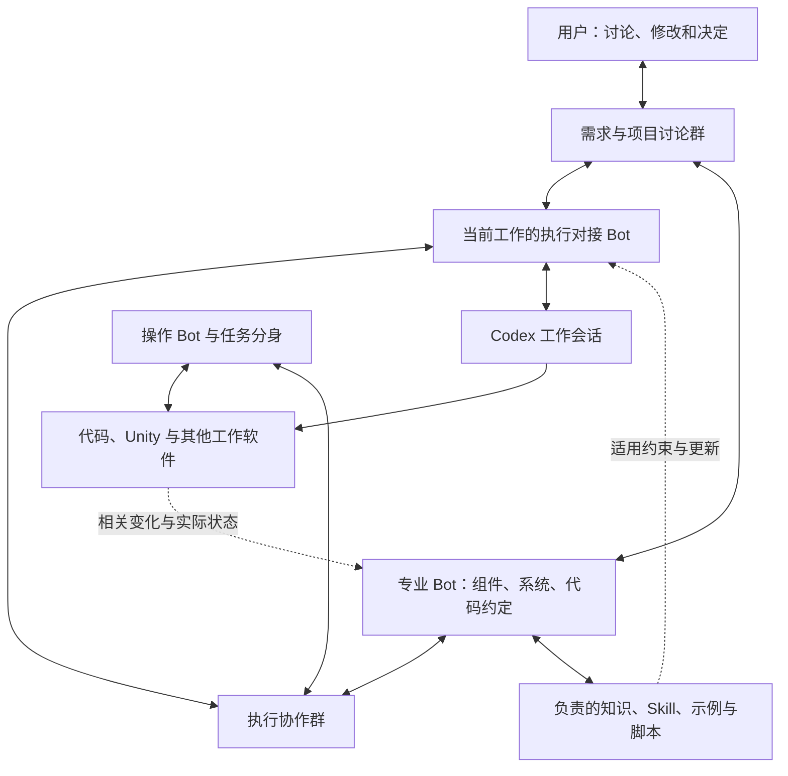
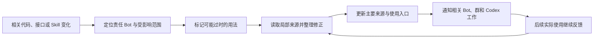

# Relay-Bot：专业知识维护、Codex 监督与多群协作设计

更新日期：2026-10-22  
状态：产品与运行体系设计；本轮仅修订文档，不改代码、不配置或启动服务。  
沿用文件名：`P2P_BOT_RUNTIME_DESIGN.md`，便于从原有入口继续查阅。

本文按本轮进一步明确的原始目标重整：Relay 是长期使用真实电脑工作的虚拟员工体系，承担用户在多个执行 Agent 之外反复进行的背景补充、专业提醒、进度观察、意见传递和经验维护。全 Bot、P2P、分身与群聊用于支持这些职责。

本文中的行为、记录与接口都是目标设计，不代表当前版本已经实现。现有实现说明见 [架构文档](D:/Relay-Bot/docs/ARCHITECTURE.md)，开发约定见 [开发说明](D:/Relay-Bot/docs/DEVELOPMENT.md)。用户后续明确要求优先；本文不把历史方案中的测试、哈希、临时环境或额外交付检查带回当前流程。

当前第一阶段以 [基础 Bot 设计](BOT_FOUNDATION_DESIGN.md) 为准：每个长期或临时 Bot 都维护自己的历史、记忆、知识与 Skill；公共 Skill 库由专门 Bot 维护；专业性通过初始方向和持续积累形成。Codex 监督留到后续岗位开发。此前的 [Codex 监督与专业协作源码对照](PROFESSIONAL_BOT_MINIMAL_PLAN.md) 保留为后续参考，不再作为第一阶段改造顺序。以下产品目标仍然保留，各方案均未实施。

## 1. 核心问题与产品目标

### 1.1 用户目前承担的隐形工作

游戏研发同时涉及通用组件、代码约定、业务系统、资源、Unity、运行中的游戏和设备。把这些内容保存成 SQL、Markdown 或 Skill，解决了知识存放的问题，却没有保证它们会在合适的时候参与执行。

一个持续工作的 Codex 对话，需要理解目标、检索规范、规划、编辑代码、操作软件、处理报错，还要记住之前的约定。具体操作不断引入新上下文，既有约束可能被忽略。用户很难提前知道它会遗漏哪一项，因此只能持续查看进展、提醒组件用法、修正方向，并在不同会话之间搬运信息。

Skill 还会随项目变化失效：最初编写后，代码、接口、示例、脚本和人的工作习惯分别发生变化；如果没有人持续负责同步，它会以“看起来仍然完整”的形式继续误导执行者。

### 1.2 Relay 要承担的责任

**文档保存知识，专业 Bot 持续负责相关知识的维护、使用和纠错；Relay 将这些专业责任与正在进行的工作连接起来。**

| 用户当前需要亲自做的事 | Relay 应承担的工作 |
| --- | --- |
| 反复提醒通用组件和项目约定 | 专业 Bot 为当前任务提供适用约束，并关注相关变更 |
| 监控 Codex 是否偏离目标 | 按领域观察实际工作，在发现具体偏差时介入 |
| 把讨论整理成长提示词 | 从已有讨论形成简洁、可执行且可更新的委托 |
| 在多个会话重复解释修改意见 | 找到受影响的工作，传递同一项决定及各自需要的调整 |
| 逐个打开会话看进度 | 汇总当前结果、实际阻碍和需要用户决定的问题 |
| 想起某个 Skill 可能已经过时 | 根据依赖变化和使用反馈维护其适用性与内容 |
| 每次重新教同一种工作 | 将本次修正沉淀到负责该领域的知识、Skill 和工具中 |

产品效果应体现在用户少写重复提示、少做信息搬运、少为同一个已知问题反复纠正。Bot 数量、群数量和自动消息数量不作为成果。

### 1.3 持续工作与实际电脑

工作主要发生在具有 CPU、GPU 和真实应用的本地实体机上。模型可以来自远程服务。Codex、Unity、浏览器及其他软件是员工使用的工作工具。

24 小时在线表示能够持续接收消息、保留工作状态和处理事件；空闲时不需要模型不停推理。专业知识维护、例行观察和事件处理可以由普通代码与模型判断共同完成。

## 2. 用户参与工作的方式

用户可以在一个常用入口中讨论需求、提出修改、询问状态、查看产物和暂停工作。内部 Bot 和群聊负责把这些信息送到正确的工作位置，用户仍可直接打开任意 Codex 会话或联系任意专业 Bot。

希望形成的交互是：

> 用户讨论一个页面 → Relay 整理已明确的目标和专业约束 → 对接 Bot 联系 Codex 执行 → 专业 Bot 按领域关注进展 → 用户提出一句修改意见 → 相关任务获得更新 → 成果与必要问题回到用户入口 → 专业知识和 Skill 随工作维护。

讨论中的建议、用户已经确定的要求和尚未决定的问题要分别保留。不能把随口提出的候选方案自动升级为执行指令，也不能把明确指令弱化成建议。

普通实现选择由 Bot 在已有范围内处理。真正缺少目标、必要信息或用户决定时，提出一个带背景的具体问题，并在不受该问题影响的部分继续工作。

界面默认呈现当前目标、谁在处理、实质变化、当前阻碍与产物。详细工具日志和完整群聊可以展开查看，不要求用户逐条阅读才能控制工作。

## 3. 专业岗位、任务分身与执行对接

### 3.1 长期专业责任

每个 Bot 都有一定的工作方向，并通过共同的历史、记忆、知识和 Skill 机制逐渐形成专业积累。长期岗位可以细到一个反复复用的组件，也可以覆盖一个业务系统；粒度根据实际知识量和合作需要调整。维护自身积累是所有 Bot 的基本能力，不是只有专业岗位才具备的特权。

| 职责示例 | 长期维护内容 | 工作中怎样介入 |
| --- | --- | --- |
| 通用组件 Bot | 组件用法、限制、示例、相关 Skill | 判断复用方式，指出具体调用或生命周期问题 |
| 系统 Bot | 业务关系、接口约定、项目决策 | 识别当前修改与系统规则的冲突 |
| 代码约定 Bot | 本项目写法、目录与公共惯例 | 对相关代码提出局部修正，避免泛化成无关整改 |
| 操作 Bot | Unity、游戏、桌面和设备流程 | 承担导航与现场处理，反馈当前实际状态 |
| 执行对接 Bot | 当前委托、Codex 会话、待处理咨询与修改 | 传递背景，汇总调整，维护工作的连续性 |
| 聊天室 Bot | 讨论记录、成员、讨论方式与结论关联 | 建立合适的讨论环境，将必要信息送到相关成员 |
| 公共 Skill 库 Bot | 共享方法、来源、适用版本、贡献与过时项 | 整理各 Bot 的改进，联系相关作者，通知使用者 |
| 维护 Bot | Bot 与工作环境的运行情况 | 处理实际故障，协助恢复和更新 |

这些是职责，不要求第一版创建同样数量的 Bot。一个 Bot 可以兼任多个职责。每个 Bot 维护自己的 Skill；公共 Skill 库明确由专门 Bot 负责整理，领域内容由它与实际使用、维护相关内容的 Bot 协作处理。公共库 Bot 也使用相同本体，不获得全局指挥权。

### 3.2 责任范围需要可查询

建议一份简短的岗位说明包含：

- 负责的项目、组件、系统或工作流程。
- 维护哪些文档、Skill、工具说明与示例。
- 主要从哪些代码、接口、讨论和实际操作中获得事实。
- 哪些变化需要通知自己，哪些事项不属于本岗位。
- 如何联系，离线时由谁临时代管或接手。

“没有查到负责者”不能默认为没有规范。可以向已知同伴查询或安排临时责任归属，保留尚未覆盖的范围；不必因此阻止所有不相关工作。

### 3.3 长期岗位配独立分身

长期 Bot 保存自己的方向与积累。具体委托可以创建分身，持有独立进程、上下文、任务、结果接收方和工作记录。临时分身同样维护自己的记忆、知识和 Skill，结束时交出有来源的改进；临时生命周期不意味着缺少这些基础能力。

两个页面同时咨询组件 Bot，可以得到两个分身。它们按需读取同一专业知识，分别处理各自任务，结束后提交自己的经历和修正建议。分身不复制全部母体历史，也不自动共享其他任务的对话。

恢复一个实例可以沿用原实例记录，但进程 ID 与地址可能变化。另建分身使用新的实例记录。结束分身时保留任务与经验，不能只退出进程就丢掉未处理工作。

### 3.4 对接职责不产生全局主控

各 Bot 保持平级，用户是最终决定者。对接 Bot 负责把当前任务中的有效结论送给执行者，不拥有替其他专业成员判定事实或修改用户目标的特殊权力。

同一个 Codex 会话在同一阶段由一个明确对接者负责自动发送执行调整，避免多个 Bot 同时写入冲突指令。对接者可以交接；专业 Bot 仍可以直接咨询、提出异议和联系其他同伴。

## 4. 工作、知识和会话之间的关系

图中是协作关系，群和岗位不要求一次性全部建立。简单工作可以直接委托，出现需要共享的讨论时再建群。

建议把下列关联保存为可查询记录，具体存储和字段以后按实现选择：

| 对象 | 至少要能说明什么 |
| --- | --- |
| 用户要求或讨论结论 | 原始来源、确定程度、适用工作、当前修订和取代了什么 |
| 工作委托 | 目标、约束、范围、关联项目、对接者与当前状态 |
| 执行会话绑定 | 哪项工作对应哪个真实 Codex 会话及工作目录 |
| 专业责任 | 谁维护某个知识领域、Skill 或组件 |
| Skill 使用关系 | 哪项工作使用了哪个适用范围下的哪次 Skill 修订 |
| 专业观察或修正 | 发现了什么、来源在哪里、影响什么、建议怎样处理 |
| 群间信息关联 | 结论来自哪里、送往哪里、关联哪项工作或决定 |

同一结论在多个群出现时，仍引用同一个来源与修订，不能在每次转述后变成互不关联的新版本。这些关联可以分散由负责它们的 Bot 保存，不要求再创建一个包含全部历史的中央对话。

## 5. 专业 Bot 怎样持续维护知识

### 5.1 按领域维护，按任务提供

专业 Bot 维护事实来源、当前结论、适用条件、例外和历史修正。完整资料保留在可查询存储中；每次工作只加载当前目标所需的一小部分。

例如，通用列表 Bot 可以知道完整组件体系，但给某个背包任务的说明只包含：应该使用哪个组件、需要哪些初始化条件、哪些行为已有公共实现，以及本次必须注意的限制。

这份说明引用原始资料，执行者有问题时可以继续查询。简短摘要不能删除用户的明确限制或掩盖专业分歧。

### 5.2 事实来源与记忆的区别

当前代码、实际接口返回、用户明确决定和当前现场观察，是形成专业结论的依据。聊天总结和历史经验提供线索，其适用性仍需结合当前项目与环境判断。

不同来源发生冲突时，专业 Bot 说明冲突位置和适用条件。某个分支实现变了，不自动说明所有分支都改了；用户为某项工作指定的例外，也不自动成为全项目永久规则。

未经确认的推测保持为推测。多个 Bot 重复同一句话，不会使它自动成为事实。

### 5.3 知识更新由事件和使用共同驱动

变化线索来自实际工作的自然事件：相关代码修改、接口变化、用户纠正、操作失败、专业咨询、任务成果和 Skill 本身的编辑。

处理链是：

1. 识别这个变化与自己负责的知识是否有关。
2. 读取受影响的局部来源，判断旧结论是否仍适用。
3. 更新知识或记录仍未确定的差异。
4. 查找哪些 Skill、当前委托和会话使用了相关结论。
5. 把需要的调整送给这些工作，而不是把全部资料广播给所有成员。

普通事件接收、去重和索引查询可以直接运行代码。只有需要理解变化含义时才调用模型。

### 5.4 每次工作留下可继续使用的经验

每个 Bot 在完成、失败或取消时保存本次实际经历，并维护自己的记忆、知识和 Skill；分身还向指定接收方提交可复用增量，适合共享的内容可贡献公共库。没有新增发现时可以不改已有结论，有未处理修正时保留为维护工作。用户暂停后不擅自继续整理调用。

长期专业 Bot 依次整理各分身提交，保留来源与适用条件。两个分身产生不同结论时先区分环境，避免用最后一次写入无声覆盖前一次经验。

这里的持续学习首先指知识、Skill、说明方式和工具的持续修正，不要求模型参数训练。专业 Bot 也会判断错误，因此其结论需要能回到来源，并接受用户或同伴修正。

## 6. Skill 的沉淀、更新与过期处理

### 6.1 一份 Skill 是持续维护的工作方法

Skill 可以包含说明、适用条件、示例、脚本与参考资料。它把重复工作的方法保存下来，专业 Bot 则负责解释它、应用它、根据变化修正它。

主要维护者负责持续维护，其他人和 Bot 仍可以编辑。修改者不必记得通知所有使用方；Relay 应通过可获得的变更信息补上影响识别与后续同步。

每个 Bot 默认维护自己的知识与 Skill，公共 Skill 库则由专门 Bot 持续整理。公共库 Bot 接收贡献、合并重复方法、处理版本和过时项；它与各 Bot 的自身维护并行存在，不替代后者。两者通过统一的基础能力和普通 Bot 通信协作。

### 6.2 每份 Skill 需要明确归属与适用范围

建议维护一份轻量记录：

| 信息 | 用途 |
| --- | --- |
| Skill 标识和目的 | 说明解决什么具体工作 |
| 主要维护 Bot 与临时代管关系 | 确保变化出现后有人负责继续处理 |
| 适用范围 | 项目、组件、分支或版本、软件环境及必要前置条件 |
| 主要编辑来源 | 指向应该修改的那份说明、脚本与示例 |
| 使用位置 | 知道当前 Bot、Codex 工具入口或安装副本从哪里读取 |
| 相关来源 | 依赖的代码、API、配置、流程说明及其他 Skill |
| 当前修订与适用状态 | 区分仍适用、待更新、被替代等情况 |
| 修改原因与已知限制 | 让下一位维护者理解本次变化 |

记录可以附在可编辑 Markdown 中，并由现有存储维护关系索引。无需先建立复杂的版本发布平台，不使用内容哈希作为日常维护前置条件。

“最后修改时间较新”不能证明 Skill 适用。它可能刚被改了措辞，依赖的接口却仍然写错。

### 6.3 从工作经历沉淀 Skill

当出现可重复使用的工作方法时，由负责该领域的 Bot 进行整理：

1. 明确目标、输入、适用环境和必要前置条件。
2. 从实际过程提取步骤，区分有效做法、临时绕行和失败尝试。
3. 查找是否已有同目的 Skill，优先修正或扩展已有内容。
4. 保存执行步骤、可能出现的分支和如何判断当前结果。
5. 关联实际依赖、维护者和已有使用经历。
6. 向需要它的 Bot 提供简短能力说明和读取入口。

有稳定重复动作时可以沉淀为脚本。需要结合现场判断的部分保留为说明或由专业 Bot 决定，不把一次偶然成功的操作硬写成通用规则。

没有实际使用经历的内容可以保存为草稿，说明依据和不确定之处；不宣称它已经稳定可用，也不为把草稿变成某种标签自动启动额外测试。

### 6.4 需要处理的变化来源

| 变化来源 | 可能让什么过时 | 负责 Bot 应做什么 |
| --- | --- | --- |
| 用户或其他 Bot 修改组件代码 | 调用方式、生命周期、示例 | 定位涉及的 Skill 章节与在途使用者 |
| API、MCP 工具或参数变化 | 工具名、参数、返回值处理 | 调整调用说明和脚本，保留旧环境的适用边界 |
| Unity 工程、场景、Prefab 或页面变化 | 路径、控件定位和导航流程 | 更新相关操作说明，不把旧截图位置当作当前事实 |
| 用户明确修正工作方式 | 默认行为、禁用方式和交付约定 | 按本次或长期适用范围更新，避免扩大用户原意 |
| Skill 自身被直接编辑 | 示例与正文不一致、脚本和说明脱节 | 合并局部修改，找出还需同步的部分 |
| 执行时出错或发现旧步骤失效 | 前置条件、步骤、故障处理 | 保存当前观察，形成具体修正或限制说明 |
| 另一份 Skill 或基础文档变化 | 下游引用及组合流程 | 沿已知引用关系通知下游维护者 |

不要求每次文件保存都启动模型。事件可以按对象合并，跳过明显无关范围，等当前写入结束后处理有意义的变化。

### 6.5 更新过程：从变化到正在执行的会话

具体处理包含四件事：

- **内容更新**：正文、示例和脚本相互一致，明确新的适用条件。
- **状态更新**：说明旧修订在哪些环境仍适用，哪些用法已经失效。
- **使用入口更新**：让实际读取方能够获得新内容；只改源码但使用方仍读取旧副本时，维护尚未完成。
- **在途任务更新**：对已经读取旧内容的会话发送必要变化，而非假定改文件会自动刷新模型上下文。

代码、示例、部署来源和任务关系只保存必要引用，维护过程中直接更新工作记录，不额外制造一套交付报告。

### 6.6 使用状态与执行经历分别表达

建议用少量状态表达适用性，名称可在实现时调整：

| 状态 | 表达的含义 |
| --- | --- |
| 草稿 | 方法已经整理，仍有明确缺项或不确定条件 |
| 适用 | 根据当前已掌握的相关来源，在标明范围内可继续采用 |
| 待更新 | 已发现依赖变化或冲突，部分内容需要处理 |
| 已替代 | 有明确的新方案，保留旧记录供历史工作解释 |
| 退役 | 当前不再提供这项方法，需要选择其他能力 |

另行记录已有使用经历及尚未实际执行的部分。文档已同步不等于脚本实际运行过；真实使用成功也只说明当时条件下的结果，不自动证明所有环境都适用。

“待更新”应说明具体章节、环境和原因，避免把一处示例错误扩大成整个项目不可工作。

### 6.7 新任务与在途任务采用不同更新方式

**新任务。** 选择适用范围匹配的修订，避开已经明确失效的用法。没有适用修订时由专业 Bot 处理当前需求，可以提供局部替代方法，并保留后续维护事项。

**正在执行的任务。** 先判断变化是否影响下一步动作。必要的更新送给该任务的对接者，由其通过可用的 Codex 会话控制方式传递。

| 变化影响 | 处理方式 |
| --- | --- |
| 旧调用已不兼容，继续会产生错误操作 | 在相关下一步执行前暂停该步骤，说明替代方式；不影响的工作可继续 |
| 新写法兼容旧写法，但后续应采用 | 在合适的工作边界补充增量说明 |
| 只影响另一分支或项目 | 更新相应适用范围，不干扰当前任务 |
| 只是文字澄清 | 同步资料，通常无需打断执行 |

已经发生的操作不会因 Skill 更新而撤销。对接者根据实际情况决定是否需要调整已完成部分；不能为了“跟上最新修订”无理由重做工作。

采用了哪次修订、后来收到什么修正，可以从任务关系和已有会话事件中记录，不要求执行者额外制作签收材料。没有看到会话继续处理该修正时，只能表达“已发送，是否采用尚不清楚”。

### 6.8 多人同时修改

Skill 的主要维护者协调合并，不阻止其他人直接修正。分身和同伴提交时说明基于哪次内容、改了哪里及为什么改。

若同一部分已经被别人更新，先读取当前内容再合并。保留各方有效修改；意见冲突按来源和适用条件处理，不能采用最后写入覆盖一切的方式。

内容写入可由普通事务、条件更新或局部互斥完成。这里只需要避免实际覆盖，不引入全项目统一审批链。

针对不同项目或工具版本确实需要不同方法时，可以保留明确的变体。变体各有适用范围与维护关系，避免以多个同名副本悄悄分叉。

### 6.9 失效、回退和退役

发现一项新修正不适用时，维护 Bot 保存原因并修正相关范围。旧修订可以在兼容的环境中继续使用；若依赖也已经变化，不能机械回退旧说明后宣称问题解决。

Skill 被替代或退役时，要更新已知引用与后续任务入口。历史工作保留当时使用的修订信息，方便解释已经发生的行为，不改写过去的记录。

第三方内容无法直接修改时，维护自己负责的适配或补充说明，明确上游原件尚未更新，避免把本地修正误报成上游已经生效。

### 6.10 怎样发现没有主动通知的修改

需要组合几种范围有限的方式：

- Relay 内发生的编辑和工作完成事件，直接提供关联线索。
- 对已登记的重要文件、Skill 和接口接入可用的变化通知。
- 在下一次实际使用相关能力时，检查已知变更与待处理维护事项，必要时读取相关来源。
- 离线恢复后，按已知事件位置和未完成记录补处理遗漏的关联变化。

文件通知只能说明某处变了，语义影响仍需专业判断。如果某项外部修改没有事件、没有登记关联，且尚未再次使用，系统无法承诺立即发现。发现漏关联后应补上责任和依赖关系，逐步减少同类盲区。

不使用全盘扫描、哈希比对或反复模型轮询来制造“永远最新”的表象。确有定时维护需要时，另外明确范围与频率；本文不创建定时任务。

### 6.11 维护者离线与维护欠项

负责人离线时，变化与经验提交要留在现有持久记录中，由约定的同伴临时代管或等待恢复。责任转移时同时交接维护对象、待更新原因与已知受影响任务。

当前功能交付与后续知识维护分别表达。必要的即时纠正先处理；与当前交付无关的经验整理可以保留为维护工作，不因此扣住成果或增加用户的确认负担。

同时不能把 Skill 维护永远推给“以后”：相关工作记录必须有负责者和下一步，并在下一次使用、负责人恢复或约定维护事件中继续处理。用户暂停自动工作时尊重停止意图，保留待办而不无限自行运行。

## 7. 专业 Bot 怎样监督 Codex

### 7.1 Codex 保持独立的执行上下文

Codex 在自己的工作会话中调查、编辑和操作工具。Relay 保存目标、约束、工作关系和必要进展，并按需连接专业 Bot。执行日志不整体复制到每个群，也不自动写进所有专业记忆。

简单操作可以由专业 Bot 自己完成，不要求每一条动作经过 Codex；需要专业执行能力时再委托。用户也能直接进入 Codex 会话工作。

### 7.2 工作开始时给出适用的委托

对接者从用户讨论和专业咨询中整理：

- 本次目标、范围与所需交付。
- 用户已经明确的约束，以及仍未决定的事项。
- 本次适用的组件、系统规则与 Skill 修订。
- 实际项目和工作环境，必要材料的读取入口。
- 出现专业疑问时应联系的 Bot。

委托是可更新的当前工作记录。用户改动要求后，后续补充指向这份记录的变化，不把所有历史再次塞进执行上下文。

### 7.3 按领域观察实际变化

监督者应能看到与其职责有关的原始信息。例如组件 Bot 查看相关代码和组件使用，系统 Bot 查看受影响接口与配置，操作 Bot 查看当前应用状态。

Codex 的总结帮助定位进展，但不能独自证明实际工作符合目标。监督者也不必重做全部任务，只针对相关变化与具体疑点获取必要信息。

建议关注的事件包括：

| 事件 | 应作的判断 |
| --- | --- |
| Codex 提出问题 | 哪位专业 Bot 能回答，是否确实需要用户决定 |
| 相关文件或产物改变 | 是否涉及已有组件、系统约定或受影响 Skill |
| 工具执行错误 | 是执行错误、环境问题，还是知识已经过时 |
| 任务进入新的工作阶段 | 当前委托是否仍适用，需要补充哪些专业知识 |
| 用户或专业 Bot 给出修正 | 当前执行是否受影响，怎样传递最小必要变化 |
| 工作结束或中断 | 实际完成了什么，还有哪些工作需要继续 |
| 有具体理由怀疑工作停滞 | 查看当前等待原因，再决定处理方式 |

事件接收和基础筛选可以运行普通代码，不要求每个事件都唤醒所有 Bot。单纯没有新文字不等于卡住；进程存在也不等于工作正常。

### 7.4 发现偏差后形成具体调整

一条有效的专业修正应尽量包含：关联任务、具体位置、观察到的事实、适用规则、建议调整及对当前工作的影响。

例如：

> 当前背包页面新增了独立列表逻辑。这个项目的通用列表已经提供回收和刷新能力，且本次要求沿用它。请把相关实现改回公共组件；组件 Bot 已给出当前初始化方式。

这种修正能帮助执行者继续工作。泛泛重复“注意规范”“再检查一下”只会增加上下文和用户负担。

### 7.5 同一会话的调整由明确对接者汇总

专业 Bot 可以直接互相咨询，提出不同意见。对同一 Codex 会话的自动写入，由当前对接者汇总成一致的调整后发送。

对接者不可以把未解决的专业冲突伪装成共识。能通过来源或当前现场澄清的，先由相关 Bot 处理；涉及用户目标取舍且仍无法决定的，带着具体选项联系用户。

对接关系需要指向真实会话和当前工作，避免同名任务或分身之间串线。交接时传递最新委托、待发送变化、当前等待状态和已有用户干预，不要求所有历史重新推理一遍。

### 7.6 依据会话实际能力续接或干预

实现时使用已有执行器实际支持的事件、消息、续接、取消或中断能力。支持运行中补充时发送相关增量；只支持在轮次边界继续时，保存待处理变化并在可用时机发送。

无法确认消息是否已被执行者采用时保留未知状态。发送超时不自动重开一份相同任务，也不盲目重放可能产生副作用的动作。

正在等待专业咨询的执行者可能仍占用工程资源。专业 Bot 尽量通过读取已有资料回答，不再启动一个必须等待同一资源才能完成的修改任务，避免互相等待。确需现场操作时，先协调当前执行的暂停与交接。

### 7.7 用户直接干预仍然有效

用户在 Relay 中或直接在 Codex 中作出的明确调整，应纳入同一项工作的当前要求。对接 Bot 在再次发送自动调整前，处理自己能够看到的最新用户消息，撤销已被取代的待发送意见。

如果某个外部会话没有可读取的更新入口，系统应保留这个可见性限制，不能假称已经知道用户在那里说过什么。重新接续时先补齐可取得的当前情况。

### 7.8 监督不增加默认交付门槛

监督围绕当前目标、专业约束和真实错误展开，不自动扩展到所有模块、所有历史问题或额外测试。专业 Bot 发现的是当前工作的问题，就提出对应的局部调整。

本项目仍遵循仓库约定：用户未另行要求时，不自动运行或补写测试，不做哈希、完整性扫描、重复验收，也不把额外回执和报告作为交付条件。需要真实操作或测试的任务，由用户已授权的任务范围决定。

## 8. 多个群聊怎样协作

### 8.1 群聊提供不同的工作上下文

| 讨论环境 | 主要内容 | 向其他环境交付什么 |
| --- | --- | --- |
| 需求与项目讨论群 | 用户目标、方案讨论、决定、修改和整体进度 | 当前要求、已确定结论、待决问题 |
| 专业讨论群 | 组件用法、系统约束、技术分歧和知识修正 | 适用约束、专业解释、Skill 更新 |
| 执行协作群 | 某项具体工作的委托、咨询、进展和处理意见 | 当前状态、实际结果、需要上层决定的问题 |
| 可选的维护讨论群 | 跨领域 Skill 更新或运行故障 | 受影响范围、处理情况与必要通知 |

这些是讨论用途，不是每个任务必须经过的固定关卡。可以先在一个群完成简单工作；上下文确实需要分开或参与人不同时，再创建相应讨论环境。

同一个 Bot 可以加入多个群，但各群当前上下文分别维护。房间保存共享消息，Bot 按需读取，不把所有群聊全量拼接进一个主对话。

### 8.2 跨群传递可引用的结论和变化

一条跨群信息应能找到原始来源、关联工作、适用范围和当前修订。必要时附上原话中的关键约束，避免摘要把“必须复用”改写成“可以参考”。

跨群主要传递：

- 已确定的目标或约束。
- 需要专业回答的具体问题。
- 有依据的专业结论与尚未解决的分歧。
- 对当前执行有影响的变化。
- 结果、实际阻碍和需要用户决定的事项。

完整资料和工具日志保留引用，相关成员需要时自行查询。转述次数不会改变结论的来源和确定程度。

### 8.3 用户一句修改怎样影响多项工作

例如，用户在需求群说：

> 背包和好友页都沿用现有通用列表，原来的交互方式保留。

Relay 根据任务关系定位两个页面，分别整理该工作需要的调整；组件 Bot 提供当前公共组件用法；各任务对接者把变化交给自己的 Codex 会话。

需求群只需收到一条有意义的汇总，例如哪些工作已收到调整、哪项工作受到影响、是否还缺少用户决定。不把两套完整执行过程重新倒回需求群。

如果其中一个页面已经完成，先确定这条要求是否真的改变其结果，再决定是否需要后续工作；不能因讨论消息重复投递而反复返工。

### 8.4 结论更新、撤回与冲突

同一要求变化时，保留“新修订取代旧修订”的关系。接收者丢弃已经失效的待发送指令，对正在执行的部分评估实际影响。

旧群消息晚到时，不应覆盖较新的明确决定。两项意见看似冲突但适用工作不同，可以分别保留；同一范围仍无法协调时显式保留分歧。

用户明确要求优先。专业 Bot 可以指出事实、风险和实现限制，但不能悄悄替换用户的目标。

### 8.5 避免消息循环和群聊噪声

重复事件按关联标识处理，不把同一个结论在群之间无限转发。对自己无关的信息可以不回复；已有处理中的问题不因再次出现就创建一份新工作。

只通知受影响的群与任务。一个 Skill 的文字修正通常不必通知整个项目，确实改变当前操作的修订才进入相关执行上下文。

### 8.6 离线、重启与结束

房间保留成员、共享消息和未完成讨论，各 Bot 保存自己的读取位置与待处理工作。恢复联系后补查相关变化；无法确认是否已执行的工作先查当前状态。

长期群与未完成工作可以恢复，已完成的临时分身保留归档即可。群成员历史不直接决定哪些进程现在应启动。

## 9. 怎样减少用户编写提示词

### 9.1 从讨论自然形成委托

用户与 AI 商量需求时，Relay 逐步积累已确定的目标、例外、专业背景和待决事项。到需要执行时，由对接者从这些已有内容整理委托，不再要求用户重新写一篇完整提示词。

整理时保留原始信息入口，明确哪些是用户要求，哪些是 Bot 的实现建议。缺少普通实现细节时可以采用合理做法；真正无法继续的关键问题才询问用户。

### 9.2 小范围任务说明示例

下面是说明形式，不是必须填写的表单：

> 工作：制作背包列表交互。  
> 用户已定：复用现有通用列表，保留原有交互，不新增同类基础组件。  
> 专业背景：组件 Bot 提供当前初始化方法和本项目适用的 Skill 入口。  
> 当前环境：关联现有 Unity 工程和当前工作会话。  
> 交付：完成本次要求中的改动，说明实际结果和仍需处理的问题。  
> 咨询：组件用法联系组件 Bot，现场操作联系操作 Bot。

这份说明保持精简，详细材料按需查询。需要规范约束时提取具体适用条目，不把全项目所有文档重新塞进上下文。

### 9.3 用户改意见只需要表达一次

用户在当前入口表达修改后，Relay 负责定位关联任务、保留原意、获取专业补充并更新执行。与当前任务无关的讨论保持为讨论，不自动启动新工作。

若用户的话有多个实质不同的解释，应在一个入口集中澄清，避免每个 Bot 分别追问同一个问题。

### 9.4 执行中的疑问尽量由同伴解决

Codex 遇到项目知识、组件用法、历史约定等问题时，可由相关专业 Bot 回答。涉及用户偏好取舍、目标变化或当前授权之外的事项，再回到用户。

专业 Bot 无法从现有事实确认答案时说明不确定之处，不能为了避免打扰用户而编造规则。

## 10. 怎样减少用户盯进度

对接 Bot 保存每项工作的当前状态，例如正在执行、等待专业回复、等待工具、需要用户决定、完成或中断。这些是可读的状态说明，具体内部状态机由后续实现选择。

用户入口默认突出：

- 发生了什么实质变化。
- 当前是否需要用户处理，以及具体需要什么。
- 原目标是否受到影响。
- 已经可以使用的产物或结果在哪里。

正常运行、重复心跳和无变化的内部讨论不反复通知用户。出现真实错误时先由相关 Bot 在已有范围内处理，需要用户决定或条件确实不足时再明确报告。

通知根据实际影响合并。例如一个组件 Skill 变化影响两个页面，可以在项目入口说明总体影响，各执行群保留具体调整，不向用户连续发送多份相同告警。

已经结束的任务不会因为知识整理尚未完成就一直显示“执行中”。知识维护可以单独保留负责人和待办；存在影响当前结果的问题则如实列明。

用户仍可展开具体会话看原始过程。汇总的作用是帮助控制工作，不能隐藏实际失败、丢失的上下文或未知状态。

## 11. 记忆与上下文的组织

### 11.1 分开保存，按需连接

| 层次 | 保存什么 | 默认不装入什么 |
| --- | --- | --- |
| 社交上下文 | 当前讨论、用户表达、必要的项目背景 | 全部工具日志和其他群完整历史 |
| 当前工作状态 | 目标、约束、委托修订、会话绑定、等待与结果 | 所有专业领域的完整资料 |
| 专业知识与 Skill | 领域事实、适用条件、流程、来源和修正 | 每个分身的完整私人对话 |
| Codex 执行历史 | 调查、工具调用、文件修改和执行细节 | 无关群聊与其他任务状态 |
| 经验提交 | 本次值得保留的发现、错误原因与建议 | 未加区分的全部聊天内容 |

工作之间通过引用、短摘要和相关变化连接。持续维护依靠可查询的状态和责任归属，不能要求某个常驻 Bot 永远在上下文里记住所有事情。

### 11.2 更新粒度与冲突

专业记忆、Skill 与用户要求分别保存适用范围和修改原因。分身提交自己的经历，主要维护者整理；多个维护者并发修改时避免直接覆盖。

用户在任务中的临时选择，默认只影响该任务。只有明确适合作为长期做法的结论，才进入相应专业知识；外部工具报错和未确认推测不能直接变成永久规则。

### 11.3 学习效果来自之后的实际使用

一次修正完成后，后续自然发生的同类工作可以提供反馈：是否还需要重复提醒、是否仍有同一种误用、说明是否够清楚。相关 Bot 根据实际反馈继续调整。

不因更新了一份记忆就宣称能力提升，不把这项反馈设计成每次交付都必须新增的测试或报告。总上下文、模型调用和协作成本也可能增加，设计时优先减少无关信息与重复转述。

## 12. 完整例子：通用列表 Skill 随项目变化继续维护

以下是说明设计的假设场景，不指代仓库中的真实 API，也没有执行实际操作。

### 12.1 用户与 AI 讨论需求

用户在项目群提出背包页面需求，讨论中确定沿用现有列表组件。组件 Bot 参加相关讨论，提供适用用法；对接 Bot 将结论整理进工作委托，连接一个 Codex 会话。

Codex 按需读取该 Skill，工作记录保留这次使用关系。用户不必再写一份包含全部组件背景的长提示词。

### 12.2 执行过程中有人改了组件

另一项工作调整了列表组件的初始化方式，却没有更新 Skill。相关文件已经登记为依赖，变更事件到达组件 Bot。

组件 Bot 读取受影响的实现，发现旧示例在当前项目已不适用。它标记具体用法待更新，定位使用旧说明的背包任务，而不是把整个项目全部停下。

### 12.3 同步内容，也同步正在工作的会话

组件 Bot 更新说明、示例和相关脚本，并说明变更原因和适用范围。如果实际读取位置还保留旧副本，它继续安排对应更新，不把“源文件改完”直接视为所有使用者已生效。

背包任务的对接 Bot 收到局部纠正，将新初始化方式及需要调整的位置交给 Codex。若当前还没做到相关步骤，直接影响后续操作；若已经采用旧方式，则根据具体改动处理受影响部分。

### 12.4 用户同时提出另一项修改

用户在项目群补充“好友页也沿用相同组件，交互保持一致”。Relay 找到另一项相关工作，将同一个决定的适用部分交给它的对接者。

两个 Codex 会话分别得到自己的调整；它们共享同一份专业知识来源，不共享完整执行上下文。用户不用进入两个会话重复解释。

### 12.5 专业监督发现实际遗漏

背包任务的相关代码变化显示，仍有一处旧调用。组件 Bot 提出具体位置与修正，由对接者送入原工作会话。它依据相关代码提出问题，不只依据 Codex 的完成总结。

不相关部分继续工作，不追加无关模块检查，也不因为这个例子自动要求运行测试。

### 12.6 本次经验继续留在专业职责中

流程结束后，组件 Bot 记录旧示例为何容易误用、哪些说明需要更明确，以及这次遗漏表明哪项依赖关系还应补上。

如果修改曾发生在没有通知的外部环境，则可能直到下一次使用或报错才被发现。此时补足关联和维护方式，承认发现时机，不能倒过来宣称系统一直知道。

用户看到的是页面工作的实际进展、已处理的专业问题和需要自己决定的事项。Skill 的维护成为工作的一部分，不再依赖用户偶然想起它已过时。

## 13. 全 Bot / P2P 运行方式如何支撑这些职责

### 13.1 同一种 Bot 运行单元

长期岗位、任务分身、聊天室、入口和维护都可以由同一种精简 Bot 程序承担。各活动实例具有独立进程、配置、状态和上下文，按需使用模型、普通代码、工具与 Skill。

统一 Bot 模型帮助分离职责和维护能力。不是每个函数都要成为一个进程，也不要求一次业务请求依次经过许多模型。

### 13.2 发现与直接通信

入口 Bot 可以维护已知成员、能力摘要和地址。Bot 找到目标后直接联系；已知同伴之间无需所有消息都经入口转发。

传输可以使用本机 HTTP 或现有合适接口。至少保留消息来源、目标、请求关联和工作范围，区分收到请求与实际完成。

重复消息按原处理记录响应。外部动作执行情况不明时检查现场，不因为回执丢失就重复执行。接口升级和地址变化由相关成员更新联系人与能力说明。

### 13.3 聊天室与专业 Bot 都可派生分身

聊天室 Bot 可创建适应当前讨论的房间分身。专业 Bot 可为某次咨询、导航或工作创建分身。两者都保留自己的任务状态和使用经历，结束后将可复用部分交回长期维护者。

创建者退出不应默认带走独立工作的分身。记录保留与进程存活分别处理，历史消息存在也不意味着所有历史分身必须继续运行。

### 13.4 真实电脑与共享资源

独立进程不会创造第二套桌面、鼠标或 Unity 工程。Bot 需要协商当前谁在使用、何时交接、是否可并行、失联时怎样恢复。

流程判断由 Bot 负责，必要的互斥、事务和动作检查由普通代码落实。对于脚本操作，尽量提供状态、进度、结果和日志入口，让 Bot 能诊断具体问题。

### 13.5 启动和工作恢复

操作系统现有机制启动入口，再恢复应运行的成员。入口保存恢复索引与运行意图，各 Bot 保存自己的工作与知识状态，聊天室保存成员和共享记录。

恢复时至少能够接续：

- 尚未完成的委托和真实执行会话关系。
- 等待中的专业问题与用户决定。
- 尚未送达的有效修改，以及已经被取代的旧意见。
- Skill 待更新事项、责任归属与受影响工作。
- 各实例的停止意图与当前实际环境。

只重新创建空对话不能视为恢复工作。所有 Bot 都停止时，仍需要操作系统现有机制或人重新启动第一位成员。

### 13.6 自身修改与相互维护

Bot 可以维护自己的身份配置、提示、记忆、Skill、工具与程序，也可以帮助同伴修复。修改源文件后要区分后续加载、创建新实例或重启等实际生效方式。

维护 Bot 可以直接检查目标的进程与本地材料，不能依赖坏掉的聊天室先恢复。人工停止应被尊重，同一无效修复不能无限重复。

这些原则保留原全 P2P 设计的方向，不因有某项协调职责就赋予一个 Bot 全局上级地位。

## 14. 与当前实现和正式环境的关系

当前 [架构文档](D:/Relay-Bot/docs/ARCHITECTURE.md) 描述了独立 Pi Bot、外部能力服务、网关、Web、Codex 执行、分身和持久状态。这些机制可以作为后续实现本设计的基础。

本文没有把这些现有能力认定为已经实现专业知识监督、Skill 变化传播或多群任务同步；也不把目标层的全 Bot 组织方式写成当前所有服务的真实部署结构。

未来需要补足的主要语义包括：

| 设计能力 | 需要表达的关系或行为 |
| --- | --- |
| 专业责任 | 知识领域、Skill 与长期维护者的对应关系 |
| 相关变化 | 代码、接口、用户修正与知识维护工作的关联 |
| Skill 使用 | 修订、适用范围、实际使用入口与在途任务 |
| 执行对接 | 工作委托、真实 Codex 会话、当前对接者与待处理变化 |
| 专业监督 | 从相关实际信息形成具体纠正，并返回原工作 |
| 群间协作 | 共用结论来源、更新关系与受影响任务映射 |
| 用户关注点 | 汇总实质进展、具体问题与需要决定的事项 |

同一正式环境中的不同 Bot 数据应属于现有数据根的管理范围，不另起开发或临时服务。当前明确约定为：

- 源码：`D:/Relay-Bot`。
- 正式安装：`D:/Relay-Bot-app`。
- 唯一正式数据根：`D:/Relay-Bot-data`。
- 正式入口：`https://bot.lin0.org`，本机对应 `http://127.0.0.1:8787`。
- 源码改动依照现有正式安装流程交付，不把其他端口作为交付入口。

本轮只整理设计，未改变这些环境。文档里关于 Bot 分身和独立进程的描述，不构成新建独立部署环境或额外数据根的指令。

## 15. 设计优先级与边界

### 15.1 先补每个 Bot 都有的积累与维护能力

按最新讨论，先完成通用基础，再开发具体岗位。实现顺序见 [基础 Bot 设计](BOT_FOUNDATION_DESIGN.md)，收敛为：

1. 每个 Bot 都能查询自己的历史，维护自己的记忆、知识与 Skill。
2. 将取用积累、纠错和工作结束后的整理变成默认机制。
3. 用同样的本体安排公共 Skill 库 Bot，连接查询、贡献与更新。
4. 让临时 Bot 与分身继承必要基线，保留并交出自己的学习增量。
5. 在这个基础上发展不同专业方向，再实现 Codex 监督、电脑操作与多群工作协作。

这是后续实现的组织建议，本轮不开始制作、不运行示例或测试。现有职责足够时可以复用同一个 Bot，避免先把基础设施数量扩大。

### 15.2 产品判断依据

应当关注用户是否更少重复输入背景、是否不用逐个盯执行会话、已知专业问题是否减少重复提醒、Skill 的已知变化是否有人接续维护，以及一次修改能否抵达相关工作。

这些是产品设计的方向，不是本轮新增的验收清单、强制统计或交付材料。实现中的不确定与限制要如实表达，不能承诺消除所有遗忘或幻觉。

### 15.3 已确定方向与建议机制

| 已确定的方向 | 本文提出的具体机制，可在实现时调整 |
| --- | --- |
| 所有 Bot 都维护自身积累，逐渐形成专业性 | 初始方向、自有历史/记忆/知识/Skill、默认维护循环 |
| 公共 Skill 库有专门 Bot 持续整理 | 普通 Bot 本体、贡献处理、适用修订与使用者通知 |
| Skill 应随项目变化持续维护 | 依赖关联、适用状态、修订与使用关系 |
| 多群合作减少用户重复提示 | 共用结论来源、任务映射与增量传递 |
| Relay 监督并衔接 Codex 工作 | 每个执行会话的明确对接者与专业观察 |
| 分身隔离具体工作并归还经验 | 独立任务状态、经验提交与顺序整理 |
| Bot 平级协作，用户决定目标 | 对接者负责传递与协调，不获得全局裁决权 |
| 全 Bot 架构支持可维护、可演进的职责 | 同型实例、直接通信、入口恢复与互相维护 |

本次修订将文档重点从进程和基础设施组织，转向专业责任如何持续参与真实工作。旧稿中“新开隔离环境”“额外运行验收场景”等实施建议不再沿用；现行开发约定与本轮“只做设计”的范围保持有效。
