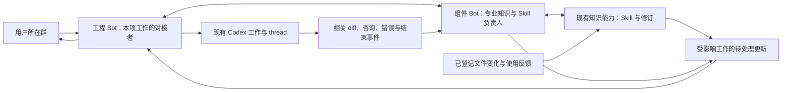

# 专业 Bot、Skill 持续更新与 Codex 监督：最小改造方案

日期：2026-10-22。状态：源码对照与实施建议，尚未实施。

> 后续讨论已调整实施优先级：当前先完成所有 Bot 通用的自身历史、记忆、知识、Skill 与持续维护能力，并安排公共 Skill 库 Bot。现行第一阶段见 [基础 Bot 设计](BOT_FOUNDATION_DESIGN.md)。本文保留为之后开发 Codex 监督与专业协作的源码对照，下面关于“两名岗位 Bot 先串起 Codex”和“暂不安排公共 Skill 库 Bot”的建议不再作为当前实施顺序。

对应目标：[专业知识维护、Codex 监督与多群协作设计](P2P_BOT_RUNTIME_DESIGN.md)。本次依据 `D:/Relay-Bot` 当前工作区源码，包括已有未提交修改；没有把它等同于正式安装中正在运行的版本。本轮仅编写文档，不改代码、不启动服务、不运行测试、不计算哈希。

## 1. 结论与第一版范围

现有系统已经有独立 Bot、私有记忆、群聊、同伴咨询、知识修订、Codex 执行及运行中追加指令。最主要的缺口是：**专业责任、Skill 版本、正在进行的工作，以及应该送达的变化，还没有形成可持续运转的关联。**

因此，第一版建议复用现有组件 Bot、工程 Bot、知识能力和 Codex 能力，完成一个完整流程：

> 用户在群里讨论需求 → 工程 Bot 整理委托 → 组件 Bot 提供适用知识与 Skill → Codex 执行 → 相关文件变化或专业意见唤醒组件 Bot → 更新 Skill、指出具体偏差 → 工程 Bot 把变化送回原 Codex 会话 → 有意义的进展回到用户 → 本次经验留给下一次工作。

第一版规模：一个实际项目、一个专业领域、一份真实 Skill、两个现有 Bot；从一项 Codex 工作开始。数据结构允许同一 Skill 关联多项工作、不同来源群，但沿用现有 Codex 队列，不以多 Codex 并行为前提。

组件 Bot 负责知识内容与专业判断；工程 Bot 兼任该工作的执行对接者。入口 Bot 可以继续接待用户，但不是这条链路的必经节点。无需先创建 Skill 总管、全局 Supervisor 或新的基础设施进程。

## 2. 对照当前代码：已有与缺失

以下均为源码事实，不是运行验收结论。链接指向本次阅读时的主要位置。

| 环节 | 当前实现 | 对目标还缺什么 |
| --- | --- | --- |
| 专业 Bot | 已有 `components` 角色、专业工具及 `expertise` 文本；角色提示仍以通用协作要求为主。[角色](D:/Relay-Bot/roles/components/prompt.md:1)、[创建](D:/Relay-Bot/capabilities/bot-management/service.mjs:31) | 没有“负责哪些 Skill、哪些组件路径、什么变化需要找它”的结构化关联。岗位名字不能触发持续维护。 |
| 私有记忆 | Bot 有 `memory_list/write`、`state_get/set`，支持修订冲突；执行上下文按会话保存。[工具](D:/Relay-Bot/bot/src/capabilities/core-tools.mjs:28)、[存储](D:/Relay-Bot/bot/src/storage/store.mjs:143) | 记忆需要被取用；当前任务准备没有按专业责任主动提供相关知识的机制，也没有任务结束必然形成维护事件的链路。 |
| 共享知识 | `KnowledgeService` 有事实/假设区分、来源、修订历史、过期状态和可选 `expectedRevision`。[实现](D:/Relay-Bot/capabilities/knowledge/service.mjs:5) | 节点保存字段没有专业负责人、项目适用范围、Skill 源文件、依赖和消费者；`active` 不等于 Skill 当前适用。 |
| Skill 加载 | 启动时加载目录与描述，正文经 `read_resource` 按需读文件；显式 `/skill:` 也可展开。[初始化](D:/Relay-Bot/bot/src/agent/engine.mjs:35)、[资源读取](D:/Relay-Bot/bot/src/context/resources.mjs:11) | 已有文件的正文重新读取可看到变化，但目录/描述没有通用热刷新入口；已加载旧正文的会话不会因此自动更新。也没有 Skill 与工作之间的版本使用关系。 |
| Skill 存放 | 新 Bot 默认指向发行物内 `skills/`；分身可复制母体自己的 `resources/`。[默认路径](D:/Relay-Bot/capabilities/bot-management/service.mjs:31)、[分身资源](D:/Relay-Bot/capabilities/bot-management/service.mjs:184) | 改源码的 `skills/` 不等于更新安装包内文件；母体资源更新也不等于分身副本更新。需要明确专业 Skill 的可编辑源和消费入口。 |
| Codex 委托 | `works` 已保存 `botId/roomId/goal/cwd/constraints/inputRefs/sourceMessageId/threadId/turnId`。[记录](D:/Relay-Bot/capabilities/codex/executor.mjs:181) | 缺专业参与者、结构化 Skill 引用、适用范围、委托修订与跨群更新关系。`inputRefs` 目前主要是文本引用，不能据此找到受影响消费者。 |
| 监督信号 | 执行器已保存消息、工具项、计划、diff、咨询和结束事件。[事件](D:/Relay-Bot/capabilities/codex/executor.mjs:358) | 事件没有按专业责任投递给 Bot。网关事件主要广播给界面；这与唤醒专业 Bot 是两件事。[事件桥接](D:/Relay-Bot/capabilities/gateway/index.mjs:159) |
| 观察权限 | `codex_status` 使用 `assertOwner`，默认仅工作所属 Bot、manager/memory 角色及 controller 可读。[检查](D:/Relay-Bot/capabilities/services/builtin.mjs:72) | 工程 Bot 提交后，组件 Bot 即便有 `codex_status` 工具，也不能直接查看这项工作。需要工作范围内的专业参与者读取权。 |
| Codex 纠偏 | `codex_resume(content)` 对活动工作实际调用 `turn/steer`；结束后通过原 thread 继续。[实现](D:/Relay-Bot/capabilities/codex/executor.mjs:227) | **不是缺 steer。** 缺更新的持久排队、去重、顺序、来源和失效关系；工作刚启动时会报“turn 尚未开始”，请求结果不明也没有业务更新记录可供判断。 |
| 咨询 | 已有 `relay_consult`，指定同伴或用户；同伴咨询被限制为只读。[路由](D:/Relay-Bot/capabilities/services/builtin.mjs:56)、[执行器](D:/Relay-Bot/capabilities/codex/executor.mjs:393) | 能回答被问到的问题，尚未形成主动观察。咨询过程中不能顺带写 Skill、创建工作或等待持锁的写入完成。 |
| 完成回传 | 完成/失败后向原群 `append` 一条 work 消息，`hop:4`。[回传](D:/Relay-Bot/capabilities/services/builtin.mjs:61) | `append` 只保存消息，不负责 enqueue。原对接 Bot 不会仅因这条回传就自动接着处理；中断、断线等也需要单独的实质状态通知。 |
| 多群协作 | 已有群/私聊/讨论、来源关联、异步 DM 回答返回、重复投递抑制和 hop 限制。[群聊](D:/Relay-Bot/capabilities/chatroom/service.mjs:21)、[返回路由](D:/Relay-Bot/capabilities/chatroom/service.mjs:90) | 能传话，但没有“这个决定影响哪些工作”和“同一 Skill 的更新应通知哪些群”的业务关系。群里说过不等于执行会话已收到。 |
| 分身学习 | 已有分身持久交付和记忆增量/冲突合并。[实现](D:/Relay-Bot/capabilities/memory-management/service.mjs:19) | 合并对象是记忆记录，不会自动修订 Skill 文件、更新使用者或重装资源。可以保留，不能把它当作持续维护已经完成。 |

另有两个影响范围的现状：

- 每个 Bot 的 Pi 执行是串行的；可用不同 `sessionId` 隔离不同工作的对话，但不能据此声称同一个进程可同时推理多个任务。[执行队列](D:/Relay-Bot/bot/src/agent/engine.mjs:87)
- 每个 Codex 能力实例目前只有一个 `active`，工作依次执行；它启动自己的 app-server 并管理所创建的 thread。第一版监督这些 Relay 发起的工作，不承诺接管用户任意一个已有桌面 Codex 对话。[队列](D:/Relay-Bot/capabilities/codex/executor.mjs:258)、[thread 创建](D:/Relay-Bot/capabilities/codex/executor.mjs:314)

## 3. 最小组织方式



图中的事件整理和更新记录是现有能力服务里的普通代码，不是新的智能主管。代码负责保存、匹配引用和送达；Bot 判断变化意味着什么、是否要修改 Skill、怎样修正工作。遇到异常，把实际状态交给 Bot 处理，不把所有修复路径写成固定状态机。

一项工作只有一个自动对接者，复用当前 `work.botId`。专业 Bot 提建议、读相关工作、维护自己的知识；多个专业意见由这个对接者合成一次清楚的修改。这是每项工作的分工，用户仍可直接干预，Bot 之间仍然平级。

## 4. 只补必要的业务记录

继续使用现有各能力的 `RecordStore`，无需先替换数据库或建设独立事件平台。它已经能保存任意命名 collection；新增字段需要在实际保存入口明确接收，不能只在请求里传入后期待自动保留。[存储实现](D:/Relay-Bot/capabilities/shared/store.mjs:6)

### 4.1 专业 Skill 记录：知识能力持有

建议新增 `skills` 与 `skillRevisions` collection，不把 Skill 状态硬塞进现有知识节点的 `fact/hypothesis` 类型。

| 必需字段 | 用途 |
| --- | --- |
| `skillId/title/ownerBotId` | 稳定名称与持续维护者；负责人可更换，其他人仍可提出或提交修改。 |
| `scope` | 当前项目目录，以及确有必要的分支/组件版本条件；不自动覆盖不同适用范围。 |
| `sourcePath`、相关文本资源路径 | 一份明确的可编辑 Skill 源文件与相对引用。 |
| `dependencies` | 明确的组件文件、接口说明、其他 Skill；第一版以登记的文件/目录为主，不推断整个仓库依赖图。 |
| `revision/freshness/reason` | 已发布修订；`draft/applicable/needs_update/retired` 等适用状态及原因。 |
| `basisRefs/lastChangeId` | 本次内容依据哪项实际变化、用户决定或使用反馈。 |

专业责任先由 `ownerBotId + scope + dependencies` 表达。查询某个文件/Skill 的负责人就从这里找到 Bot，暂不增加一套岗位目录服务。长期领域事实仍可用现有知识节点，记录其来源，再由 Skill 引用。

`skillRevisions` 保存被采用过的正文快照及依据。这里的 revision 是整数修订号，不使用文件摘要作为版本条件。内容适用与否也不等同于已经通过实际运行。

### 4.2 工作关联：扩展现有 works

保留 `botId` 作为对接者，增加：

- `origin`：原始群和用户消息；复用已有 `roomId/sourceMessageId`，补齐从 Bot 工具提交时的传递。
- `scope`：此次工作的实际项目和适用条件。
- `expertBotIds`：参与本项工作的专业 Bot。
- `skillRefs`：`skillId + scope + revision`，以及这份修订是否已放入执行输入。
- `briefRevision`：当前明确委托的修订；用户原话和来源单独保留，不用摘要替代。

第一版可以按 `skillRefs` 查询受影响工作，不必另建消费者服务。执行输入包含某版 Skill，只表示该版本内容已提供；实际使用是否正确，还要从 Codex 后续改动判断。

### 4.3 更新与意见：Codex 能力持有

新增 `workUpdates`，统一保存用户修改、专业发现和 Skill 更新：

`updateId/workId/sourceRef/author/kind/content/skillRef/supersedes/status`。

状态只表达必要事实：待对接者处理、待送入执行、已送入、被更新取代、结果不明。相关证据引用保留在同一条记录或已有 workEvents 中，不增加一套交付报告。

专业意见不是用户授权；一条更新不能自行改变工作范围。对接者可合并相容意见，明确用户决定优先；真正冲突且无法在已有目标内解决时才询问用户。

知识变更及工作事件各自保存小型待投递记录，复用 Bot `/messages` 的稳定消息 ID 和去重。记录在产生事件的能力数据库里，不依赖 Web 是否打开。不能只发送一次 HTTP/SSE 后就认为维护已经发生。

跨能力接线也保持小范围：知识能力保存修订和待投递事件，经现有内部 RPC 通知 Codex 能力；后者查询自己持有的 `works.skillRefs` 并保存对应更新，再调用管理能力向指定 Bot 投递。知识能力不直接改 Codex 数据库。接收方按来源事件 ID 去重；负责人暂不可用时保留待处理项，用户主动暂停的 Bot 不被通知机制擅自恢复。

## 5. Skill 怎样持续更新，而且进入实际工作

### 5.1 第一版的存放与读取选择

建议专业 Skill 的默认可编辑位置为：

```text
D:/Relay-Bot-data/capabilities/knowledge/skills/<scopeId>/<skillId>/SKILL.md
```

这是同一正式数据根中的知识文件，不是新的环境。既有发行物里的 development/discussion 等 Skill 继续提供通用工作方法；长期演进的项目 Skill 通过知识能力的接口管理。

对于项目已经有的权威 Skill，可登记其真实源路径，不默认复制出第二份。登记时明确由知识能力访问哪些源路径和依赖；不依赖普通文件工具能够访问任意项目或整个数据根。当前普通文件工具的可读写根是 Bot workspace 与配置的 projectRoot，数据根另受保护。[路径边界](D:/Relay-Bot/capabilities/filesystem/tools.mjs:175)

**第一版采用按需 API 读取专业 Skill。** 组件 Bot 读取指定 Skill/版本，为当前工作提取必要约束；工程 Bot 将必要内容和修订引用放入初始委托或后续 steer。Codex 需要细节时仍可用 `relay_consult` 向组件 Bot 询问。无需把所有专业 Skill 加入每个 Bot 的启动目录，也无需为每次修订刷新 Pi 的完整 Skill 索引。

这份内容仍然是可编辑的 Markdown Skill；变化的是查找和取用通道。将其进一步接入 `read_resource`、原生 `/skill:` 或外部插件安装位置，留到确实需要该入口时再做。

### 5.2 最少增加的知识工具

名称为方案建议，不代表现有接口已经存在。全部放在现有 knowledge 能力，并沿用 `knowledge_` 路由。

| 拟新增工具 | 作用 |
| --- | --- |
| `knowledge_skill_list` | 按项目、Skill、负责人或相关路径找适用内容；返回目录与状态，不返回所有正文。 |
| `knowledge_skill_read` | 取指定修订或当前适用内容、来源与待更新原因；不把过时内容默认为最新规则。 |
| `knowledge_skill_save` | 登记责任与依赖，或提交内容修订；修改已有记录必须带 `expectedRevision`。 |
| `knowledge_skill_feedback` | 保存某次实际变化、错误用法、用户纠正或任务经验，唤醒负责人；不是直接把反馈当作已确认知识。 |

接口提供持久化能力，是否写、写什么、怎样处理冲突由负责 Bot 决定。人工编辑和其他 Bot 的修改都允许进入维护链路，负责人承担整理责任，不成为只有它才能编辑的障碍。

### 5.3 变化来源与最小处理链

| 变化来源 | 第一版处理 |
| --- | --- |
| Codex 的相关 diff/文件操作事件 | 与已登记依赖及当前 `skillRefs` 匹配；合并为一次专业观察任务。diff 是线索，组件 Bot 再读受影响的实际文件。 |
| Relay 文件工具写入 | 在已有写入完成处提供路径事件；不把命令任意输出当成完整变更清单。 |
| 人或外部程序直接编辑已登记文件 | 在知识能力中对这些源/依赖目录建立文件监听，记录需要重新判断的变化。监听只作为提示，不当作内容已读懂。 |
| 使用中遇错、用户纠正、任务结束经验 | 写入 `knowledge_skill_feedback`，保留相关 work/message/file 引用。 |
| 监听中断、离线或不可观察的接口变化 | 保留“需要更新/尚未判断”的事实；下一次实际使用前由负责人读取相关来源。未登记、无通知的外部变化不能承诺即时发现。 |

处理链为：记录变化 → 找到负责人和受影响 Skill → 负责人读取局部实际来源 → 判断适用范围 → 更新正文、示例与依赖 → 保存新修订或说明无需改动 → 为受影响工作生成更新。

不逐 token 唤醒 Bot；同一批文件写入合并，按操作完成、咨询或阶段边界处理。负责人的一次自发写入带上变更来源，避免自己的发布事件再次形成无限维护循环。

### 5.4 并发修改与 Markdown 的关系

Markdown 是明确的可编辑源；数据库保存最近一次被整理并发布的修订快照与适用状态，两者职责分开。

- 通过接口的修改按 `expectedRevision` 串行提交；发生冲突时交给 Bot 读取当前内容再合并。
- 人直接改 Markdown 后，先形成待整理变化；接口须明确返回有未归档修改，不能继续把旧快照标成已跟上源文件。
- Bot 准备写回期间又发现源文件变化，保留其候选修改，不覆盖较新的编辑；恢复时按当前源文件和既有修订判断。
- 文件与 SQLite 不是同一事务。部分写入或中断必须留下未完成状态，不能将“文件已改”当作“修订和消费者均已更新”。
- 发现一个变化并不必然增加正文版本；负责人可记录“当前适用范围内无需更改”。

这些是避免多人改丢内容所需的局部行为，不引入人工审批流程，也不使用哈希或全仓扫描判断变化。

### 5.5 新修订怎样影响已经开始的工作

知识能力按 `skillId + scope` 找到关联工作，生成带旧版/新版及影响说明的更新。

- 尚未启动的工作：对接者更新待发送委托。
- 已运行的工作：只发送与当前目标有关的差异和后续动作，不重灌整个 Skill 或完整专业群历史。
- 旧做法已不适用：对接者要求停止相关步骤，再按当前执行状态决定补充指令或中断。
- 文字完善且不影响正在做的步骤：下个边界再通知。
- 不同分支/版本：保持各自适用内容，不以“最新”覆盖所有场景。
- 已结束的工作：保留当时使用的版本；除非确有相关遗漏且仍在原委托范围内，否则不自动重开。

只有实际送入执行输入后，才更新该工作的“已提供版本”。这仍不能证明 Codex 已正确遵守；组件 Bot 根据后续相关实际改动继续判断。不能用一句模型回复把整项工作直接标为正确。

## 6. Codex 监督怎样运转

### 6.1 先准备一份简短委托

工程 Bot 从已有讨论提取目标、明确约束、项目目录和来源消息；查询相关 Skill，必要时联系组件 Bot。给 Codex 的内容只包括本次必要的知识要点、具体修订和专家联系方式。

用户不用填结构化表格。内部字段由 Bot 形成；尚在讨论的选项保留为未决定，不因为补齐字段就自动执行。

### 6.2 把现成事件交给合适的专业 Bot

在 Codex 能力内部增加一个轻量事件投递模块。优先使用已经保存的 `workEvents`；持久记录投递进度，不以网关的即时广播为唯一来源。

| 事件 | 主要接收者与动作 |
| --- | --- |
| 与专业依赖相关的 diff/文件项完成 | 组件 Bot 读取相关片段，判断具体用法是否符合当前约束。 |
| Codex 项目事实咨询 | 延用当前 `relay_consult` 只读答复；在答复中指出需维护事项，由事件接线保存待办，咨询结束后再投递普通维护任务。 |
| Skill 新修订、用户新决定 | 工程 Bot 整理本项工作的变化，送入原执行会话。 |
| 失败、中断、连接丢失、具体等待原因 | 工程 Bot 看当前事实，尝试已有范围内的处理；需要人决定才回群。 |
| 本轮结束 | 工程 Bot 处理交付与剩余工作；组件 Bot 仅处理相关结果或待维护经验。 |

对高频输出做普通代码聚合；不把命令日志逐段送给所有模型。若一段时间没有有效进展，先看当前状态、咨询和命令项，再决定是否交给对接者判断；不能仅凭没发消息就杀掉执行。

现有完成回群消息可以保留，同时增加面向负责 Bot 的独立事件。Bot 的事件任务完成后，系统还需读取其结果或持久意见，不能在收到任务编号时就结束整个协作。

当前咨询限制还会在网关按 Bot 身份生效，因此同一个 Bot 的其他维护任务也可能暂时不能写入。第一版延后这些写入，不要求只读咨询任务调用 `memory_write`、Skill 保存或反馈工具突破限制。

### 6.3 补齐范围内的观察与意见接口

- 扩展 `codex_status`：本工作登记的 `expertBotIds` 可以读取；增加按事件位置/数量读取，避免每次把完整历史塞给专业 Bot。
- 新增 `codex_feedback`：专业 Bot 保存与本工作有关的具体发现，写入 `workUpdates` 并通知对接者。
- 保留 `codex_resume/cancel` 的明确操作方：通常是工作对接者和用户；专业 Bot 不因获得观察权就同时向执行器发互相矛盾的修改。
- 读取实际文件时，需要保证专业 Bot 已配置对应项目访问范围。不能因为新给了 `codex_status` 就认为任意 `cwd` 中的文件都可读取。

一条专业反馈至少说明：看到了什么、对应文件/对象/事件、相关规则或 Skill 修订、为什么影响当前目标，以及建议改什么。没有充分事实时提出局部待确认问题，不扩展成全项目整改。

### 6.4 对接者如何可靠地使用现有 steer/resume

继续扩展 `codex_resume`，增加业务 `updateId`、委托修订与被替代的更新引用。执行器保存待送更新，再依据真实状态处理。

| 当前状态 | 最小行为 |
| --- | --- |
| 排队或启动中，尚无可用 turn | 更新待发 brief，或保存更新直到 turn 可接收；不要求模型反复重试“turn 未开始”。 |
| running 且 thread/turn 有效 | 沿用 `turn/steer`，携带相应业务更新；串行发送，避免多 Bot 并发纠偏。 |
| waiting，同伴咨询 | 先走原咨询的回答流程；需要写入的维护任务另行排队，不让咨询等待工作区锁。 |
| waiting，明确等待用户决定 | 保持等待；Bot 的建议不替代用户答案，维护通知也不能冒充答复。 |
| 已结束但有原范围内的剩余修改 | 对接者决定是否沿用原 thread 继续；不因为任意通知就自动开新 turn。 |
| 中断、断线、发送结果不明 | 记录已知状态并读取相关事件；能确定未发送才补发，结果不明先由 Bot判断，不盲目重放。 |

当前已有 `steered` 事件，可作为“请求被执行端接受”的依据；不能把它解释成“代码已经改好”。同一 `updateId` 重复到达时返回已有状态。新用户决定通过来源及 `supersedes` 使旧意见失效，避免迟到消息把工作改回旧方向。

现有执行器在重启后把未确认工作标为 interrupted，这一事实要尊重。恢复事件处理不等于自动恢复全部 Codex 副作用。

### 6.5 绕开当前锁和串行任务的实际限制

Codex 当前在整次执行期间持有工作目录锁，普通文件写入也使用该类锁。[执行锁](D:/Relay-Bot/capabilities/codex/executor.mjs:272)、[文件接入](D:/Relay-Bot/capabilities/services/builtin.mjs:81)

因此，专业 Bot 可在 Codex 执行时读取相关文件；保存在知识数据目录内的 Skill 可由知识能力独立维护。若 Skill 源本来就在 Codex 正在改动的项目内，则在合适边界写回或请对接者安排，不在只读咨询里等待这次写入。

组件 Bot 的事件任务应短，只处理当前观察和维护，不持续轮询等一个长 Codex 工作结束。不同工作使用独立会话键，例如 `professional:<scopeId>:<workId>`；持久知识通过接口共享。长操作真正需要并发时，再使用已有分身能力承接。

## 7. 多群怎样协作，用户怎样少盯进度

第一版不新增群聊类型。项目群承接用户讨论；专业协作复用私聊或已有专业群；Codex 仍持有自己的执行上下文。

以 `workId` 连接来源群、对接者、参与专家和 Skill，群之间传递来源引用、当前决定与增量内容。

- 用户在群 A 改要求：负责该工作的工程 Bot 将原话和来源记入更新；明确影响另一项工作时，关联到那项工作，由其对接者处理。
- 组件 Bot 在专业群发现 Skill 过时：知识能力查找使用同一适用版本的工作，分别形成更新；不向所有群广播全文。
- 两个群询问同一项工作的状态：都读取同一个 work 的状态；不各自启动新 Codex 任务。
- 普通协作沿用现有 DM 来源返回关系和重复抑制；维护事件直接投递给确定对象，不把无限多轮自动群聊当事件总线。
- 用户直接在 Relay 的工作入口修改或回答时，纳入同一更新顺序。第一版看不到的外部 Codex 操作，应明确表示暂未同步，不能假装已全面观察。

回到用户群的内容只包括实质进展、已经处理的关键纠正、真实阻碍、待用户决定和交付物。用户不必收到每条 Skill 文件事件、每次模型调用或重复状态播报。

第一版可以完全利用已有群消息和工作详情呈现，不新做大型控制台。若需要最小界面补充，只在原工作详情显示“相关专家、使用的 Skill 版本、当前待处理变化”，知识侧显示维护者与适用状态；这可以在主链路之后增加。

## 8. 建议的最小实施顺序与文件落点

下面是后续获得实施指令后的工作包，本轮不执行。四步合在一起才形成目标闭环；不能仅写角色提示词就宣布完成。

| 顺序 | 必须完成的改造 | 主要文件落点 |
| --- | --- | --- |
| 1. 知识有人负责 | 专业 Skill 记录、修订、读取/保存/反馈接口；登记一份实际 Skill 的 owner/scope/dependencies | `capabilities/knowledge/service.mjs`；必要时拆出同目录 `skills.mjs`；`capabilities/gateway/tools.mjs`、`capabilities/services/builtin.mjs` |
| 2. 工作知道自己用了什么 | 提交时保存来源、专业参与者、Skill 修订和 briefRevision；专业参与者能读取该工作；意见有持久去处 | `capabilities/codex/executor.mjs`、`capabilities/services/builtin.mjs`、`capabilities/gateway/tools.mjs`、`capabilities/gateway/index.mjs` |
| 3. 变化真正流到执行 | 保存并投递相关事件、文件变化与结束事件；生成 Skill 更新；完善 queued/starting/running 状态下更新排队、去重和 steer | `capabilities/codex/executor.mjs`；同目录轻量投递模块；`capabilities/knowledge/` 的变更处理；`capabilities/filesystem/tools.mjs` 与 builtin 的路径事件接线 |
| 4. Bot 按职责接续 | 组件 Bot 处理相关观察与经验；工程 Bot 准备委托、整合意见、监督实际状态和回群；任务结束把经验写给负责人 | `roles/components/`、`roles/engineer/`、相关 `skills/development/SKILL.md` 与 `skills/discussion/SKILL.md` |

公共声明、路由、能力内部校验要一起接好。只修改 `role.json` 不足以让已经创建的 Bot 得到新工具；创建后工具名保存在 Bot 记录中，既有配置也有自己的 prompt。

后续实施时，对指定组件/工程 Bot 使用已有 grant 和 prompt 更新路径补齐配置，保留其自定义内容，不重建身份或清空记忆。[工具更新](D:/Relay-Bot/capabilities/services/control.mjs:77)、[prompt 更新](D:/Relay-Bot/capabilities/bot-management/service.mjs:58)

本方案第一版不要求改 `bot/src/agent/engine.mjs` 或 `bot/src/context/resources.mjs`：专业 Skill 先经知识工具按需读取，普通 Bot 执行器继续通用。已有能力版本切换和正式安装流程继续承担代码交付；不为这条流程新增服务端口、环境或数据根。

## 9. 一个具体的目标流程

以下使用“通用列表组件”作示例名称，不代表已经选定或确认仓库里存在同名组件。

1. 用户在项目群讨论一个页面，确定实现目标。工程 Bot 保存原消息，查询到列表 Skill 的维护者是组件 Bot。
2. 组件 Bot 读取当前组件和适用 Skill，说明本次需要的绑定、释放规则。工程 Bot 建立 work，保存 Skill 修订并提交简短委托。
3. 另一位开发者修改了该组件接口，却没有更新 Skill。已登记的文件变化唤醒组件 Bot；它读取接口，判断旧示例不再适用，更新 Skill 并保留依据。
4. 该 Skill 关联到工作 A 和工作 B：A 正在执行，B 尚在排队。A 的对接者把具体变化送入原 turn；B 的待发委托使用新修订。若 B 属于另一分支且接口未变，则继续使用对应版本。
5. 组件 Bot 从 A 的相关 diff 看到仍有旧调用，读取具体文件确认，再提出带位置的修正。工程 Bot 将意见送回 A；用户不必自行找到这个遗漏并编写提示。
6. Codex 本轮结束，工程 Bot 被事件唤醒，整理实际完成内容与剩余问题。组件 Bot 把本次发现写入相应 Skill 或使用经验；没有新知识则记录无需修改，避免无意义扩写。
7. 下次同类工作查询该 Skill 时，直接获得维护后的规则。用户只需讨论新目标，无需再次解释同一接口变化。

这里的关键是事件有人接、内容有人维护、使用者能收到变化。它描述预期产品行为，不是本轮测试任务或新增验收材料。

## 10. 暂缓内容与第一版的实际边界

| 暂缓项 | 原因 |
| --- | --- |
| 把网关、数据库和启动器全部改成 Bot | 不影响专业维护与监督链路先发挥作用，属于后续组织形态调整。 |
| 新建全局 Supervisor、岗位目录中心、消息总线 | 现有 Bot、知识记录和局部投递足够支撑一个领域。 |
| 全仓依赖图、向量检索或全量自动扫描 | 先登记已知依赖，按事件和实际使用更新；未知依赖仍可能漏掉，需要逐步补充。 |
| 所有 Skill 的原生加载热更新、分身副本广播、外部插件包自动发布 | 第一版统一通过知识读取接口取专业内容，不先解决所有安装格式。 |
| 分身自动回收与通用知识融合重写 | 现有分身机制保留；短专业任务先按工作隔离会话。使用分身时，其经验仍需显式进入 Skill 反馈，记忆合并不会自动替代这一步。 |
| 同时接管任意桌面 Codex、多个独立执行器和完整电脑调度 | 当前先监督 Relay 自己创建的 Codex 工作；实际桌面与 Unity 操作 Bot 后续接入相同事件关系。 |
| 每次专业观察都补测试或重复验收 | 监督基于当前授权工作已经产生的事实；额外测试仍按用户指令，不由该设计自动扩张。 |

专业 Bot 仍然可能判断错误；这套改造的实际价值是让知识有持续负责人、错误有具体反馈入口、变化能抵达相关工作，减少用户反复提醒和逐个盯会话。不能承诺“多一个 Bot 就不会遗忘或产生幻觉”。

第一版最重要的交付不是更多角色、页面或协议，而是：**某份专业 Skill 的已知变化，能由负责的 Bot 持续整理，并经原工作对接者影响正在执行的 Codex；用户不再承担这段信息搬运。**
