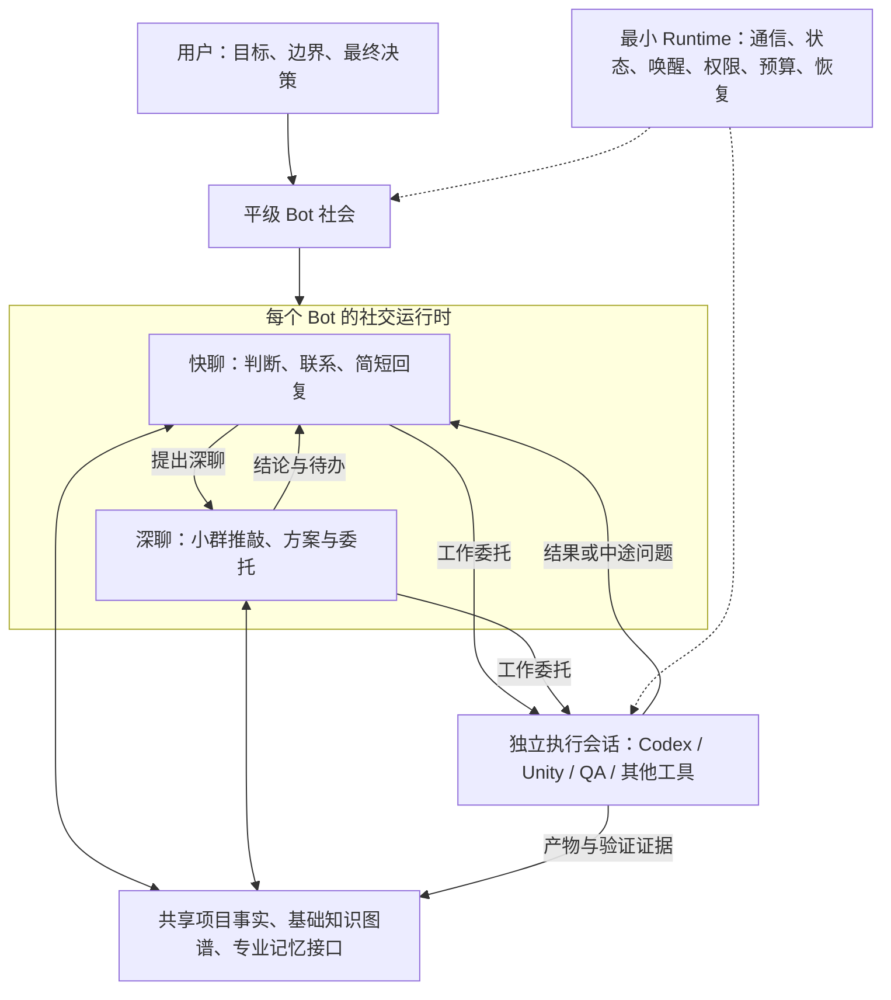

# Relay Bot：项目初始目标与架构方向

版本：0.2；日期：2026-10-18；状态：目标基准；实际实现状态统一见 [开发进度](DEVELOPMENT.md)。

> 2026-10-18 实施修订：用户确认独立建设精简 Relay 内核，Hermes 只作参考/可选 Adapter。最新约束优先于本文早期建议：首版不建设权限体系、复杂认证授权、审批链、门禁/哈希比对、冗余一致性检查、插件市场或分布式服务。下文与此冲突的权限、预算治理、版本启用审批及复杂更新平台建议均为后续按需事项，不是首版要求；保留必要的标识、去重、防无限循环、异常处理和真实功能验证。技术与模型默认值见 [实现方案](ARCHITECTURE.md)，不再等待选型确认。三种会话分离、平级成员、真实执行咨询、记忆/知识关系和持久化仍是首版目标。

## 1. 文档目的与适用范围

本文把 Agent Society 原始讨论、既有总结中的有效结论，以及用户随后提出的三种模型角色、平级功能 Bot、自迭代和相互纠错想法，整理为 Relay Bot 的初始目标。

本文回答：为什么做、用户希望得到什么、要解决什么问题、哪些原则不能丢、最初需要实现哪些能力，以及怎样判断系统有用。它不记录逐轮讨论，不把早期被否定的中央主控方案保留为目标。

- **已确定原则**：来自用户明确要求及后续修正，是实施时应遵守的目标边界。
- **建议实现**：为让目标可执行而整理的机制、接口字段、角色和建设顺序，可以继续调整。
- **待验证事项**：开源底座、技术栈、模型、性能数值和具体运行策略，不能当作已确认事实。

本文中的流程和验收场景均为建设目标，不代表仓库已有相应代码、测试或运行结果。

## 2. 项目是什么

Relay Bot 要建立一个由长期专业成员组成的 AI 项目组织。Bot 在共享的项目环境中观察事件、承担责任、交流意见、协商分工、调用专业执行器、验证结果，并根据反馈继续推进项目。

用户是唯一最终权威。各 Bot 在社会关系上平等，没有拥有上级指挥权或最终裁决权的中央主控。协调、流程、深度讨论组织和知识维护同样可以由平级 Bot 承担。

首个落地场景是 Unity 游戏研发，以现有真实项目、真实组件和真实执行环境验证协作。整体架构需要允许扩展到策划、美术、后端、测试、性能、构建、发布和运营等领域。

系统的价值体现在：用户提出目标后，相关 Bot 能主动参与、直接沟通、持续履责，形成实际交付；用户不必承担所有成员之间的信息转述和逐步派工。

## 3. 为什么要做

### 3.1 单一主对话承担了过多认知责任

开发一个大功能，往往需要把策划案、美术稿、Figma、效果图、Prefab、项目代码和历史约束都交给一个对话。这个对话要调查、规划、拆分、协调和检查，后续执行越长，重要上下文越容易被忽略。

典型问题是：早期知道项目有通用列表、通用图标或已有组件，执行过程中仍然重新实现。扩大上下文窗口或临时安排一个“组件专家”角色，并不能单独保证有人持续维护这项责任。

### 3.2 临时子任务难以形成长期专业性

一次性的角色提示通常缺少独立历史、长期经验、持续职责和与同事的关系。任务结束后，该角色不再主动关注项目变化；下次工作仍可能重新调查、重复犯错。

Relay Bot 希望把专业分工落实到长期存在的成员和运行机制中。通用列表 Bot 应持续维护用法、限制、历史问题和使用方，发现新需求或 API 变化时主动介入。

### 3.3 岗位之间存在反复转述和信息损耗

策划向 AI 描述需求，程序重新理解并再次向 AI 描述，测试又重新理解实现和验收条件，发现问题后再转回程序。每次交接都可能遗漏背景、边界条件和已经确认的限制。

专业 Bot 应直接访问各自负责的原始材料和共享项目事实，并直接联系相关成员。QA 可以从需求讨论阶段参与，也可以查看实际变更、构建版本和验收条件。

### 3.4 社交与执行混在一起会互相拖累

群聊需要及时判断、简洁回复和主动联系；代码调查、方案研究、调试和构建可能持续很久。共用一个长会话会导致响应阻塞、上下文污染和责任混乱。

系统需要同时容纳快速交流、允许较高延迟的深入讨论，以及独立进行的专业工作。

### 3.5 过多写死的流程限制了系统演进

如果每次分工、升级讨论、协商或流程变化都要修改中心脚本，系统很难随项目形成新的专业成员和协作方式。Relay Bot 希望把需要判断的策略交给 Bot，把底层固定逻辑压到必要的运行机制。

## 4. 用户希望获得的体验

用户可以在项目大群提出“完成这个好友列表页面”。策划、UI、组件、Unity 和 QA 等成员根据职责判断是否参与，不相关的成员保持沉默。

复杂问题可以转到规模受控的深度讨论小群。相关成员分析方案、澄清冲突，形成有来源的决策、需求说明或工作委托，再把必要结论带回大群和项目知识。

Unity Bot 调用本机 Codex 等专业工具执行工作。工作期间，该 Bot 仍能回复消息、参与其他讨论，并在执行器遇到疑问时向相关专家咨询。QA 根据真实变更验证，发现问题后直接协商修复和复测。

用户可以随时联系任意 Bot、进入相关群组、查看执行状态与证据、修改目标或撤回授权。需要最终判断的问题交给用户；日常协作在已有授权范围内自行推进。

产品应让用户看到成员在做什么、依据什么作出判断、哪些问题仍未解决。底层调用关系可以追溯，但不要求用户手工维护每一步调用。

## 5. 已确定的核心原则

| 原则 | 对实现的要求 |
| --- | --- |
| 用户是唯一最终权威 | 不设置永久或临时拥有上级指挥权的 Master、Chief 或中央决策 Bot；流程协调者也是平级成员。 |
| 社会平等、专业分工 | Bot 可以有不同职责、能力和操作权限；这些差异不赋予其支配其他 Bot 的社会地位。 |
| 责任长期存在 | 身份、经验、专业约束和关注对象跨任务延续，工作会话结束不等于成员消失。 |
| 社交与工作真正分离 | 分离运行时、会话、上下文生命周期和状态；不能只在同一个对话中临时切换模型。 |
| 社交支持快与深 | 快速交流和深度讨论都有适合的场合、上下文和延迟预期；深聊不阻塞快速响应。 |
| 减少写死的业务流程 | 分工、讨论组织、专业判断、流程改进优先由可替换的 Bot 承担。 |
| 首版架构完整、规模可以小 | 私聊、多群、深聊、记忆维护、基础知识关联和执行隔离不能只留为未来占位接口。 |
| 共享事实、按需获取 | 每个 Bot 保留自己的专业性，通过共享知识和证据协作，不反复装载全部项目历史。 |
| 允许相互纠错 | 任何相关 Bot 都可以提出异议和证据；通过核查修正事实，不按身份或票数认定真相。 |
| 真实交付和持续演进 | 以执行、验证和反馈证明进展，同时支持专业成员和系统功能随项目演进。 |

## 6. 两层运行时、三种模型角色

一个 Bot 在架构上分为社交层和干活层。社交层内部有快速聊天和深度聊天两种工作方式，因此可能使用三种模型角色。

| 模型角色 | 主要用途 | 上下文与运行要求 |
| --- | --- | --- |
| 快速聊天模型 | 判断相关性、PASS、简单回复、发现同事、联系成员、提出深聊或执行请求 | 使用精简的当前对话、相关记忆和状态；优先保证响应速度与并发可用性。 |
| 深度聊天模型 | 方案比较、跨领域推敲、澄清争议、形成决策与工作委托 | 默认在目标明确、规模受控的小群或深聊会话中运行；可以接受更高延迟。 |
| 专业执行模型 | 在专业 Harness 中调查、修改、调试、测试、构建或制作产物 | 使用独立 Work Session，由 Codex 或其他适合的工具承担。 |

三种角色不要求固定使用三个不同厂商的模型，也不要求每个任务都经过三种角色。具体模型和推理配置可以按能力、速度、成本与可用性选择。

深度聊天用于成员之间的方案推敲和共同决策；专业执行用于完成可交付的工作。两者都可能需要强推理，但工作边界和结果接收方不同。

同一个 Bot 在快聊、深聊和执行委托中保持同一身份与专业责任。深聊过程和工作日志不应自动灌入快聊；通过阶段结论、证据引用和状态更新衔接。

速度是架构约束。长时间分析应进入深聊或专业工作，快聊不应承担无限扩展的研究。具体响应时延目标由小规模实测确定；讨论中出现过的秒数和模型名称不作为已确认指标。

## 7. 深度讨论由平级 Bot 组织

### 7.1 职责与权限

系统应允许专门的深聊协调 Bot 观察讨论，判断是否值得深入研究、邀请哪些专业成员、建立怎样的小群，并跟进结果。

它是可替换的专业成员，没有决定其他成员必须服从的权力。其他 Bot 和用户也能在相同规则与权限下发起深聊、邀请同事或提出结束讨论；不能要求全部消息和升级请求经过唯一协调 Bot。

可记录触发理由并提供可编辑的升级策略，例如：存在重要方案取舍、跨领域约束冲突、当前信息不足、需要形成复杂工作委托。它们是 Bot 使用的判断依据，不应固化成庞大的中央业务路由脚本。

简单且信息充分的任务可以直接执行，不强制为每份委托开会。

### 7.2 系统需要提供的机制

建议每个深聊会话记录：讨论目标、来源消息或任务、参与成员、输入事实、输出要求、模型策略、预算与退出条件。人数、轮数、时间、调用量或费用可以按项目配置上限，具体数值待试验。

Runtime 执行已配置的硬边界；Bot 负责判断和协商。达到上限仍未收敛时，应保存已知事实、分歧、候选方案和待决问题，并按项目策略通知用户或结束为“待决”，不能伪造共识继续运行。

深聊和执行需要与快速响应隔离资源占用。少数慢会话不能耗尽全部调度容量，导致整个项目群失去交流能力。

### 7.3 深聊必须形成可引用的产出

正常结束时，至少产出一项决策、需求说明、视觉说明、技术方案、工作委托，或明确的“暂无法决定及其原因”。保留必要的约束、依据、异议、待办和未解决问题。

结果写入相应项目知识或任务记录，再通知大群和相关成员。暂定方案与已确认决策必须区分；凡涉及用户最终裁决或超出已有授权的事项，不由小群自行升级为最终决定。

小群用于专业分析，大群用于跨领域协作。例如需求、视觉、技术小组分别形成 Requirement Spec、Visual Spec 和 Technical Spec，再共同讨论实现。各群拥有独立对话上下文，重要成果可以跨群查询。

## 8. 一个完整 Bot 应具备什么

| 能力 | 最小内容 |
| --- | --- |
| Identity / Profile | 稳定 ID、名称、职责、所属项目、独立配置、模型策略、启停与恢复状态。 |
| 专业能力 | 自己的 Skills、工具和执行器配置、使用约束、经验；凭据通过受控引用访问。 |
| 社交能力 | 快聊、深聊、群聊、私聊、@、PASS、主动联系、等待答复和继续跟进。 |
| 社会关系 | 能发现其他成员、了解各自职责和专长、查询合作关系与所属群组。 |
| 记忆与项目知识 | 私有记忆、专业记忆、社交上下文、按需查询及更新共享项目知识。 |
| 执行能力 | 创建独立工作会话、传入委托、处理进度和中途问题、接收结果。 |
| 持续责任 | 订阅相关事件，安排定时职责，主动检查变化、提醒、纠错和跟进。 |
| 生命周期 | 创建、暂停、恢复、退役；保持消息、工作状态和知识来源可追溯。 |

独立 Profile 不要求为每个 Bot 安装一套软件或使用独立物理数据库。重要的是归属、权限、状态和上下文边界清楚。

成员目录必须能够支持“我需要哪位同事”。目录可以提供名称、专业职责、可联系入口、能力与知识范围，不必把所有成员的完整记忆塞入每个提示词。

Bot 可以按模块或组件细分，例如通用图标、无限列表、弹窗、资源管理；也可以按岗位或功能领域划分。角色粒度由真实协作效果决定，不固定为一套五人团队，也不为每个小函数创建一个 Bot。

## 9. 通信、事件和持续职责

第一版必须提供用户与 Bot 直聊、Bot-to-Bot 私聊、项目大群、专业小群和跨群协作。一个 Bot 可以同时属于多个群，并保持同一份长期专业记忆。

群聊是一份真实共享的消息记录。发送方、群或私聊 ID、时间、@、回复关系、附件引用和关联任务需要一致且可追溯；不能由每个成员各自模拟一份互不一致的群聊。

成员可以回复、PASS、提问、联系同事、提议深聊、发起工作或提交知识。具体动作协议可以继续设计，不能只靠解析自由文本猜测是否应该执行外部操作。

事件可来自新消息、私聊、@、执行进度与完成、文件变更、需求调整、知识修订、构建或测试结果、性能与运营反馈，以及定时职责。Runtime 按订阅和基础规则送达事件，专业行动由 Bot 自行判断。

Routine 应表达持续职责，例如定期检查新增功能的性能、构建完成后核查结果、组件 API 变化后通知受影响成员。没有新用户指令时，成员仍可在已有授权与预算内履责。

应保留基本工作认领、负责人、依赖和状态，避免重复开工。这些记录可以由平级成员协商维护；具体任务网络可以随信息交换形成，不要求先由中央 Agent 完整规划。

## 10. 记忆、知识图谱与相互纠错

### 10.1 上下文和知识分层

| 层次 | 内容与作用 |
| --- | --- |
| Bot 私有记忆 | 身份、经历、偏好、长期责任和个人经验，维持成员连续性。 |
| 专业领域记忆 | 组件用法、技术规范、设计规则、限制、历史问题和验证方法。 |
| 社交上下文 | 各群、各私聊、各深聊会话的历史、关系、摘要和待跟进事项。 |
| 项目共享知识 | 需求、设计、组件目录、代码事实、决策、测试和版本状态。 |
| 工作上下文 | 某次专业执行所需的代码、调查、工具输出和过程记录，独立保存。 |

快聊、深聊、私聊和执行会话需要适合自身的压缩策略，保留决策、约束、待办、来源和未解决问题。压缩历史解决上下文长度；知识维护解决跨 Bot、跨会话和跨迭代的一致性，两项能力首版都必须实际可用。

记忆维护至少支持提取、检索、修订、过期标记和来源追踪。事实、假设、个人判断与待核查消息需要区分，不能把聊天中的自信表达直接作为项目事实。

### 10.2 首版具备可运行的基础知识图谱

第一版需要实际建立、保存和查询知识关联，不能只有文件搜索或未来接口。最小关系示例是：需求对应设计稿，设计稿对应页面或 Prefab，页面使用组件，组件关联代码与使用方，代码变更对应测试与构建版本。

Bot 应能沿关系查询“这个需求影响哪些页面”“这个组件改动影响谁”“这条测试结论对应哪个版本”。实体和关系应记录来源、确认时间、适用版本和当前状态。

可以使用关系表、索引或其他简单存储实现，不强制第一版引入复杂图数据库。高级图推理和跨项目知识复用可以后续增强；基础关系的写入、维护与查询不能延期。

### 10.3 相互纠错是核心场景

用户提供的截图展示了一种有价值的协作：一个 Bot 判断某接口不存在，另一个 Bot 提及之前的接口扩展和联调记录，指出前者可能遗忘，并建议回查实际记录。

截图证明对话中出现了纠正行为，不能独立证明被引用的服务器状态或测试结果。Relay Bot 应把这种行为发展成可核查的工作链路：提出矛盾，定位来源，检查当前代码、数据或运行证据，确认适用版本，再修订知识并通知相关成员。

纠正可以来自任何有相关证据的 Bot。对暂不能确认的冲突保留争议状态，不让最后发言者覆盖已有事实，也不把多个 Bot 的一致说法当成独立证据。

目标是降低单个 Bot 遗忘或误判对项目造成的影响。多成员可能共享同一错误来源，也可能同时遗漏信息，因此不能承诺完全避免失忆或错误。专业冗余、可检索的共享事实和真实验证共同提供支撑。

## 11. 最小 Runtime、功能 Bot 与插件

“一切皆 Bot”表达的是功能和策略可以由平级成员负责、改进和替换。需要判断的工作尽可能交给 Bot；实际通信、数据存储和能力调用仍通过代码与接口实现。

| 分工 | 负责什么 | 边界 |
| --- | --- | --- |
| 最小 Runtime | 身份与消息标识、投递、持久化、唤醒、定时调度、并发、权限检查、预算、防循环、去重、超时与恢复 | 执行明确规则，不代替成员作专业判断或决定业务分工。 |
| 平级功能 Bot | 深聊组织、流程协调、工作拆分建议、知识维护、成员生成建议、纠错与改进 | 与其他成员使用相同通信和权限体系；可替换，不形成必经的智能主控。 |
| 插件与 Adapter | 提供工具、执行器、知识查询、事件来源、通信扩展或产品功能的实现 | 能力需要明确接口、版本、输入输出和可用范围；调用仍受 Runtime 约束。 |

一个功能 Bot 可以负责某项插件或服务的开发与维护；插件是它能使用或改进的能力。二者不应混为同一实体，也不要求每条底层消息都经过一次模型判断。

底层硬规则控制在保证系统可运行、可恢复的最低范围。业务路由策略、深聊触发建议和组织方式应可配置或由 Bot 改进，不在 Runtime 中写死完整研发流水线。

Bot 可以建议调整预算和策略，但不能自行绕过权限、解除循环保护或扩大自己的授权。用户可以预先授权一定范围内的创建、执行和改进，无需因此把每次例行工作都变成人工审批。

最小内核也可能有缺陷。工程目标是让它小、确定、可测试、可诊断、可恢复；保留可用的历史版本和独立恢复入口，不使用“绝对可靠”或“永远改不坏”作为未经验证的承诺。

## 12. 专业执行与上下文防火墙

Bot 是长期成员；Codex、Unity Editor、Figma、QA 工具和构建服务是专业工作能力。一个 Bot 可以调用多种能力，一个执行器也可以服务多个 Bot，但不同工作不能因此混用上下文和身份。

优先验证 Windows 本机的 Codex 与 Unity 项目工作链路。现有 QA Hub、LiveLoop、性能监控、构建上传、Git、Codex Bridge、虚拟机和备份恢复能力，应在核实实际接口后考虑接入。它们是复用方向，当前仓库尚未完成这些集成。

### 12.1 建议的工作委托内容

每份 Work Order 至少清楚表达：委托方与关联讨论、目标、项目和工作目录、适用版本、输入资料引用、必须遵守的约束、验收条件、允许的操作范围、预算或停止条件，以及结果回传位置。

来自组件 Bot 的约束必须进入委托。例如“使用项目现有 InfiniteList，按指定接口与使用示例接入”。只在群里提醒过一次不构成执行保障。

### 12.2 独立会话与双向交接

按工作建立独立执行会话，支持状态查询、进度、取消、超时和失败处理。工作结束可以归档或释放会话，Bot 的身份、专业记忆和责任继续存在；不要把整个项目生命周期装进一个永不结束的 Coding Session。

执行器中途可以提出结构化问题，由委托 Bot 查询知识、联系专业成员或发起深聊，获得答复后继续。不能只支持起点派单和终点回传。

工作期间收到新约束时，应记录新的委托或决策版本，并判断原工作是否需要调整。不能把旧输入下的完成结果自动当作新需求的完成证明。

### 12.3 结果与验证

结果应包含状态、摘要、变更文件或资源、产物引用、验证证据、未解决问题和风险，并能追溯完整执行记录。

编译、构建、运行、视觉、设备测试、QA 验收和发布是不同状态，记录实际完成的验证。专业 Bot 决定哪些结果进入当前讨论、专业记忆或共享知识，过程日志保留在独立执行记录中。

## 13. 自迭代：项目演进与系统演进

### 13.1 项目自身的持续改进

Bot 根据需求、测试失败、性能数据、用户反馈、运营指标与构建状态提出问题，直接协商、执行改进并验证效果。经确认的结果成为下一轮工作的项目事实和专业经验。

用户无需为每个已经授权的反馈循环重新转述需求。系统仍需遵守目标范围、操作权限和发布策略，不能把自迭代理解为可以擅自扩大项目目标。

### 13.2 从已有项目初始化并逐步派生成员

系统需要支持接入完整的现有项目，分析代码、策划、设计稿、Prefab、资源和组件，识别职责，批量生成初始 Profile、专业记忆、能力配置和群组关系。

初始化可以是一次性分析工作，不需要因此创建一个常驻主控。生成结果可检查、编辑、合并、暂停或撤销。

随着项目发展，成员可以发现新的专业领域并提议或在授权范围内创建新 Bot。创建数量、费用与权限由项目策略约束；可以采用用户逐次批准，也可以预先授权受限的自动派生，不预设一律人工确认。

保留成员的职责和创建原因，观察其实际贡献。涌现意味着有价值的新分工，而非只增加角色数量。

### 13.3 Bot 可以开发和改进 Relay Bot 自身

群聊、私聊、深聊组织、知识维护和管理界面等功能，可以由专门负责这些领域的功能 Bot 持续开发与完善。它们使用专业执行器修改实现，相关测试 Bot 根据目标验证效果。

系统必须先具备可运行的最小底座，才能让成员改进自身。初始内核、通信契约、基础状态和恢复入口需要通过常规工程工作建立，不能依赖尚不存在的 Bot 完成启动。

建议的更新链路是：提出改进，隔离开发，验证功能和兼容性，形成可审查的版本，按用户授权或发布策略启用，监测结果，必要时回滚。策略可以允许已授权的低风险更新自动进行，并为扩大权限或其他指定变更保留人工决策。

不能把“可以修改源代码”等同于“直接覆写正在提供通信和状态服务的实例”。特别是数据结构变更，需要考虑备份、兼容或迁移恢复；仅回退代码未必能恢复数据。

恢复路径应独立于被更新的 Bot 和主要聊天服务，至少能够停用故障扩展、恢复已验证版本并访问持久化状态。自迭代不应使系统失去最后的修复入口。

## 14. 第一版范围与建议建设顺序

### 14.1 首版必须真实具备的能力

- 完整单 Bot：独立 Profile、职责、技能配置、私有与专业记忆、社交与执行运行时。
- 快聊、深聊和专业执行三种模型角色及其独立上下文；深聊和执行期间仍能快速响应。
- 私聊、大群、小群、多群成员关系、@、回复关系、PASS 与主动通信。
- 成员目录、职责发现、事件唤醒和基础定时职责。
- 由平级 Bot 判断并组织深聊，支持受控规模、明确产出和未决事项处理。
- 可工作的上下文压缩、知识维护、基础知识图谱及来源和版本追踪。
- 至少一个真实专业执行器，优先 Codex；支持委托、进度、中途咨询、结果和证据回传。
- 基本状态持久化、恢复、去重、并发控制、权限、预算和循环保护。
- 扩展能力与功能 Bot 的接口，使后续增加成员、能力和策略不必重写整个核心。

### 14.2 第一轮建议

先验证少量成员即可。可从策划、UI/Figma、通用组件、Unity、QA 开始，再按实验需要安排深聊协调和知识维护职责。具体数量和角色粒度不是架构限制；这些协调职责与业务成员保持平级。

建议按以下顺序推进，每步保留可运行的证据：

1. 核实候选底座、现有执行环境和可复用接口，确认是否适合平级协作与运行时隔离。
2. 做通完整单 Bot：身份、记忆、快聊、深聊、专业执行、结果回传和恢复。
3. 做通多成员通信、目录发现、小群产出和项目知识关联，验证相互纠错。
4. 用真实 Unity 功能验证需求、设计、组件、执行、QA、修复与复测。
5. 验证现有项目的基础分析与成员初始化，逐步增加受控的自动派生。
6. 让功能 Bot 完成一次小范围插件或系统功能改进，验证隔离更新与恢复。
7. 根据实际瓶颈增加成员、领域能力与规模化优化。

完整自动派生、大规模协作和整个底座自主重构不作为第一条功能闭环的前置条件；首版仍必须保证上述基础架构实际成立。

### 14.3 可逐步增强的部分

大型事件系统、数十或数百成员的调度优化、高级图推理、跨项目经验复用、更丰富的工作台、复杂组织结构和更高程度的自主系统更新，可以根据验证结果逐步投入。

允许实现规模小，不允许以 MVP 为由取消私聊、小群、社交执行分离、基础知识图谱或记忆维护。

## 15. 首批验收场景

以下均为计划中的验收场景，当前没有执行结果。后续应逐项记录项目版本、输入、参与成员、实际行为、产物和验证证据。

| 场景 | 应观察到的结果 |
| --- | --- |
| 用户只提出一个功能目标 | 相关成员主动参与、发现所需同事并形成分工，无须用户逐个派单或逐层转述。 |
| 通用组件复用 | 组件要求进入工作委托，实际代码或 Prefab 确实使用既有组件，QA 核查结果；仅发过提醒不算通过。 |
| 快聊与慢任务并存 | 深聊或 Codex 工作期间，同一 Bot 仍能及时处理其他社交消息；记录实际延迟。 |
| 深聊形成结果 | 成员自行识别复杂问题、组织受控小群，输出决策或委托、写回知识并通知相关成员。 |
| 深聊没有收敛 | 达到配置边界时保存分歧与待决项，按策略请求用户判断或进入待决状态，没有无限讨论或虚假共识。 |
| 协调 Bot 可替换 | 暂停一个协调成员后，其他成员仍能交流、工作并按权限发起深聊；不存在全局必经智能主控。 |
| 小群与知识共享 | 同一 Bot 的群上下文相互独立，专业记忆连续，重要成果可跨群查询而不广播所有原文。 |
| 基础知识图谱 | 能从需求查询到关联设计、代码、组件和测试版本；来源和版本发生变化后能维护对应关系。 |
| 纠正过时判断 | 在明确标注的测试场景中，让某成员持有过时信息；其他成员凭证据指出问题，核查后修订事实并保留来源。 |
| 执行中途咨询 | 执行器提出疑问，委托 Bot 联系专家取得答复，工作继续；不要求用户承担转述。 |
| 真实开发闭环 | 执行器生成实际变更，QA 发现问题后能直接触发修复与复测，验证状态与证据对应。 |
| 持续职责 | 在无需新用户消息的情况下，按授权完成定时检查或变更通知，不相关成员不会被反复唤醒。 |
| 重启与重复事件 | 成员、记忆、群记录与未完成状态可恢复，重复投递不会产生未受控的重复工作或外部操作。 |
| 项目导入与派生 | 从已有项目生成可编辑的职责和知识初始化材料；新成员遵守同样的权限、预算和生命周期规则。 |
| 系统自我改进 | 功能 Bot 完成一次隔离的功能改进，经验证后启用；故障时能通过独立恢复入口回到可用状态。 |

验证应覆盖一段持续运行和多轮迭代，观察组件约束、历史决定与责任是否仍能维持。一次脚本化演示不能证明长期稳定性。

建议记录快聊响应时延及分布、深聊轮数与产出率、模型调用成本、无效唤醒、人工转述次数、实际组件复用、纠错依据、返工情况和恢复结果。具体阈值在测量后确定，不预先宣称优于单 Agent 或现有流程。

## 16. 待验证与待决策事项

| 事项 | 当前立场 |
| --- | --- |
| 开源底座 | 原讨论中助手倾向优先验证 Hermes，并参考 Rakazo 和 Grok Bot 的设计；这不是用户已经确认的选型。需检查源码、许可证、运行机制与最小实验。 |
| 插件化参考 | 用户提及 DeepSeek Harness 的插件化思路作为启发；具体所指项目、版本及能力尚未核验，不能据此断言它已满足本项目要求。 |
| 语言、框架与存储 | 尚未确定。应围绕已有工程能力、可维护性、隔离和恢复需求选择。 |
| 模型与 Provider | 保留快聊、深聊、执行的独立策略，不绑定讨论中出现过的型号；以实际速度、能力、成本和可用性评估。 |
| 深聊规模与升级策略 | 需要实测人数、轮数、时间、预算以及成员选择方式；专业判断优先交给 Bot。 |
| Bot 创建与操作授权 | 支持用户预先配置范围与额度；哪些操作自动执行、哪些提交用户决定，需形成具体项目策略。 |
| 工作空间与并发冲突 | 需要明确不同执行任务的目录、资源、占用和结果合并方式，不把共享权限理解为任意覆盖。 |
| 知识冲突与确认规则 | 明确来源优先级、适用版本、争议状态和验证方式；不能由知识维护 Bot 凭身份直接决定所有领域事实。 |
| 产品界面 | 至少能找到成员、进入群聊和私聊、查看工作及证据；具体 Web/Desktop 形态和设计尚未确定。 |
| 系统更新与发布 | 需要明确插件兼容、数据迁移、版本启用和独立恢复方式；不默认任何功能 Bot 拥有无限发布权限。 |
| 开源与许可证 | 参考开源项目不等于 Relay Bot 已确定公开发布或采用某种许可证，另行决定。 |

底座验证应特别检查：长期 Profile、独立技能与记忆、真实共享群聊、异步私聊、快深会话隔离、外部执行器、中途提问、项目知识扩展和恢复。现成产品的宣传或原讨论中的能力陈述，只能作为调查线索。

## 17. 来源与目标追踪

本文件依据用户提供的《Agent_Society_原始对话.md》《Agent_Society_总结对话.md》、随后补充的想法和相互纠错截图整理。新增消息中重复粘贴的段落按一次意图合并；其中关于表达方式的闲谈不作为项目目标。

| 目标来源 | 本文承接位置 |
| --- | --- |
| 原始对话消息 5、11：主动协作、长期专业分工、组件复用、小群汇总 | 第 3、4、7、8、15 节。 |
| 原始对话消息 13、15：专业工具与社交分离、用户唯一权威、快速社交 | 第 5、6、11、12 节。 |
| 原始对话消息 17、19：跨岗位协作、现有项目接入、随项目派生与迭代 | 第 2、9、13、14 节。 |
| 原始对话消息 21：完整单 Bot、私聊和多群、压缩、知识图谱与项目记忆首版必备 | 第 8、9、10、14 节。 |
| 本轮新增想法：快聊、深聊、执行三种模型角色与深聊小群 | 第 6、7、15 节。 |
| 本轮新增想法：判断与流程由平级 Bot 承担，尽量缩小固定 Runtime | 第 5、7、11 节。 |
| 本轮新增想法：功能 Bot 改进群聊、私聊和整个系统，随项目演进 | 第 11、13、14 节。 |
| 本轮截图与感想：其他 Bot 可以发现并纠正某个成员的遗忘 | 第 10、15 节。 |

原始聊天文件和包含个人信息的截图未复制到本仓库。本文保留与目标有关的机制和案例含义，不把截图中的业务数据作为测试证据或项目输入。

后续方案可以改变实现细节，但应说明对上述目标的影响；若要改变用户明确的核心原则，应先形成可审查的变更建议。
