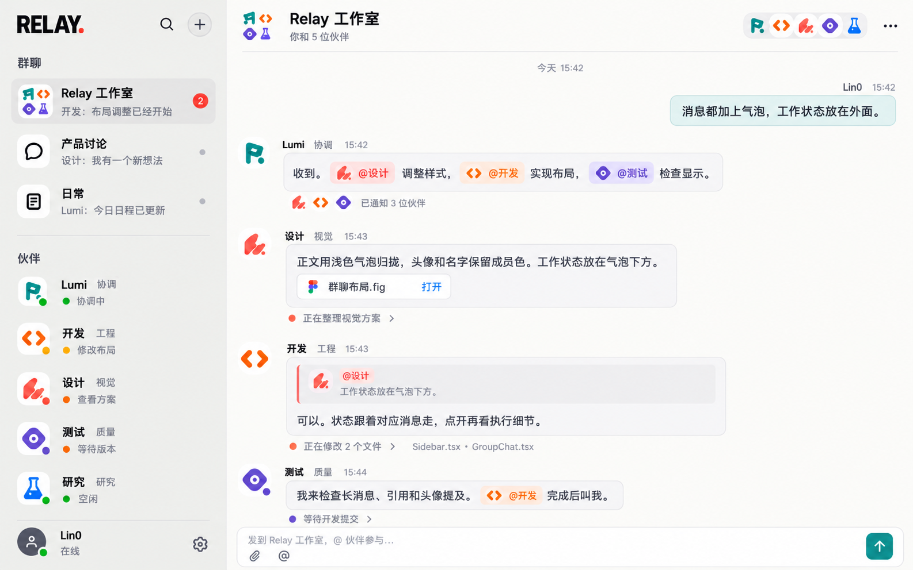

# Summon Bot 网页群聊视觉改版（已确认）

用户于 2026-10-28 确认以下最终效果图，要求现有网页 1:1 还原。此前讨论中的其他概念图均不作为实施目标。

## 范围与交付

改造现有 Summon Bot 网页，不另造静态演示页。保留真实群聊、私聊、Bot、消息、工具及数据功能。未来采用网页套壳，当前只开发网页，不制作桌面壳、不改造原生客户端。按现有正式安装流程交付现有网页。

“只开发网页”指产品范围，不授权另建开发环境。继续遵守 AGENTS.md 和 DEVELOPMENT.md：单一正式数据根 D:/Relay-Bot-data，正式入口 https://bot.lin0.org（本机 8787）；不启动额外预览/测试/开发服务，不补写或运行测试、不计算哈希。仅执行交付必需的构建、配置和安装启动。

## 已确认的视觉和交互

- 两栏：左侧群聊及伙伴列表，右侧当前对话。无仪表盘、巨幅插画、人物卡片和额外常驻右栏。
- 以最终图的比例、间距、字号、灰白底、细边框、圆角、图标与色彩为还原依据。桌面宽屏优先，同时保持现有窄屏可用性。
- 黑色 SUMMON 字标配红色点缀。保留团队活跃感，不做冷淡的单助手文档工作台。
- Bot 使用可复用的抽象职业头像。沿用现有 Little Crew 体系，结合最终图统一视觉，不为每个 Bot 绘制具象人像。头像在列表、群成员栏、消息、引用和提及处保持一致。
- 每条消息都具有独立气泡框。Bot 消息左对齐，用户消息右对齐；发言者头像、名字、职责和时间位于气泡外。
- @其他 Bot 时，提及组件内必须在名字前显示目标 Bot 的小头像，采用其对应成员色。引用消息也要清楚显示原发言者。
- 正文、引用、附件放在消息气泡内；正在执行什么的状态放在对应气泡下方、气泡框外，左边与气泡内容区域协调对齐。
- 工作状态采用小图标/点、小字号弱化文字和展开入口。可以显示修改文件、整理方案、等待同伴、通知对象等真实状态；详细执行过程按需展开。
- 保持消息归属和跨 Bot 协作可见，让各 Bot 独立发言、引用、提及和交接，不能全部伪装为 Lumi 转述。
- 顶部为当前群名、成员信息及成员头像；底部为输入框、附件、@与发送按钮。搜索、新建、设置等现有入口保留并合理安置。

## 数据约束

效果图中的群名、人员、任务、时间、文件、未读数和进度都是视觉示例，不得硬编码为真实业务数据，不得生成示例对话污染正式历史。现有数据不足时展示真实空态。若气泡外工作状态需要补接真实事件，完成必要的数据映射，但不扩大到重写 Bot 执行引擎。

## 执行要求

用户指定在新对话中使用 GPT-6.1-Sol、ultra，并开启 goal 模式持续推进，直到网页改版及正式交付完成。先阅读本图与相关源码；保护并行改动。不得因未做测试、哈希或额外验收报告停工。最终如实说明修改及安装启动情况。
