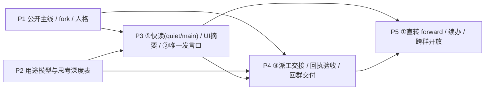

# 单 Bot 内部对话与模型配置表 · 拆分制作总纲

**2026-11-20。** P1–P3 已提交。P4 和 P5 按同日确认的直接派生关系和跨群续办规则合并制作。

整体目标不变：每个 Bot 在每个群各有一条①快读阅读位置和一条②主对话（空闲时无需运行模型）；每条②可并行持有 **0 到多条**同级③执行会话（独立 Pi 与外部引擎）；群消息从收件分流到验收回群职责清晰，各环节模型与思考深度由可编辑用途表统一管理。基线为正式版 0.3.122（build 126）。[正式安装指针](D:/Relay-Bot-app/current.json) · [房间调度](D:/Relay-Bot/bot/src/runtime/bot.mjs:317) · [执行入口](D:/Relay-Bot/capabilities/platform/executions.mjs:209)

## 拆分文档清单与依赖顺序

| 批次 | 独立文档 | 核心交付内容 | 前置依赖 | 独立验证重点 |
| --- | --- | --- | --- | --- |
| **P1** | [群公开主线、本轮 fork 与五层人格](3-5-p1-context-fork-persona.md) | 稳定群公开主线格式、本轮 fork 顺序（`A→B→C` / `A→C→D`）、异步唤醒公开增量、跨轮缓存断点、私聊对齐、五层人格与冲突顺序 | 无 | 上下文序列化稳定性、插话与唤醒顺序、多群同人格与冲突优先级 |
| **P2** | [可编辑的用途模型与思考深度配置表](3-5-p2-model-purpose-table.md) | 按连接与用途可编辑表（①②③ 及外部 Codex 组合）、新型号与 Codex 订阅元数据补齐、跟随默认 vs 显式固定、授权联动与旧 Bot 迁移、网页编辑页 | 无（可与 P1 并行） | 改表校验、`usage.sqlite` 实际模型与思考档、独立 Pi / 外部 Codex 锁定、旧 Bot 迁移 |
| **P3** | [① 快读收件（静默 / 交主对话）、UI 摘要通道与 ② 唯一公开发言口](3-5-p3-fast-read-and-main-output.md) | 每 Bot 每群 ① 快读游标投影、`quiet`/`main` 路由、连发合批与故障降级、原子交接、非聊天事件与 EggBot 旁路、UI 摘要通道、② 独占群 `send` 硬门禁 | P1、P2 | `quiet` 不唤醒 ②、`main` 交 ② 发言、故障降级、③ 群 `send` 被拒、网页摘要呈现与 `fast_read` 用量 |
| **P4** | [③ 并行派工交接、回执验收与回原群交付](3-5-p4-execution-handoff-delivery.md) | 各层管理直接子会话，原群和原提问决定验收归属，回执去重，引用交付并结案，失去群权限时保留私有记录 | P1、P2、P3 | 聊天与工作回合隔离，受理与达标区分，迟到回执和多工作汇合 |
| **P5** | [① 直转 `forward`、续办与跨群开放](3-5-p5-fast-read-forward-cross-room.md) | 唯一匹配的文本或 Pi 材料续投原工作，混合和停止请求交②，原群显式开放或撤销续办 | P3、P4 | 同群和跨群直转，协议失效回主对话，送达未知查原调用 |

## 沿用的外部边界（不在 P1–P5 范围内）

- **长历史压缩与后台记忆维护**：长历史压缩继续沿用现行调用、触发条件和摘要保存方式（3.3 的公开主线独立超窗压缩留待压缩专题）；后台资料整理 `material`、连接初始化及维护对话沿用现行处理。[现有压缩边界](D:/Relay-Bot/bot/src/context/room-history.mjs:26) · [后台资料整理](D:/Relay-Bot/bot/src/context/materials.mjs:171)
- **群级兜底、接龙上限与生命周期**：群主控兜底与同源自动接龙上限归工作项 5；Bot 暂停、退群、归档与删除的完整清理归工作项 6；模型每日查新与接口 Bot 升级提案后置；附件引用源文件走独立支线 3.1。[群级讨论](3.5-single-group-reply.md) · [第 3–5 章制作总览](3-5-single-bot-implementation.md)
- **头像动画**：P3 仅向表现层提供事实型 UI 摘要与消息归属，头像动画留给表现层专题。

## 这次集中审核的三处取舍

各篇记录对应的决定和实现范围。

1. **又补件又改要求时整句交②**。取消、停止、暂停也由②处理。[P5 分流规则](3-5-p5-fast-read-forward-cross-room.md#什么消息可以直转)
2. **当前明确要求能覆盖哪层默认**（拆出不可覆盖的真实性与授权硬底线，明确用户/同伴/引用身份及长期约定落盘）→ 见 [P1 待审核拍板项](3-5-p1-context-fork-persona.md#本篇待审核拍板项)。
3. **模型表的首版值和生效时点**（DeepSeek 独立 Pi 选型、GPT API 与 Codex 订阅分列核实、旧 Bot 一次性迁移及 Codex 组合校验）→ 见 [P2 待审核拍板项](3-5-p2-model-purpose-table.md#本篇待审核拍板项)。

逐节现状与历史讨论依据见 [第 3–5 章制作总览](3-5-single-bot-implementation.md) 与 [第 3–5 章联合讨论稿](3-5-single-bot-conversations.md)。
